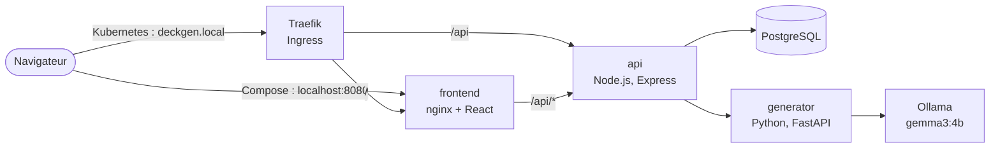
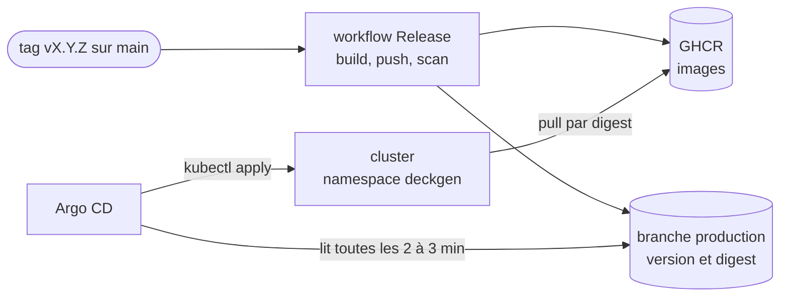

# deckgen

[](https://github.com/marc-awad/deckgen/actions/workflows/ci.yml?query=branch%3Adevelop)
[](https://github.com/marc-awad/deckgen/actions/workflows/release.yml)

Générateur de flashcards par IA : collez un cours, obtenez des cartes prêtes à importer dans Anki.

Réviser avec des flashcards est efficace, mais les écrire à la main prend du temps. deckgen
transforme un texte de cours en cartes question/réponse grâce à un modèle de langage qui tourne
**en local** (Ollama) : aucun coût d'API, et le cours ne quitte pas la machine. Les cartes sont
modifiables, puis exportées au format texte d'Anki. Version actuelle : **v1.0.0**, déployée sur
Kubernetes par GitOps (Argo CD).

## Fonctionnalités

- Création d'un deck à partir d'un cours collé (50 à 20 000 caractères), avec un nombre maximal
  de cartes (1 à 30)
- Génération par un LLM local (`gemma3:4b` par défaut), avec un nombre de cartes borné selon la
  longueur du cours
- Liste des decks, modification et suppression des cartes et des decks
- Export d'un deck en fichier texte importable dans Anki
- Version de l'application affichée en pied de page (`/version.json`)

## Architecture



Avec Docker Compose, nginx (frontend) sert l'interface et relaie `/api/` vers l'api. Sur
Kubernetes, Traefik est le point d'entrée unique : il envoie `/` au frontend et `/api` directement
à l'api. Dans les deux cas, seule l'api accède à la base et au generator.

| Service | Rôle | Technologie | Image de base | Port |
|---------|------|-------------|---------------|------|
| frontend | Interface web | React 19, TypeScript, Vite, Tailwind CSS, nginx | `node:24.21.0-alpine3.24` (build), `nginxinc/nginx-unprivileged:1.30.5-alpine3.24` | 8080 |
| api | API REST, stockage, export Anki | Node.js 24, Express 5, TypeScript, Drizzle ORM | `node:24.21.0-alpine3.24` | 3000 |
| generator | Transforme un cours en cartes | Python 3.13, FastAPI, httpx | `python:3.13.16-slim-trixie` | 8000 |
| postgres | Decks et cartes | PostgreSQL 18.6 | `postgres:18.6-alpine3.24` | 5432 |
| ollama | Serveur du modèle de langage | Ollama 0.40.3 | `ollama/ollama:0.40.3` (Compose) ; installé sur l'hôte (Kubernetes) | 11434 |

## Prérequis

**Mode développement (Docker Compose)**

- Docker Desktop (Windows ou macOS) ou Docker Engine avec le plugin Compose (Linux) : rien
  d'autre à installer, ni Node, ni Python, ni PostgreSQL, ni Ollama
- Environ 15 Go d'espace disque (images et modèle)
- Option : carte NVIDIA (pilote installé, WSL 2 sous Windows) pour accélérer la génération

**Mode Kubernetes**

- Docker Desktop avec Kubernetes activé en mode kubeadm (Settings > Kubernetes > Enable
  Kubernetes > Kubeadm)
- Helm (`winget install --id Helm.Helm --exact`)
- Ollama installé sur l'hôte, avec le modèle téléchargé (`ollama pull gemma3:4b`)
- Port 80 libre sur l'hôte (Traefik y est publié)
- Entrée `deckgen.local` dans le fichier hosts, en PowerShell **administrateur** :

```powershell
Add-Content -Path "$env:SystemRoot\System32\drivers\etc\hosts" -Value "`r`n127.0.0.1`tdeckgen.local" -Encoding ascii
ipconfig /flushdns
```

Sans cette entrée, http://deckgen.localhost fonctionne directement dans un navigateur. Version
de la commande qui évite les doublons, et entrée `argocd.deckgen.local` :
[deploy/README.md](deploy/README.md#fichier-hosts-powershell-en-administrateur).

## Lancement en développement (Docker Compose)

Depuis la racine du dépôt, en PowerShell :

```powershell
Copy-Item .env.example .env      # puis changez POSTGRES_PASSWORD dans .env
docker compose up --build
```

Puis ouvrez **http://localhost:8080** (port modifiable avec `FRONTEND_PORT` dans `.env`).
Ajoutez `-d` pour lancer l'application en arrière-plan.

Le premier lancement est long : le service `ollama-pull` télécharge le modèle `gemma3:4b`
(environ 3 Go) avant le démarrage du generator. Le modèle est ensuite conservé dans un volume.

**GPU NVIDIA.** Par défaut, Ollama tourne sur le processeur. Pour lui donner le GPU, décommentez
dans `.env` la ligne `COMPOSE_FILE=docker-compose.yml;docker-compose.gpu.yml` (séparateur `:`
sous Linux et macOS). Vérification pendant une génération :
`docker compose exec ollama ollama ps` affiche `100% GPU`.

| Commande | Rôle |
|----------|------|
| `docker compose ps -a` | État des services (`healthy`, et `ollama-pull` en `Exited (0)`) |
| `docker compose logs -f api` | Suivre les logs d'un service |
| `docker compose up --build -d` | Reconstruire après une modification du code |
| `docker compose down` | Arrêter et supprimer les conteneurs (les données sont conservées) |

`docker compose down -v` supprime aussi les volumes : la base de données et le modèle téléchargé.
Détails (réseaux, volumes, ordre de démarrage) : [docs/docker-compose.md](docs/docker-compose.md).

## Déploiement Kubernetes

En fonctionnement normal, Argo CD déploie la dernière release (images publiées sur GHCR) depuis
la branche `production`. Ordre d'installation sur un cluster neuf, en PowerShell depuis la racine
du dépôt :

```powershell
kubectl config use-context docker-desktop

# 1. metrics-server (mesure CPU et mémoire, nécessaire à l'autoscaling de l'api)
kubectl apply -f deploy/cluster/metrics-server.yaml

# 2. Traefik, contrôleur Ingress
helm repo add traefik https://traefik.github.io/charts
helm repo update traefik
helm upgrade --install traefik traefik/traefik --version 41.7.1 `
  --namespace traefik --create-namespace -f deploy/cluster/traefik-values.yaml --wait

# 3. Argo CD
helm repo add argo https://argoproj.github.io/argo-helm
helm repo update argo
helm upgrade --install argocd argo/argo-cd --version 10.9.7 `
  --namespace argocd --create-namespace -f deploy/cluster/argocd-values.yaml --wait

# 4. Namespace et Secret PostgreSQL (mot de passe aléatoire, jamais écrit dans un fichier)
kubectl apply -f deploy/00-namespace.yaml
$bytes = New-Object byte[] 24
[System.Security.Cryptography.RandomNumberGenerator]::Create().GetBytes($bytes)
$password = [Convert]::ToBase64String($bytes) -replace '[+/=]', ''
kubectl create secret generic postgres-credentials --namespace deckgen `
  --from-literal=POSTGRES_USER=deckgen `
  --from-literal=POSTGRES_PASSWORD=$password `
  --from-literal=POSTGRES_DB=deckgen
Remove-Variable password, bytes

# 5. Application Argo CD : déploie la branche production
kubectl apply -f deploy/cluster/argocd-application.yaml
kubectl get applications -n argocd       # deckgen  Synced  Healthy (2 à 3 minutes)
```

**Accès**

- Application : **http://deckgen.local** (ou http://deckgen.localhost)
- Interface Argo CD : **http://argocd.deckgen.localhost**, ou
  `kubectl port-forward service/argocd-server -n argocd 8090:80` puis http://localhost:8090.
  Utilisateur `admin` ; récupération et changement du mot de passe initial :
  [deploy/README.md](deploy/README.md#mot-de-passe-admin)

Détail de chaque étape, vérifications, tests locaux avec la synchronisation suspendue et
suppression : [deploy/README.md](deploy/README.md). Objets Kubernetes, probes, autoscaling,
persistance et Ingress : [docs/kubernetes.md](docs/kubernetes.md).

## CI/CD

**CI** ([ci.yml](.github/workflows/ci.yml)) : à chaque pull request vers `develop` ou `main`, et
à chaque push sur `develop`, lint, typecheck et tests des trois services (Node 20.19 et 24 pour
l'api et le frontend), validation de `docker-compose.yml` et des manifestes Kubernetes, build des
trois images et scan Trivy (échec sur une vulnérabilité CRITICAL corrigeable). Ces 9 jobs sont
les status checks exigés pour fusionner. Toutes les actions sont épinglées par SHA de commit, et
Dependabot propose les mises à jour chaque semaine.

**Release** ([release.yml](.github/workflows/release.yml)) : un tag `vX.Y.Z` sur `main` construit
et publie les images sur GHCR, les scanne, puis écrit la version (tag et digest) dans la branche
`production`, qu'Argo CD applique au cluster.



Détails : [docs/ci.md](docs/ci.md), [docs/cd.md](docs/cd.md), [docs/release.md](docs/release.md).

## Choix techniques

| Choix | Raison |
|-------|--------|
| React (Vite), Node.js (Express, TypeScript), Python (FastAPI), PostgreSQL | Technologies courantes et légères pour chaque rôle : interface monopage compilée en fichiers statiques, API REST typée, écosystème Python pour l'appel au LLM, base relationnelle pour les decks et leurs cartes |
| LLM local avec Ollama, modèle `gemma3:4b` | Gratuit, et les cours restent sur la machine. `gemma3:4b` (3,4 Go) produit un JSON valide et tourne sans GPU ; `gemma4:latest` reste une option plus précise mais plus lente ([docs/model-choice.md](docs/model-choice.md)) |
| Ollama sur l'hôte en mode Kubernetes | Accès direct au GPU de la machine, et ressources limitées du cluster local ; le generator l'appelle sur `host.docker.internal:11434` |
| Dockerfiles multi-stage, utilisateurs non-root | Images 87 à 96 % plus petites, sans outils de build ; moins de surface d'attaque, compatible avec `runAsNonRoot` |
| Traefik comme contrôleur Ingress | Maintenu, chart Helm officiel, compatible Gateway API ; ingress-nginx est retiré depuis mars 2026 |
| GitOps avec Argo CD | Le cluster local n'est pas joignable depuis Internet, et le poste professionnel est derrière un proxy qui empêche un runner auto-hébergé : le cluster va lui-même chercher la version à déployer |
| Kustomize | Une seule liste de manifestes pour `kubectl apply -k` et Argo CD ; la release y ajoute les images de GHCR sans modifier les fichiers de `develop` |

## Workflow Git

- **Branches** : `main` (protégée, ne reçoit que des PR depuis `develop`), `develop` (branche par
  défaut), et des branches de travail `feature/…`, `fix/…`, `docs/…`, `chore/…` créées depuis
  `develop`. La branche `production` est écrite uniquement par le workflow de release.
- **Conventional Commits**, par exemple dans l'historique du dépôt :
  - `feat(api): add decks and cards routes, generation and anki export (#26)`
  - `fix(generator): enforce card count bounds with JSON schema (#29)`
  - `build: add multi-stage dockerfiles and nginx config (#32)`
  - `ci: add github actions workflow with tests, image builds and trivy scan (#41)`
  - `docs: document LLM model choice (#23)`
  - `chore(deps): ignore incompatible dependabot updates (#50)`
- **Pull requests obligatoires** sur `develop` et `main`, avec les 9 status checks de la CI
  (rulesets `protect-develop` et `protect-main`).
- **Fusion** : squash des branches de travail vers `develop` (un commit par fonctionnalité),
  merge commit de `develop` vers `main` (seule méthode autorisée, pour que les deux branches ne
  divergent pas).
- **Release** : tag annoté `vX.Y.Z` sur `main` (versionnement sémantique, pré-versions
  `vX.Y.Z-rc.N`), protégé contre la modification et la suppression. Procédure, retour arrière :
  [docs/release.md](docs/release.md).

## Tailles des images

Comparaison avec une version naïve (une seule étape, image de base complète, toutes les
dépendances), mesurée avec `docker image ls` :

| Service | Naïve (disque / compressée) | Optimisée (disque / compressée) | Gain |
|---------|-----------------------------|---------------------------------|------|
| generator | 1,75 Go / 459 Mo | **221 Mo / 53 Mo** | -87 % / -88 % |
| api | 2,2 Go / 570 Mo | **279 Mo / 65 Mo** | -87 % / -89 % |
| frontend | 2,13 Go / 548 Mo | **90,5 Mo / 25,7 Mo** | -96 % / -95 % |

Ce qui fait la différence (image de base, multi-stage, dépendances de production seulement) :
[docs/docker-images.md](docs/docker-images.md).

## Structure du dépôt

```text
deckgen/
├── frontend/                Interface React (Vite), servie par nginx
├── api/                     API REST Node.js (Express, Drizzle ORM, migrations dans drizzle/)
├── generator/               Service Python (FastAPI) qui appelle Ollama
├── deploy/                  Manifestes Kubernetes et kustomization.yaml
│   └── cluster/             Composants du cluster : metrics-server, valeurs Helm de Traefik
│                            et d'Argo CD, Application Argo CD
├── docs/                    Documentation technique, captures dans docs/images/
├── .github/                 Workflows CI et release, Dependabot, modèle de pull request
├── docker-compose.yml       Application complète en local (Ollama sur CPU)
├── docker-compose.gpu.yml   Surcharge : GPU NVIDIA pour Ollama
└── .env.example             Modèle du fichier .env de Docker Compose
```

## Usage de l'IA

### Démarche

Le projet a été piloté de bout en bout par son auteur, avec l'IA comme outil de production.
Conformément aux règles du projet, cette section détaille ce qui a été fait par l'auteur et ce
qui a été délégué à l'IA.

### Travail de l'auteur

- **Décisions techniques** : choix du sujet ; choix de la stack parmi les options étudiées
  (Node.js plutôt qu'ASP.NET, Python pour le service IA, LLM local plutôt qu'une API payante) ;
  maintien de Node 20 sur le poste avec Node 24 dans les images ; priorisation de la persistance
  des données avant la configuration ; choix d'Argo CD après analyse de trois options de
  déploiement au regard de contraintes réelles (poste professionnel, proxy, budget, GPU).
- **Gestion de projet** : 21 issues et une issue de bug, avec critères d'acceptation ;
  GitHub Projects, milestones et labels ; une branche et une pull request par issue ; rulesets
  et status checks ; Conventional Commits ; tri des pull requests de Dependabot (fermeture des
  mises à jour incompatibles et règles d'exclusion).
- **Opérations** : installation et configuration de l'environnement (Git, GitHub CLI, Docker
  Desktop, Kubernetes, Helm) ; cluster local, fichier hosts, Argo CD et son mot de passe
  administrateur ; configuration des rulesets GitHub ; publication des releases v1.0.0-rc.1
  puis v1.0.0.
- **Validation** : test manuel de chaque fonctionnalité ; import réel des exports dans Anki ;
  démonstrations avec captures (rolling update et rollback, pull request bloquée par la CI,
  self-heal d'Argo CD) ; contrôle du contenu de chaque commit avant son envoi.
- **Détection et diagnostic de problèmes** : génération réduite à une seule carte sur un long
  cours (issue #27), traitée par un diagnostic mesuré avant toute correction ; cartes répétées
  sur un texte court ; modification hors périmètre écartée avant commit ; erreurs
  d'environnement résolues (PATH, verrou Git, résolution DNS, accès au cluster).

### Travail délégué à l'IA

- **Claude (claude.ai)** : tuteur pour les notions du cours ; proposition du découpage en issues
  et du workflow Git ; rédaction des consignes données à Claude Code, à partir des besoins et
  des contraintes exprimés par l'auteur ; guidage pas à pas des opérations et aide à la lecture
  des messages d'erreur.
- **Claude Code (extension VS Code)** : écriture du code des services et des tests, des
  Dockerfiles, des fichiers Compose, des manifestes Kubernetes, des workflows GitHub Actions et
  de la documentation, selon ces consignes. Chaque livraison était accompagnée d'une explication
  fichier par fichier.

### Processus de validation

Aucune contribution de l'IA n'a été fusionnée sans vérification :

1. les **tests automatisés** (123 tests : 30 pour le generator, 67 pour l'api, 26 pour le
   frontend) ;
2. la **CI** : lint, typecheck, tests sur Node 20 et 24, build des images, scan Trivy ;
3. la **lecture des explications** fournies fichier par fichier, pour comprendre et pouvoir
   expliquer chaque ligne ;
4. un **test manuel** de la fonctionnalité.

L'IA s'est trompée à plusieurs reprises ; ces erreurs ont été détectées et corrigées en mesurant
plutôt qu'en supposant. Par exemple, l'hypothèse selon laquelle le délai de lecture de Traefik
(`readTimeout`) couperait les générations longues s'est révélée fausse : les mesures ont montré
que c'est `writeTimeout` qui coupe la réponse
([docs/kubernetes.md](docs/kubernetes.md#délais-dune-génération-longue)).

### Sécurité

- Deux mots de passe ont été affichés par erreur dans une conversation avec l'IA : le mot de
  passe administrateur initial d'Argo CD, changé immédiatement (et son Secret initial supprimé),
  et celui de PostgreSQL, remplacé ensuite (`ALTER USER` dans la base, puis mise à jour du Secret
  Kubernetes). Aucun autre secret n'a été partagé.
- Les mots de passe sont générés aléatoirement et stockés hors de Git : fichier `.env` ignoré
  par Git, Secret Kubernetes créé par commande, gestionnaire de mots de passe.
- Les images ne contiennent aucun secret ; la CI et la release n'en utilisent aucun (jeton
  `GITHUB_TOKEN` éphémère fourni par GitHub).

## Documentation

| Document | Contenu |
|----------|---------|
| [docs/docker-images.md](docs/docker-images.md) | Dockerfiles, tailles des images, choix par service |
| [docs/docker-compose.md](docs/docker-compose.md) | Services, réseaux, volumes, ordre de démarrage |
| [docs/model-choice.md](docs/model-choice.md) | Choix du modèle de langage, diagnostic de l'issue #27 |
| [docs/kubernetes.md](docs/kubernetes.md) | Objets Kubernetes, probes, autoscaling, persistance, configuration, Ingress |
| [docs/rolling-update.md](docs/rolling-update.md) | Mise à jour sans interruption et retour arrière, démonstration |
| [docs/ci.md](docs/ci.md) | Intégration continue, scan Trivy, épinglage des actions, Dependabot |
| [docs/cd.md](docs/cd.md) | Release, GHCR, branche production, Argo CD |
| [docs/release.md](docs/release.md) | Versionnement, étapes d'une release, retour arrière |
| [deploy/README.md](deploy/README.md) | Installation pas à pas sur Kubernetes |
| [api/README.md](api/README.md), [generator/README.md](generator/README.md), [frontend/README.md](frontend/README.md) | Routes, configuration, développement local sans Docker, tests |
