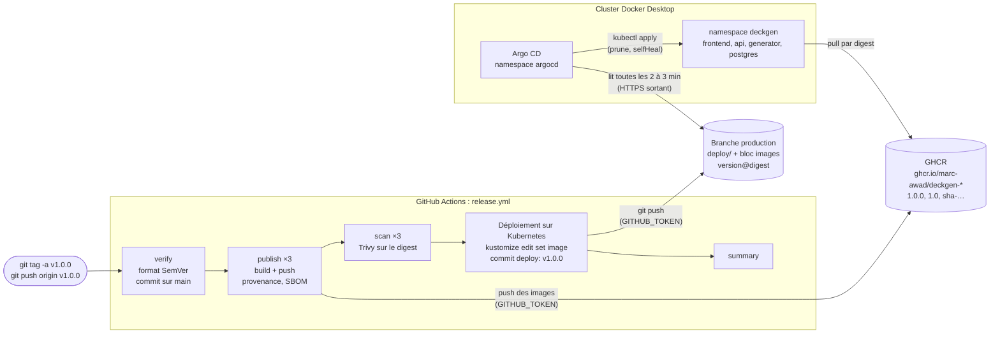

# Livraison et déploiement continus (GitOps avec Argo CD)

Consigne du projet : *« Le pipeline doit s'exécuter sur la création d'un tag Git sur main pour
déclencher le déploiement en production. Étapes : Build des images Docker → Push vers un
registre (GHCR) → Déploiement sur Kubernetes (kubectl apply). »*

Mise en œuvre : le workflow [.github/workflows/release.yml](../.github/workflows/release.yml),
déclenché par un tag `vX.Y.Z`, construit et publie les trois images sur GHCR, puis écrit la
version à déployer dans la branche `production`. **Argo CD**, installé dans le cluster, surveille
cette branche et applique les manifestes. Procédure pas à pas : [release.md](release.md).

## Flux complet



Toutes les flèches vers le cluster partent **du cluster** : Argo CD lit GitHub, le kubelet lit
GHCR. Rien sur Internet n'a besoin de joindre le cluster.

## Les trois étapes de la consigne

| Étape de la consigne | Où | Comment |
|----------------------|----|---------|
| Déclenchement : tag Git sur main | `on: push: tags` + job `verify` | Tag au format `vX.Y.Z` (pré-versions `vX.Y.Z-rc.N` acceptées) ; `verify` refuse un tag dont le commit n'est pas sur `main` |
| Build des images Docker | job `publish` (matrice ×3) | `docker/build-push-action` avec Buildx, mêmes Dockerfiles que la CI |
| Push vers un registre (GHCR) | job `publish` | `ghcr.io/marc-awad/deckgen-<service>`, authentification par `GITHUB_TOKEN` |
| Déploiement sur Kubernetes (kubectl apply) | job « Déploiement sur Kubernetes » + Argo CD | Le job écrit l'état voulu dans Git ; Argo CD fait l'équivalent d'un `kubectl apply -k deploy/` dans le cluster |

L'étape de déploiement est bien un `kubectl apply` : Argo CD utilise la même logique d'application
que kubectl (il rend les manifestes avec kustomize, comme `-k`, puis les applique). La différence
est **qui** l'exécute et **d'où** : un contrôleur dans le cluster, qui tire l'état voulu (modèle
*pull*), au lieu d'un runner GitHub qui pousserait vers le cluster (modèle *push*).

## Pourquoi GitOps plutôt qu'un runner ou un cluster cloud

Un job GitHub Actions ne peut pas faire `kubectl apply` sur ce cluster : il tourne sur une machine
de GitHub, sur Internet, et l'API Kubernetes de Docker Desktop (`127.0.0.1:6443`) n'est joignable
que depuis le PC.

| Solution | Pourquoi elle n'est pas retenue |
|----------|---------------------------------|
| **Runner auto-hébergé sur le PC** (le job s'exécute sur le PC, qui voit le cluster) | Poste professionnel : on n'y installe pas un agent qui exécute du code venu d'Internet. Sur le réseau de l'entreprise, le proxy bloque GitHub : le runner ne recevrait pas les jobs. Sécurité : sur un dépôt **public**, GitHub déconseille les runners auto-hébergés, car une pull request d'un fork pourrait faire exécuter son code sur la machine. |
| **Exposer l'API du cluster sur Internet** (tunnel, redirection de port) | Ouvre le contrôle total du cluster à Internet ; un kubeconfig administrateur devrait être stocké dans GitHub. Impossible derrière le proxy de l'entreprise. |
| **Cluster cloud** (AKS, EKS, GKE) | Coût (un cluster et un équilibreur de charge en continu) ; l'application utilise Ollama avec le GPU du PC, et un GPU dans le cloud est cher ; le projet est noté sur ce cluster local. |
| **GitOps (Argo CD)**, retenu | Le cluster va lui-même chercher l'état voulu, en HTTPS sortant, comme un navigateur. Aucun port ouvert, aucun identifiant du cluster hors du cluster, aucun agent qui exécute du code de workflow sur le PC. Git devient l'historique des déploiements. |

## Rôle de chaque job

| Job | Permissions (en plus de `contents: read`) | Rôle |
|-----|-------------------------------------------|------|
| `verify` | aucune | Vérifie le format SemVer du tag, et que son commit appartient à `main` (`git merge-base --is-ancestor`, historique complet avec `fetch-depth: 0`). Sortie : `version`, le tag sans le `v` |
| `publish (…)` | `packages: write`, `id-token: write`, `attestations: write` | Connexion à `ghcr.io`, tags et labels OCI (`docker/metadata-action`), build et push, provenance et SBOM, attestation signée. Le digest de chaque image est enregistré dans un artefact `digest-<service>` |
| `scan (…)` | `packages: read` | Trivy sur l'image publiée, **par son digest** ; même politique que la CI : rapport (MEDIUM à CRITICAL) dans le résumé, échec seulement sur une CRITICAL corrigeable |
| Déploiement sur Kubernetes | `contents: write` (au lieu de `read`) | Met à jour la branche `production` (voir plus bas), vérifie le résultat avec `kubectl kustomize`, commit et push. Environnement GitHub `production` |
| `summary` | aucune | Résumé : version, commit tagué, résultat des jobs, images et digests, commit de déploiement, lien vers la branche |

- **`concurrency: group: release`, `cancel-in-progress: false`** : deux releases ne s'exécutent
  jamais en même temps (deux push concurrents sur `production` se gêneraient), et une release en
  cours n'est jamais annulée (elle pourrait l'être au milieu d'un push d'images). GitHub ne garde
  qu'**une** exécution en attente : une troisième release lancée pendant ce temps remplace celle
  qui attend.
- **Déclencheur** : `v[0-9]+.[0-9]+.[0-9]+` et `v[0-9]+.[0-9]+.[0-9]+-*`. Le filtre de GitHub est
  approximatif (`-*` accepte n'importe quoi) : `verify` applique ensuite l'expression exacte de
  SemVer 2.0. Les métadonnées de build (`+build.5`) sont refusées : `+` est interdit dans un tag
  Docker.
- **Pourquoi vérifier `main`** : n'importe qui ayant le droit d'écrire peut poser un tag sur
  n'importe quel commit, y compris d'une branche de fonctionnalité jamais relue. Seul le code
  fusionné dans `main` (PR et 9 status checks) est publié.
- **Les digests passent par des artefacts** : les sorties d'un job de matrice s'écrasent entre
  elles (la dernière exécution gagne). Chaque exécution de `publish` dépose son digest dans son
  propre artefact, que `scan`, le déploiement et `summary` téléchargent.
- **Ordre push puis scan** : imposé par la consigne (build → push), et Trivy scanne exactement
  l'image publiée. Le déploiement attend le scan : une image avec une CRITICAL corrigeable reste
  sur GHCR mais n'est jamais déployée.

### Tags et labels des images

| Tag Git | Tags de l'image |
|---------|-----------------|
| `v1.2.3` | `1.2.3`, `1.2`, `sha-1a2b3c4` |
| `v1.2.3-rc.1` | `1.2.3-rc.1`, `sha-1a2b3c4` (pas de `1.2` pour une pré-version) |

Pas de `latest` (`flavor: latest=false`) : ce tag ne dit pas quelle version tourne, et le cluster
ne s'en sert pas. Les labels OCI (`org.opencontainers.image.version`, `revision`, `created`,
`source`…) viennent de `docker/metadata-action` ; le titre et la description sont repris des
Dockerfiles dans la matrice, sinon ils seraient remplacés par ceux du dépôt (qui n'a pas de
description). `APP_VERSION` reçoit la version : le pied de page affiche `deckgen v1.2.3`.

Le cache Buildx (`type=gha`) est **lu** dans le même `scope` que la CI. Un cache écrit par un
tag ne serait lisible que par ce même tag (GitHub limite la lecture à la branche ou au tag courant,
et à la branche par défaut) : la release n'en écrit donc pas, et profite de celui de `develop`.

### Provenance, SBOM et attestation

- `provenance: mode=max` et `sbom: true` : BuildKit joint à l'image, dans GHCR, la description
  de sa construction (dépôt, commit, Dockerfile, arguments) et la liste de ses paquets (SPDX).
  Consultable avec `docker buildx imagetools inspect ghcr.io/marc-awad/deckgen-api:1.0.0
  --format "{{json .Provenance}}"` (ou `.SBOM`).
- `actions/attest` : attestation de provenance **signée** par Sigstore (certificat obtenu avec
  le jeton OIDC du job, d'où `id-token: write`), publiée dans GHCR et dans l'onglet
  « Attestations » du dépôt. Elle prouve que l'image a été construite par ce workflow, dans ce
  dépôt : `gh attestation verify oci://ghcr.io/marc-awad/deckgen-api:1.0.0 -R marc-awad/deckgen`.
  `create-storage-record: false` : cette fonction n'existe que pour les dépôts d'organisation.

## Branche production

Le job de déploiement :

1. récupère **seulement** `deploy/` du commit tagué (`sparse-checkout: deploy`) ;
2. récupère la branche `production`, ou la **crée** si elle n'existe pas encore : test par
   `git ls-remote --exit-code` (code 2 : branche absente), puis `git switch --orphan production`,
   une branche sans historique ni fichier ;
3. remplace son dossier `deploy/` par celui du tag, puis, pour chaque service,
   `kustomize edit set image deckgen-api=ghcr.io/marc-awad/deckgen-api:1.0.0@sha256:…` ;
4. vérifie le résultat avec `kubectl kustomize` (un second kustomize, celui de kubectl, comme
   Argo CD en utilisera un troisième) : le rendu doit réussir, contenir les trois images publiées
   avec leur digest, et plus aucune image locale `deckgen-*` ;
5. commit `deploy: v1.0.0` (auteur `github-actions[bot]`, ligne `Signed-off-by`, corps avec le
   commit tagué et le lien vers l'exécution), puis `git push`. Si rien n'a changé (relance du même
   tag), pas de commit.

kustomize **v5.8.2** est téléchargé depuis sa release GitHub, avec vérification de sa somme
SHA-256 écrite dans le workflow, comme kubeconform dans la CI (même version que le job `config`).

Contenu de la branche : `deploy/` (identique au tag, plus le bloc `images`) et un `README.md`
qui la décrit. Son historique est celui des déploiements : un commit par release, dont le diff
montre exactement ce qui a changé (versions et digests).

« Signé » veut dire ici **attribué** à `github-actions[bot]` (auteur et `Signed-off-by`). Le commit
n'a pas de signature cryptographique (badge « Verified ») : seuls les commits créés par l'API de
GitHub le reçoivent automatiquement. Ce serait possible en remplaçant `git commit` et `git push`
par l'API (`createCommitOnBranch`), au prix d'un script plus complexe.

### Digest contre tag

Sur `develop`, `kustomization.yaml` n'a pas de bloc `images` : les manifestes gardent les images
locales (`deckgen-api:0.1.1`), pour pouvoir tester en local. Sur `production`, le job ajoute :

```yaml
images:
- digest: sha256:4f1c…
  name: deckgen-api
  newName: ghcr.io/marc-awad/deckgen-api
  newTag: 1.0.0
```

ce qui donne dans le Deployment `image: ghcr.io/marc-awad/deckgen-api:1.0.0@sha256:4f1c…`.

- Un **tag** est une étiquette mobile : `1.0.0` peut être republié et désigner une autre image
  (erreur, ou registre compromis).
- Un **digest** est le hash SHA-256 du manifeste de l'image : il désigne un contenu unique et ne
  peut pas changer.
- Quand les deux sont présents, Kubernetes télécharge **par le digest** et ignore le tag, qui ne
  reste que pour la lisibilité. Le cluster déploie ainsi exactement l'image construite et scannée
  par ce workflow, même si quelqu'un republiait le tag. C'est le même principe que l'épinglage
  des actions par SHA ([ci.md](ci.md#épinglage-des-actions-par-sha)).

### Pourquoi le push sur production ne déclenche pas la CI

- Les événements produits avec le `GITHUB_TOKEN` (ici le `git push` du job) ne lancent **aucun
  workflow**, sauf `workflow_dispatch` et `repository_dispatch` : GitHub évite ainsi qu'un
  workflow se déclenche lui-même en boucle.
- Même avec un autre jeton, `ci.yml` ne se déclenche que sur `push` vers `develop` et les PR vers
  `develop` ou `main`, pas sur `production`.

C'est sans risque, car la branche ne contient rien de nouveau à tester :

- `deploy/` est la copie exacte d'un commit de `main`, entré par une PR qui a passé les 9 status
  checks, dont le job `config` (kustomize build et kubeconform sur ces mêmes manifestes) ;
- le seul ajout est le bloc `images`, généré par kustomize puis vérifié par `kubectl kustomize`
  dans le même job ;
- les images qu'il désigne ont été construites et scannées par Trivy dans la même exécution.

## Argo CD

### Installation

Chart Helm officiel `argo/argo-cd` **10.9.7**, Argo CD **v3.5.4**, Redis **8.6.4-alpine**, dans le
namespace `argocd` ; valeurs dans
[deploy/cluster/argocd-values.yaml](../deploy/cluster/argocd-values.yaml) ; commandes dans
[deploy/README.md](../deploy/README.md#argo-cd-une-seule-fois-par-cluster).

**Choix de la version.** La règle du projet est de prendre une version publiée depuis au moins
14 jours (prudence vis-à-vis de la chaîne d'approvisionnement : une release piégée est en général
retirée en quelques heures). Ici, v3.5.4 (publiée le 6 octobre) corrige **4 failles critiques**
publiées le 7 octobre, dont deux permettent d'exécuter des commandes dans le repo-server
(GHSA-9v9p-x54c-58gc, GHSA-fw5c-w8rc-j7fx, GHSA-m3vr-7329-44ww, GHSA-fmxq-cgp8-87wp). Une faille
connue et critique l'emporte sur la règle : on prend la **plus ancienne** version corrigée,
v3.5.4, et non la v3.5.5, encore plus récente et sans correctif de sécurité supplémentaire.

| Composant | Rôle | requests | limits |
|-----------|------|----------|--------|
| application-controller | Compare Git au cluster, applique les différences | 100m / 256Mi | 1 / 768Mi |
| repo-server | Clone le dépôt, rend les manifestes (kustomize) | 50m / 128Mi | 1 / 512Mi |
| server | API et interface web | 25m / 64Mi | 500m / 256Mi |
| redis | Cache du contrôleur et du repo-server | 25m / 32Mi | 250m / 128Mi |
| redis-secret-init (Job) | Crée le mot de passe de Redis à l'installation | 10m / 32Mi | 100m / 64Mi |
| applicationset-controller | Non utilisé : **0 pod** | | |
| dex (SSO), notifications | **Désactivés** (`enabled: false`) | | |

Tous les conteneurs tournent en **non-root** (uid 999), avec un système de fichiers en lecture
seule, sans capability ni élévation de privilège : ce sont les valeurs par défaut du chart,
vérifiées sur les pods (`id` : `uid=999(argocd)`, `uid=999(redis)`).

### Interface, HTTP et HTTPS

- Par redirection de port : `kubectl port-forward service/argocd-server -n argocd 8090:80`, puis
  http://localhost:8090.
- Par l'Ingress Traefik : http://argocd.deckgen.local (fichier hosts) ou
  http://argocd.deckgen.localhost.

Par défaut, `argocd-server` ne parle que HTTPS, avec un certificat auto-signé, et redirige le
HTTP vers `https://`. Derrière Traefik, cela ne fonctionne pas : Traefik n'a ici qu'une entrée
HTTP et parle HTTP au service, la redirection enverrait le navigateur vers
`https://argocd.deckgen.local`, que personne ne sert. Les solutions possibles :

| Option | Effet |
|--------|-------|
| `server.insecure: true` (**retenue**) | Le serveur répond en HTTP ; Traefik le relaie. Le mot de passe circule en clair, mais seulement entre le navigateur et `127.0.0.1` |
| Traefik vers le service en HTTPS (`serversTransport` avec `insecureSkipVerify`) | Chiffré entre Traefik et Argo CD, mais toujours HTTP côté navigateur, et vérification du certificat désactivée |
| TLS dans Traefik (entrée `websecure`, certificat cert-manager) | La bonne solution sur un vrai cluster ; inutile tant que rien ne quitte la machine |

Vérifié : `/` répond 200 et `/healthz` répond `ok` par l'Ingress, sur les deux noms, et par la
redirection de port.

### Application

[deploy/cluster/argocd-application.yaml](../deploy/cluster/argocd-application.yaml) :

| Champ | Valeur | Pourquoi |
|-------|--------|----------|
| `source.repoURL` | `https://github.com/marc-awad/deckgen.git` | Dépôt public : lu sans identifiants |
| `source.targetRevision` | `production` | La branche écrite par le job de déploiement, et par lui seul |
| `source.path` | `deploy` | Contient `kustomization.yaml` : Argo CD le rend avec kustomize, comme `kubectl apply -k`. `deploy/cluster/` n'est pas listé, donc jamais appliqué |
| `destination` | le cluster local, namespace `deckgen` | |
| `syncPolicy.automated.prune` | `true` | Ce qui disparaît de Git disparaît du cluster |
| `syncPolicy.automated.selfHeal` | `true` | Une modification manuelle du cluster est annulée |
| `syncOptions` | `RespectIgnoreDifferences`, `ApplyOutOfSyncOnly`, `PruneLast` | Voir ci-dessous |
| `retry` | 5 essais, de 5 s à 3 min | Une synchronisation en échec est retentée |
| `ignoreDifferences` | `/spec/replicas` du Deployment `api` | Le HPA décide du nombre de pods de l'api |
| finalizer | **aucun** | Supprimer l'Application laisse l'application en place |

- **HPA et `replicas`** : le Deployment `api` n'a pas de champ `replicas` dans Git (c'est le HPA qui
  le fixe, issue 13), et l'annotation `last-applied-configuration` actuelle ne le contient pas
  (vérifié) : Argo CD ne voit donc pas de différence. `ignoreDifferences` le garantit même si le
  champ réapparaissait, et `RespectIgnoreDifferences=true` étend la règle à la synchronisation
  elle-même : sans cette option, le champ serait ignoré dans la comparaison, mais réécrit à chaque
  synchronisation.
- **`ApplyOutOfSyncOnly`** : seuls les objets différents de Git sont appliqués, pas les 19 à
  chaque fois.
- **`PruneLast`** : les suppressions passent en dernier, une fois le reste synchronisé et en bonne
  santé.

### Self-heal et prune

**Self-heal.** Argo CD surveille le cluster en continu (par l'API Kubernetes, pas seulement toutes
les 3 minutes). Un `kubectl edit`, `kubectl apply -k` depuis `develop`, `kubectl set image` ou
`kubectl rollout undo` est remis à l'état de Git quelques secondes après. C'est le principe du
GitOps : le cluster est **toujours** l'image de Git, et Git est le seul moyen de le modifier.
Tester en local sans conflit :
[deploy/README.md](../deploy/README.md#argo-cd-et-commandes-locales).

**Prune** ne supprime que les objets qu'Argo CD **gère**, c'est-à-dire ceux qu'il a lui-même
appliqués et marqués de son annotation de suivi (`argocd.argoproj.io/tracking-id`), et qui ont
disparu de Git :

- le **Secret `postgres-credentials`** est créé à la main par `kubectl create secret`, il n'est
  pas dans Git et ne porte pas cette annotation : Argo CD ne le considère pas comme faisant partie
  de l'application, il ne le **supprime jamais** (vérifié avant la première synchronisation :
  aucune annotation sur le Secret) ;
- le **PersistentVolume** `deckgen-postgres` est dans Git : il ne serait supprimé que s'il était
  retiré de `deploy/`. Pour qu'une erreur dans Git ne puisse pas emporter la base, le volume, sa
  claim et le namespace portent `argocd.argoproj.io/sync-options: Prune=false,Delete=false` :
  Argo CD ne les supprime ni par prune, ni à la suppression de l'Application. Le namespace compte
  autant que le volume : le supprimer supprimerait aussi le Secret, qui n'est nulle part ailleurs ;
- en dernier recours, la politique `Retain` du PV garde les fichiers sur le node, même si l'objet
  PV était supprimé.

### Avant la première release

Tant que la branche `production` n'existe pas, l'Application reste en **Sync : Unknown**,
avec la condition `ComparisonError : unable to resolve 'production' to a commit SHA`. Argo CD
n'applique rien et ne supprime rien ; l'application, déployée à la main, continue de tourner.
Constaté après création de l'Application : 7 pods inchangés, Secret au même uid. Le message prouve
aussi que le repo-server joint GitHub (il a lu la liste des branches). Dès que le job de
déploiement crée la branche, Argo CD la lit au tour suivant et prend le relais : il « adopte » les
objets existants (même nom, même namespace) en leur ajoutant son annotation, et remplace les
images locales par celles de GHCR, par rolling update.

### Fréquence de vérification

Argo CD interroge GitHub toutes les **120 s**, plus un délai aléatoire de **0 à 60 s**
(`timeout.reconciliation`, `timeout.reconciliation.jitter`) : une release est déployée au plus
3 minutes après le push sur `production`. Le bouton **Refresh** de l'interface force une lecture
immédiate.

Un **webhook** GitHub (GitHub appelle Argo CD à chaque push) rendrait le déploiement immédiat,
mais il faut que GitHub puisse **joindre** le serveur Argo CD par Internet : impossible ici, le
cluster n'est accessible que depuis le PC (et c'est voulu, voir plus haut). L'interrogation
régulière, en sortie, est le prix de ce modèle.

## Secrets et accès

La consigne demande de « stocker les accès nécessaires dans les secrets du dépôt ». Avec ce choix,
**aucun secret de dépôt n'est nécessaire** :

| Accès | Fourni par | Secret à créer |
|-------|------------|----------------|
| Push des images sur GHCR | `GITHUB_TOKEN` du workflow, permission `packages: write` sur le job `publish` | aucun |
| Lecture des images pour le scan | `GITHUB_TOKEN`, `packages: read` | aucun |
| Push de la branche `production` | `GITHUB_TOKEN`, `contents: write` sur le job de déploiement | aucun |
| Signature de l'attestation | Jeton OIDC du job (`id-token: write`), certificat Sigstore éphémère | aucun |
| Lecture du dépôt par Argo CD | Dépôt public | aucun |
| Téléchargement des images par le cluster | Packages GHCR publics | aucun `imagePullSecret` |
| Accès au cluster | Aucun : rien ne se connecte au cluster depuis GitHub | aucun kubeconfig |

Le `GITHUB_TOKEN` est créé par GitHub pour chaque exécution, limité aux permissions déclarées par
job, et expire à la fin du job : il n'y a rien à stocker, à renouveler ni à faire fuir.

Ce qui serait nécessaire dans d'autres cas :

| Cas | Ce qu'il faudrait |
|-----|-------------------|
| Packages GHCR **privés** | Un jeton en lecture (`read:packages`) dans le cluster : `kubectl create secret docker-registry ghcr-pull --docker-server=ghcr.io ...`, référencé par `imagePullSecrets` dans les pods ou le ServiceAccount |
| Dépôt **privé** | Des identifiants de dépôt dans Argo CD : un Secret du namespace `argocd` avec le label `argocd.argoproj.io/secret-type: repository` (clé de déploiement SSH en lecture seule, ou GitHub App) |
| Cluster **cloud** en modèle push (`kubectl apply` depuis le runner) | Un accès au cluster dans un secret de dépôt ou d'environnement : kubeconfig d'un compte de service limité au namespace, ou mieux une fédération OIDC (Azure, AWS, GCP) sans secret de longue durée |
| Branche `production` protégée contre les mises à jour (règle « Restrict updates ») | Un jeton capable de contourner la règle (GitHub App) dans un secret : le `GITHUB_TOKEN` serait refusé |

## Limites

| Limite | Conséquence | Correction possible |
|--------|-------------|---------------------|
| Un seul cluster, un seul environnement | Pas de préproduction : une pré-version (`-rc.1`) est déployée sur le même cluster que la version finale | Un second cluster (ou namespace) et une seconde branche, par exemple `staging` |
| Interrogation toutes les 2 à 3 minutes | Délai entre la fin du workflow et le déploiement ; pas de webhook possible | Bouton Refresh ; webhook sur un cluster joignable |
| Dépendance au réseau | Argo CD a besoin de github.com, le kubelet de ghcr.io. Derrière le proxy de l'entreprise, rien n'est déployé (l'application déjà en place continue de tourner, et Argo CD reprend au retour du réseau) | Miroir interne (registre et Git) |
| Packages publics | N'importe qui peut télécharger les images (elles ne contiennent aucun secret) | Packages privés et `imagePullSecret` |
| Images publiées avant le scan | Une image refusée par Trivy reste sur GHCR (jamais déployée) | Scanner avant de pousser (build `load`, scan, puis push) |
| Commit de déploiement sans signature cryptographique | Pas de badge « Verified » | Commit par l'API GitHub |
| Annotations `kubernetes.io/change-cause` | Elles décrivent encore les versions locales ; `kubectl rollout history` n'est plus la référence | L'historique de la branche `production` |
| Retour arrière par un ancien tag | La relance du job de déploiement réutilise les artefacts de l'exécution, gardés 90 jours | Au-delà : `git revert` sur `production` ([release.md](release.md#retour-arrière)) |

## Actions et outils épinglés

Mêmes règles que la CI ([ci.md](ci.md#épinglage-des-actions-par-sha)) : SHA de commit complet,
vérifié par deux requêtes à l'API GitHub, version en commentaire ; par prudence, une version
publiée depuis au moins 14 jours quand elle existe. Les actions déjà utilisées par la CI gardent
le même SHA.

| Action ou outil | Version | SHA ou somme |
|-----------------|---------|--------------|
| docker/login-action | v4.6.0 | `dbcb813823bdd20940b903addbd779551569679f` |
| docker/metadata-action | v6.2.0 | `dc802804100637a589fabce1cb79ff13a1411302` |
| actions/attest | v4.2.2 | `1e69f48acb82d1966a394da916b4c1698aa569d6` |
| actions/upload-artifact | v7.0.1 (et non v7.0.2, du 7 octobre) | `043fb46d1a93c77aae656e7c1c64a875d1fc6a0a` |
| actions/download-artifact | v8.0.1 (et non v8.0.2, du 7 octobre) | `3e5f45b2cfb9172054b4087a40e8e0b5a5461e7c` |
| kustomize | v5.8.2 (et non v5.8.3, du 8 octobre) | SHA-256 `06af0a202c2b831207d0173f9c9cdb1b30abceca0747cb3fbb72792d26055c95` |

`actions/attest-build-provenance` n'est pas utilisée : depuis sa v4, ce n'est plus qu'une
enveloppe d'`actions/attest`, que sa documentation recommande d'utiliser directement. Dependabot
met à jour les actions de `release.yml` comme celles de `ci.yml` (même dossier
`.github/workflows`).

## Validation locale

| Vérification | Résultat |
|--------------|----------|
| actionlint 1.7.12 sur `release.yml` et `ci.yml` | 0 erreur |
| check-jsonschema 0.36.0 (`vendor.github-workflows`) | valides |
| `kubectl kustomize deploy/` contre les 7 fichiers | 19 objets, identiques un à un (comparaison JSON aux clés triées) |
| `kubectl apply -k deploy/ --dry-run=server` | `unchanged`, sauf l'annotation `Prune=false,Delete=false` sur le namespace, le PV et la PVC (seule différence, vérifiée par `kubectl diff`, puis appliquée) |
| Job `config` rejoué (étapes extraites de `ci.yml` par yq, `ubuntu:24.04`) | 17 valides, 2 Middlewares ignorés ; un manifeste non listé fait échouer le job |
| Job de déploiement simulé : premier déploiement, v1.0.0, digests fictifs (étapes extraites de `release.yml`, `git push` vers un dépôt nu local) | Branche orpheline créée, 3 images `ghcr.io/…:1.0.0@sha256:…`, contrôle `kubectl kustomize` OK, commit `deploy: v1.0.0` par github-actions[bot] |
| Même simulation, relance du même tag, puis v1.0.1 | Relance : « nothing to commit » ; v1.0.1 : un commit dont le diff ne touche que le bloc `images` et le README |
| Rendu simulé, `kubectl apply --dry-run=server` | Accepté ; seuls les 3 Deployments changeraient (leur image) |
| Argo CD installé | 4 pods Running et Ready, Job `redis-secret-init` Completed, interface 200 par l'Ingress et par port-forward |
| Application créée | `Sync: Unknown`, `ComparisonError` (branche absente) ; application deckgen intacte |

Le `kustomization.yaml` produit par la simulation (version 1.0.0, digests fictifs) :

```yaml
resources:
- 00-namespace.yaml
- postgres-storage.yaml
- postgres.yaml
- generator.yaml
- api.yaml
- frontend.yaml
- ingress.yaml
images:
- digest: sha256:aaaaaaaaaaaaaaaaaaaaaaaaaaaaaaaaaaaaaaaaaaaaaaaaaaaaaaaaaaaaaaaa
  name: deckgen-api
  newName: ghcr.io/marc-awad/deckgen-api
  newTag: 1.0.0
- digest: sha256:bbbbbbbbbbbbbbbbbbbbbbbbbbbbbbbbbbbbbbbbbbbbbbbbbbbbbbbbbbbbbbbb
  name: deckgen-frontend
  newName: ghcr.io/marc-awad/deckgen-frontend
  newTag: 1.0.0
- digest: sha256:cccccccccccccccccccccccccccccccccccccccccccccccccccccccccccccccc
  name: deckgen-generator
  newName: ghcr.io/marc-awad/deckgen-generator
  newTag: 1.0.0
```

et les images de la sortie de `kubectl kustomize` correspondante (19 objets) :

```text
image: ghcr.io/marc-awad/deckgen-api:1.0.0@sha256:aaaa…aaaa
image: postgres:18.6-alpine3.24          (initContainer wait-for-postgres, inchangé)
image: ghcr.io/marc-awad/deckgen-frontend:1.0.0@sha256:bbbb…bbbb
image: ghcr.io/marc-awad/deckgen-generator:1.0.0@sha256:cccc…cccc
image: postgres:18.6-alpine3.24          (base de données, inchangée)
```

Ce qui ne peut se vérifier que sur GitHub : la connexion à GHCR, le push, l'attestation, les
artefacts, le push de `production` par le `GITHUB_TOKEN`, puis la synchronisation réelle par
Argo CD (déroulé et points de contrôle dans [release.md](release.md)).
