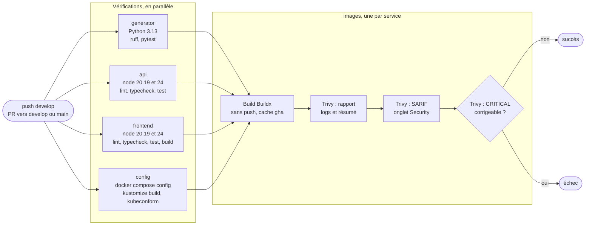

# Intégration continue (GitHub Actions)

Chaque push sur `develop` et chaque pull request vers `develop` ou `main` lance le workflow
[.github/workflows/ci.yml](../.github/workflows/ci.yml) : lint, tests, validation de la
configuration, construction des trois images et scan de sécurité. Rien n'est publié ni déployé :
la livraison continue (publication des images et déploiement sur tag) est faite par
[release.yml](../.github/workflows/release.yml), décrite dans [cd.md](cd.md) ; la procédure de
release est dans [release.md](release.md).

## Pipeline



Les quatre jobs de vérification tournent en parallèle, sur des machines séparées. Le job
`images` attend leur succès (`needs`) : construire et scanner une image n'a de sens que pour du
code qui passe le lint et les tests.

## Rôle de chaque job

| Job | Ce qu'il fait | Ce qu'il protège |
|-----|---------------|------------------|
| `generator` | Python 3.13 (comme l'image `python:3.13.x-slim-trixie`), `pip install -r requirements-dev.txt`, `ruff check`, `ruff format --check`, `pytest` (avec couverture) | Erreurs de code et de style, régressions du service Python |
| `api (node …)` | `npm ci`, `npm run lint` (ESLint), `npm run typecheck` (tsc sans émission), `npm test` (Vitest, PostgreSQL en mémoire avec PGlite) | Erreurs de types, régressions des routes et de la base |
| `frontend (node …)` | `npm ci`, lint, typecheck, `npm test`, `npm run build` (tsc puis Vite) | Même chose, plus la construction réelle du site |
| `config` | `docker compose config` (avec et sans `docker-compose.gpu.yml`), contrôle de `deploy/kustomization.yaml`, kubeconform sur la sortie de `kustomize build deploy/` | Fichier compose invalide, manifeste Kubernetes mal écrit ou oublié dans Kustomize |
| `images (…)` | Build de l'image, scan Trivy (rapport, SARIF, règle d'échec) | Dockerfile cassé, vulnérabilité critique corrigeable |

Aucun test n'a besoin d'un service externe : l'api utilise PGlite et un faux generator, le
generator simule Ollama. La CI n'a donc ni base de données ni Ollama à démarrer.

`npm ci` (et non `npm install`) installe exactement le contenu de `package-lock.json` et échoue
si celui-ci ne correspond plus à `package.json` : la CI teste les versions qui seront dans
l'image.

### Validation de docker-compose.yml

`docker-compose.yml` exige trois variables avec la syntaxe `${POSTGRES_USER:?message}` : sans
`.env`, `docker compose config` s'arrête sur ce message. Le job copie donc `.env.example` en
`.env`, comme le ferait un développeur, puis valide les deux combinaisons utilisées (CPU, et CPU
plus `docker-compose.gpu.yml`). `--quiet` n'affiche rien si tout est correct, et ne montre donc
pas les valeurs, même d'exemple.

### Validation des manifestes avec Kustomize et kubeconform

Depuis l'issue 19, les manifestes sont appliqués par Kustomize (`kubectl apply -k deploy/`, et
Argo CD sur la branche `production`). Le job valide donc ce qui sera réellement appliqué : la
sortie de `kustomize build deploy/`, et non les fichiers un par un. `deploy/*.yaml` contient en
plus `kustomization.yaml`, qui n'est pas une ressource Kubernetes : kubeconform le rejetterait.

1. **Contrôle de la liste** : chaque `deploy/*.yaml` (sauf `kustomization.yaml`) doit figurer
   dans les `resources` de `kustomization.yaml`. Un nouveau manifeste oublié dans la liste ne
   serait jamais déployé, sans aucune erreur. Vérifié en local : un fichier `forgotten.yaml`
   ajouté à une copie fait échouer le job (« forgotten.yaml is not listed »).
2. **`kustomize build deploy/`** : kustomize **v5.8.2**, téléchargé avec vérification de sa somme
   SHA-256 (même version et même somme que le job de déploiement de `release.yml`).
3. **kubeconform** sur cette sortie.

kubeconform compare chaque objet au schéma JSON de son type, pour la version exacte du cluster
(`-kubernetes-version 1.36.1`), sans cluster. `-strict` refuse en plus les champs inconnus : une
faute de frappe comme `replica: 2` est une erreur, alors que Kubernetes l'ignorerait sans rien
dire.

Version précise : **v0.8.0**, téléchargée depuis la release GitHub, avec vérification de la
somme SHA-256 écrite dans le workflow (la même que dans le fichier `CHECKSUMS` de la release).

**Schémas absents.** Le catalogue de kubeconform ne contient que les types de Kubernetes. Le
`Middleware` de Traefik (`traefik.io/v1alpha1`) est une CRD, sans schéma : kubeconform le
signale comme erreur. Deux façons de l'éviter :

| Option | Effet |
|--------|-------|
| `-ignore-missing-schemas` | Ignore **tout** objet sans schéma |
| `-skip traefik.io/v1alpha1/Middleware` (retenue) | Ignore **seulement** ce type, nommé |

La première est dangereuse : un `apiVersion: apps/v2` mal écrit n'a pas de schéma non plus, et
serait ignoré. Vérifié en local sur un tel manifeste : « Skipped: 1 » et code de sortie 0 avec
`-ignore-missing-schemas`, mais « could not find schema for Deployment » et code 1 avec `-skip`.
Les Middlewares restent vérifiés par le serveur au moment de l'apply (dry-run). Pour les valider
aussi en CI, on pourrait ajouter une source de schémas de CRD (catalogue datreeio/CRDs-catalog,
épinglé sur un commit).

Seuls les fichiers listés dans `kustomization.yaml` sont validés : `deploy/cluster/` contient des
composants du cluster (valeurs Helm, Application Argo CD), et `postgres-credentials.yaml.example`
n'est qu'un modèle, jamais appliqué.

Résultat local (job rejoué dans `ubuntu:24.04`, scripts extraits du workflow par yq) :
`19 resources found in 1 file - Valid: 17, Invalid: 0, Errors: 0, Skipped: 2` (les deux
Middlewares).

### Construction des images

- **Buildx** (`docker/setup-buildx-action`) crée un builder BuildKit dans un conteneur : c'est
  lui qui sait lire et écrire le cache GitHub Actions. Le pilote Docker par défaut ne le peut pas.
- **`push: false`, `load: true`** : l'image n'est envoyée nulle part ; elle est chargée dans le
  Docker local de la machine, où Trivy la scanne.
- **Tag `deckgen-<service>:ci-<sha court>`**, par exemple `deckgen-api:ci-1a2b3c4` : on retrouve
  le commit qui a produit l'image. Sur une pull request, `GITHUB_SHA` est le commit de fusion
  que GitHub crée pour tester la PR (branche + cible) : c'est bien ce code-là qui est construit.
- **`APP_VERSION=ci-<sha court>`** passé au frontend : le pied de page et `/version.json`
  indiquent quel build est servi. Les deux autres Dockerfiles n'ont pas cet `ARG`.

## Matrice Node 20.19 et 24

Les jobs `api` et `frontend` tournent deux fois, sous deux versions de Node :

- **20.19** : la version du poste de développement, et le minimum accepté par `package.json`
  (`engines`) ; Vite 8 exige au moins 20.19.
- **24** : la version des images Docker (`node:24.21.0-alpine3.24`), donc celle de la production.

Un code qui passe sur le poste mais pas dans l'image (ou l'inverse) est ainsi détecté avant la
fusion. `fail-fast: false` : si une version échoue, l'autre continue, et les deux résultats
restent visibles.

## Cache

| Cache | Contenu | Clé |
|-------|---------|-----|
| `setup-python`, `cache: pip` | Paquets téléchargés par pip | Hash de `generator/requirements*.txt` |
| `setup-node`, `cache: npm` | Cache de téléchargement de npm (`~/.npm`) | Hash du `package-lock.json` du service |
| Buildx `type=gha` | Couches des images (`mode=max` : aussi celles des étapes de build) | `scope` par service |
| trivy-action | Base de vulnérabilités de Trivy | Date du jour |

Le cache de npm ne contient pas `node_modules` : `npm ci` reconstruit toujours `node_modules`
proprement, mais sans retélécharger les paquets. Un `scope` par service évite que les trois
images du job `images` s'écrasent mutuellement le cache. `mode=max` compte ici, car les
Dockerfiles sont multi-étapes : sans lui, seules les couches de l'image finale seraient gardées,
et `npm ci` de l'étape de build serait rejoué à chaque fois.

## Permissions minimales

Chaque job reçoit un jeton `GITHUB_TOKEN`, dont les droits sont fixés par le workflow :

- au niveau du workflow : `contents: read`, lire le code et rien d'autre ;
- job `images` seulement : `security-events: write`, pour déposer le rapport SARIF dans l'onglet
  Security. Les permissions d'un job **remplacent** celles du workflow : `contents: read` y est
  donc répété, sinon le checkout échouerait.

Si une action était compromise, elle ne pourrait faire que ce que permet le jeton : ni pousser du
code, ni créer une release, ni modifier les PR.

Autres précautions :

- `persist-credentials: false` sur chaque checkout : le jeton n'est pas laissé dans
  `.git/config`, où une étape suivante (ou un artefact) pourrait le lire ;
- les valeurs venant de GitHub (`matrix.service`) sont passées aux scripts par `env:` et non
  écrites directement dans `run:`, ce qui évite toute injection de commande ;
- l'envoi SARIF est sauté pour une PR venant d'un fork : son jeton est en lecture seule et
  l'envoi échouerait ;
- `timeout-minutes` sur chaque job : un job bloqué s'arrête au lieu de tourner 6 heures.

## Épinglage des actions par SHA

Chaque action est référencée par le SHA complet (40 caractères) d'un commit, avec la version en
commentaire :

```yaml
- uses: actions/checkout@3d3c42e5aac5ba805825da76410c181273ba90b1 # v7.0.1
```

**Pourquoi.** Un tag Git (`v7`, `v7.0.1`) peut être déplacé vers un autre commit par quiconque
contrôle le dépôt de l'action. Un SHA désigne un contenu unique et ne peut pas être modifié. C'est
une protection contre les **attaques par la chaîne d'approvisionnement** : on attaque un outil
utilisé par des milliers de projets, plutôt que chaque projet.

Deux cas réels :

- **tj-actions/changed-files (mars 2025)** : les tags de cette action ont été déplacés vers un
  commit qui affichait les secrets des pipelines dans les logs publics.
- **aquasecurity/trivy-action (mars 2026, CVE-2026-33634)** : l'action utilisée ici. Le
  19 mars 2026, des attaquants ont déplacé 76 de ses 77 tags vers un code qui volait les secrets
  de la CI avant de lancer le vrai scan : les pipelines semblaient fonctionner normalement. Les
  workflows épinglés par SHA n'ont pas été touchés.

Un SHA ne protège pas d'un code malveillant déjà présent dans ce commit : il garantit seulement que
le code ne change pas sans qu'on le voie. Les mises à jour passent alors par une PR de Dependabot,
relue, qui change le SHA et le commentaire ensemble.

**Vérification.** Chaque SHA a été obtenu par l'API GitHub
(`gh api repos/<action>/git/ref/tags/<tag>`, en déréférençant les tags annotés), puis recoupé par
une seconde requête (`gh api repos/<action>/commits/<tag>`) :

| Action | Version | SHA |
|--------|---------|-----|
| actions/checkout | v7.0.1 | `3d3c42e5aac5ba805825da76410c181273ba90b1` |
| actions/setup-python | v7.0.0 | `5fda3b95a4ea91299a34e894583c3862153e4b97` |
| actions/setup-node | v7.1.0 | `949feb2413d6458794dcd2491c4babbbce0c15c1` |
| docker/setup-buildx-action | v4.4.1 | `f87e5991a6d7451dcb8d9637bfbc97413f497069` |
| docker/build-push-action | v7.4.0 | `c3c9e263c25d99ce0380d002d59b67737d91b0dc` |
| aquasecurity/trivy-action | v0.36.0 | `ed142fd0673e97e23eac54620cfb913e5ce36c25` |
| github/codeql-action/upload-sarif | v4.38.3 | `24c54180a607b1449ed407dd24f251e4e9147c8d` |

trivy-action v0.36.0 épingle elle-même son action interne (`aquasecurity/setup-trivy`, v0.2.6)
par SHA. Les outils téléchargés suivent la même logique : kubeconform est vérifié par sa somme
SHA-256, et la version de Trivy est fixée (`v0.75.0`, et non la v0.76.0 publiée le jour même :
une version de quelques heures n'a encore été examinée par personne).

## Trivy et la politique d'échec

Trivy (Aqua Security) liste les paquets de l'image (paquets Alpine ou Debian, `node_modules`,
paquets Python) et les compare à une base de vulnérabilités connues (CVE). Il passe trois fois
sur chaque image :

| Passage | Gravités | Bloquant | Sortie |
|---------|----------|----------|--------|
| 1. Rapport | MEDIUM, HIGH, CRITICAL, corrigées ou non | Non | Tableau dans les logs **et** dans le résumé du job (`GITHUB_STEP_SUMMARY`) |
| 2. SARIF | MEDIUM, HIGH, CRITICAL | Non | Onglet **Security > Code scanning** du dépôt |
| 3. Règle d'échec | CRITICAL, **avec correctif disponible** (`ignore-unfixed`) | **Oui** (`exit-code: 1`) | Tableau des vulnérabilités en cause |

**Pourquoi seulement CRITICAL corrigeable.** Bloquer sur tout rendrait la CI rouge en
permanence : l'image Debian du generator a 48 HIGH, dont 44 sans aucun correctif publié. Ni une
mise à jour ni un changement de code n'y peuvent rien : un échec serait du bruit, que l'équipe
finirait par ignorer. Une CRITICAL **corrigeable**, en revanche, appelle une action immédiate
(mise à jour de l'image de base ou de la dépendance) : c'est elle qui bloque. Le reste reste
visible dans le rapport et dans l'onglet Security, pour être traité sans bloquer les fusions. Les
LOW ne sont pas affichées (61 dans l'image du generator, aucune corrigeable).

**SARIF** (Static Analysis Results Interchange Format) est le format standard des résultats
d'analyse. Déposé par `github/codeql-action/upload-sarif`, il devient une liste d'alertes dans
l'onglet Security, gratuit sur un dépôt public. Chaque alerte se suit, se ferme ou se marque
« faux positif ». `category: trivy-<service>` sépare les trois images : sinon chaque dépôt
remplacerait les alertes du précédent.

`TRIVY_TABLE_MODE: detailed` sur le premier passage n'affiche que les tableaux de vulnérabilités.
Sans lui, Trivy commence par un résumé qui liste chaque `package.json` de `node_modules`, même
sans vulnérabilité (plus de 100 lignes pour l'api).

**Exceptions.** Si une CRITICAL corrigeable ne pouvait vraiment pas être corrigée tout de suite,
on l'ajouterait à un fichier `.trivyignore` à la racine (lu automatiquement par Trivy), avec un
commentaire qui justifie l'exception et une date de revue. Aucune exception n'est nécessaire
aujourd'hui : le fichier n'existe pas.

### Résultats du scan local

Trivy 0.75.0, image officielle `aquasec/trivy:0.75.0`
(`sha256:af6acf9a6b85dfe389a1941505c0ce9efef52a4719635e1a962f022a3d855daa`), base de
vulnérabilités du 14/10/2026, lancé avec `docker run` et le socket Docker :

```powershell
docker run --rm -v /var/run/docker.sock:/var/run/docker.sock -v trivy-cache:/root/.cache/ `
  aquasec/trivy:0.75.0 image --severity CRITICAL --ignore-unfixed --exit-code 1 deckgen-api:ci-local
```

Images reconstruites avec les Dockerfiles actuels (tag `ci-local`), comme en CI :

| Image | Base | CRITICAL | HIGH (corrigeables) | MEDIUM (corrigeables) | LOW | Règle d'échec |
|-------|------|----------|---------------------|-----------------------|-----|---------------|
| deckgen-api | Alpine 3.24.2 | 0 | 0 | 1 (1) | 0 | **passe** |
| deckgen-frontend | Alpine 3.24.2 | 0 | 0 | 1 (1) | 0 | **passe** |
| deckgen-generator | Debian 13.7 | 0 | 48 (4) | 60 (2) | 61 | **passe** |

Les images actuellement déployées (`api:0.1.1`, `frontend:0.2.0`, `generator:0.1.0`) donnent
exactement les mêmes nombres. **Aucune CRITICAL : la CI passera**, et aucune correction ni
exception n'a été nécessaire.

Détail des vulnérabilités corrigeables, non bloquantes :

- **api et frontend** : `zlib` 1.3.2-r0 (CVE-2026-85091, MEDIUM), corrigée en 1.3.2-r1 dans les
  dépôts Alpine. Elle disparaîtra avec la prochaine version des images de base `node` et
  `nginx-unprivileged`, proposée par Dependabot.
- **generator** : `msgpack`, `urllib3` et `setuptools` (4 HIGH, 2 MEDIUM). Ce ne sont pas des
  dépendances du generator, mais des copies internes à **pip** (`pip/_vendor`), présent deux fois
  dans l'image (Python système et venv). Piste d'amélioration : supprimer pip de l'image finale,
  comme npm est supprimé de l'image de l'api ; il ne sert pas à l'exécution.
- Les 44 autres HIGH du generator sont des paquets Debian (`util-linux`, `ncurses`, `systemd`,
  `perl-base`) sans correctif publié par Debian.

## Dependabot

[.github/dependabot.yml](../.github/dependabot.yml) ouvre chaque lundi des pull requests de mise à
jour, vers `develop` (comme une branche de fonctionnalité) :

| Écosystème | Dossiers | Regroupement |
|------------|----------|--------------|
| `github-actions` | `/` (lit `.github/workflows`) | Toutes les actions dans une seule PR |
| `npm` | `/api`, `/frontend` | Mineures et correctifs : une PR par dossier ; chaque version majeure : sa propre PR |
| `pip` | `/generator` | Mineures et correctifs : une PR ; majeures : une PR chacune |
| `docker` | `/api`, `/frontend`, `/generator` | Images de base : une PR par dossier |

- Les **versions majeures** sont à part : elles peuvent casser le code et méritent une PR qu'on
  examine seule.
- **`cooldown: default-days: 7`** : une version n'est proposée qu'une fois âgée de 7 jours. Une
  release piégée, comme celle de Trivy en mars 2026, est en général découverte et retirée en
  quelques heures.
- **`ignore`** : mises à jour que Dependabot ne propose pas, chacune avec sa raison en
  commentaire dans le fichier :

  | Écosystème | Dépendance | Ignoré | Raison |
  |------------|------------|--------|--------|
  | npm | `vitest`, `@vitest/coverage-v8` | Majeures | Vitest 5 exige Node 22 (`^22.12.0 \|\| ^24.0.0 \|\| >=26.0.0`) : le projet doit rester compatible Node 20, première version de la matrice |
  | npm | `react-router` | Majeures | React Router 8 exige Node 22 (`>=22.22.0`) |
  | npm | `@types/node` | Majeures | Types fixés sur Node 20 : le typecheck signale tout appel à une API absente de Node 20, même si le code tourne en Node 24 dans l'image |
  | docker | `node` | Majeures | Node reste en 24 (LTS), version de l'image et de la matrice |
  | docker | `python` | Majeures et mineures | Python reste en 3.13 ; pour Dependabot, 3.14 est une version « mineure » |
  | docker | `nginxinc/nginx-unprivileged` | Mineures | nginx reste sur la branche stable 1.30 ; les numéros impairs (1.31) sont la branche mainline |

  Les mises à jour mineures et les correctifs de ces paquets restent proposés (par exemple
  vitest 4.x, nginx 1.30.x). Les règles npm valent pour les deux dossiers : une règle sur un
  paquet absent d'un dossier est sans effet (`@vitest/coverage-v8` n'est que dans l'api,
  `react-router` que dans le frontend). Passer à la version suivante (Node 22 minimum, nginx 1.32
  stable) reste une décision volontaire : on retire alors la règle, et on met à jour la matrice de
  la CI si besoin.
- **`commit-message`** : `chore(deps): ...` et `chore(deps-dev): ...`, dans le format de commit du
  projet.
- Chaque PR de Dependabot passe par la CI comme les autres : une mise à jour qui casse un test ou
  apporte une CRITICAL ne peut pas être fusionnée.
- Pour les actions, Dependabot met à jour le SHA **et** le commentaire de version.

## Status checks à exiger

Noms des jobs, tels qu'ils apparaissent dans la règle de protection de branche :

- `generator`
- `api (node 20.19)`
- `api (node 24)`
- `frontend (node 20.19)`
- `frontend (node 24)`
- `config`
- `images (api)`
- `images (frontend)`
- `images (generator)`

Un job de matrice porte la valeur de la matrice dans son nom : si une version de Node change dans
la matrice, il faut mettre à jour la règle de protection. Les noms n'apparaissent dans la liste de
GitHub qu'après une première exécution du workflow.

## Parallèle avec Azure DevOps

| Azure Pipelines | GitHub Actions | Dans ce workflow |
|-----------------|----------------|------------------|
| `trigger:` (branches) | `on: push` | `push` sur `develop` |
| `pr:` | `on: pull_request` | PR vers `develop` et `main` |
| Branch policy « Build validation » | Règle de protection, « required status checks » | Les 9 checks ci-dessus |
| `stages:` | Pas d'équivalent direct : jobs reliés par `needs` | Vérifications, puis `images` |
| `jobs:` / `dependsOn:` | `jobs:` / `needs:` | `images` dépend des 4 autres |
| `steps:` | `steps:` | |
| `task:` (`NodeTool@0`, `Docker@2`…) | Action (`uses:`) | `actions/setup-node`, `docker/build-push-action` |
| `script:` / `bash:` | `run:` | `npm ci`, `pytest` |
| Agent, pool (`vmImage: ubuntu-24.04`) | Runner (`runs-on: ubuntu-24.04`) | Runners hébergés par GitHub |
| Agent auto-hébergé | Runner auto-hébergé | Non utilisé |
| `strategy: matrix:` | `strategy: matrix:` | Node 20.19 et 24, trois services |
| `variables:` | `env:` | `KUBECONFORM_VERSION`, `TRIVY_VERSION` |
| `condition:` | `if:` | Envoi SARIF sauté pour un fork |
| Tâche `Cache@2` | `cache:` de setup-node / setup-python, cache `gha` | |
| Onglet Summary, `##vso[task.uploadsummary]` | `GITHUB_STEP_SUMMARY` | Rapport Trivy |
| Permissions du service de build, service connections | `permissions:` du `GITHUB_TOKEN` | `contents: read`, `security-events: write` |
| `timeoutInMinutes:` | `timeout-minutes:` | 5 à 20 minutes |

Une différence de fond : dans Azure DevOps, les tâches sont publiées et maintenues par Microsoft
ou installées depuis la Marketplace par l'administrateur de l'organisation. Dans GitHub Actions,
une action est le code d'un dépôt Git quelconque, chargé à chaque exécution : d'où l'importance de
l'épinglage par SHA.

## Validation locale

Avant le premier push :

| Vérification | Outil | Résultat |
|--------------|-------|----------|
| Syntaxe du workflow | actionlint 1.7.12 (image `rhysd/actionlint:1.7.12`, shellcheck 0.11.0 inclus pour les scripts `run:`) | 0 erreur |
| Schémas de `ci.yml` et `dependabot.yml` | check-jsonschema 0.36.0 (`vendor.github-workflows`, `vendor.dependabot`) | valides |
| Job `generator` | Python 3.13.14 : ruff check, ruff format --check, pytest | OK, 30 tests, couverture 97 % |
| Jobs `api` et `frontend`, Node 20.19.0 | npm ci, lint, typecheck, test, build | OK : api 67 tests, frontend 26 tests, build OK |
| Jobs `api` et `frontend`, Node 24.21.0 | Mêmes commandes, dans `node:24.21.0-alpine3.24` | OK |
| Job `config` | `docker compose config --quiet` (avec `--env-file .env.example`, sans toucher au `.env` local), kubeconform v0.8.0 | OK, 17 valides, 2 Middlewares ignorés |
| Job `config` (issue 19) | Étapes extraites de `ci.yml` par yq 4.54.1, rejouées dans `ubuntu:24.04` : kustomize v5.8.2, contrôle de la liste, kubeconform sur `kustomize build` | OK, 17 valides, 2 Middlewares ignorés ; un manifeste non listé fait échouer le job |
| Job `images` | `docker buildx build` des trois images, Trivy 0.75.0 (rapport, SARIF, règle d'échec) | Builds OK, règle d'échec : 0 CRITICAL corrigeable |

Ce qui ne peut se vérifier que sur GitHub : le cache `gha`, l'envoi SARIF, le résumé du job et
l'annulation par `concurrency`.
