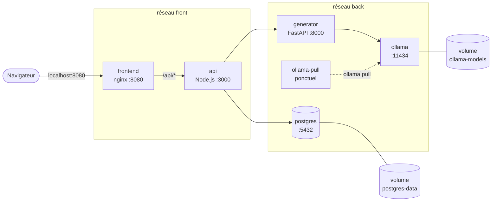

# docker-compose

`docker compose up --build` lance toute l'application et ses dépendances. Deux fichiers :

- `docker-compose.yml` : la description complète, qui fonctionne sur toute machine (Ollama sur CPU)
- `docker-compose.gpu.yml` : une surcharge qui ajoute seulement l'accès au GPU NVIDIA pour Ollama

## Services et réseaux

| Service       | Image                         | Rôle                                                        |
|---------------|-------------------------------|-------------------------------------------------------------|
| `postgres`    | `postgres:18.6-alpine3.24`    | Base de données des decks et des cartes                     |
| `ollama`      | `ollama/ollama:0.40.3`        | Serveur du modèle de langage                                |
| `ollama-pull` | `ollama/ollama:0.40.3`        | Télécharge le modèle une fois, puis s'arrête                |
| `generator`   | construit depuis `./generator`| Transforme un cours en flashcards en appelant Ollama        |
| `api`         | construit depuis `./api`      | API REST, migrations au démarrage, appelle le generator     |
| `frontend`    | construit depuis `./frontend` | nginx : sert l'interface et relaie `/api/` vers l'api       |

L'api est le seul service présent sur les deux réseaux : c'est le point de passage entre
l'interface et les services internes.

## Ordre de démarrage

Les `depends_on` avec condition imposent cet ordre, vérifié dans la sortie de
`docker compose up` :

1. `postgres` et `ollama` démarrent en parallèle.
2. Quand `postgres` est **healthy** (`pg_isready`), l'`api` démarre et applique les migrations.
3. Quand `ollama` est **healthy** (`ollama list`), `ollama-pull` télécharge le modèle.
4. Quand `ollama-pull` s'est **terminé avec succès** (code 0), le `generator` démarre.
5. Quand l'`api` est **healthy**, le `frontend` démarre.

Les healthchecks de l'api, du generator et du frontend viennent de leurs Dockerfiles : compose
les utilise sans les redéfinir.

## Volumes

| Volume          | Monté dans                     | Contenu                                  |
|-----------------|--------------------------------|------------------------------------------|
| `postgres-data` | `postgres:/var/lib/postgresql` | Données de PostgreSQL                    |
| `ollama-models` | `ollama:/root/.ollama`         | Modèles téléchargés (environ 3 Go)       |

Ils survivent à `docker compose down`, mesuré : après `down` puis `up -d`, les decks sont toujours
là, `ollama-pull` se termine en 1 s au lieu d'environ 2 minutes, et l'application est prête en
15 s. Seul `docker compose down -v` les supprime.

PostgreSQL 18 range ses données dans un sous-dossier versionné de `/var/lib/postgresql` : c'est ce
dossier qui est monté, et non `/var/lib/postgresql/data` comme pour les versions précédentes.

## Choix techniques

**CPU par défaut, surcharge GPU.** Le fichier principal ne suppose aucun matériel particulier :
il fonctionne sur n'importe quelle machine. `docker-compose.gpu.yml` ne contient que la
réservation du GPU pour Ollama (`deploy.resources.reservations.devices`), et compose fusionne les
deux fichiers. Sur la machine de développement, `COMPOSE_FILE` dans `.env` charge les deux
automatiquement. Mesures avec `gemma3:4b` : le modèle tourne à 100 % sur le GPU (RTX 1000 Ada,
2,9 Go de mémoire), une génération courte prend environ 3 s une fois le modèle chargé, contre
environ 25 s sur CPU. Sur CPU, un cours long peut dépasser le délai de 120 s par tentative du
generator (`OLLAMA_TIMEOUT`).

**Service `ollama-pull`.** L'image Ollama ne contient aucun modèle. Plutôt qu'un script de
démarrage, un service ponctuel utilise la même image et lance `ollama pull` vers le service
`ollama`, qui enregistre le modèle dans son volume. Le generator attend sa fin
(`service_completed_successfully`) : la première génération ne peut pas échouer faute de
modèle. Comme le modèle est déjà dans le volume, les lancements suivants ne retéléchargent rien.

**Isolation des réseaux.** Le frontend est exposé aux navigateurs : s'il était compromis, il ne
doit pas pouvoir atteindre la base de données ni le modèle. Il est donc seul sur le réseau
`front` avec l'api. Vérifié : depuis le conteneur frontend, `postgres`, `ollama` et `generator`
sont introuvables par leur nom, et injoignables même par leur adresse IP. Le réseau `back` n'est
pas `internal` : Ollama doit accéder à Internet pour télécharger le modèle.

**Un seul port publié.** Seul le frontend est publié sur l'hôte (`FRONTEND_PORT`, 8080 par
défaut). PostgreSQL et Ollama ne sont joignables que par les autres conteneurs : moins de surface
d'attaque, et pas de conflit avec un PostgreSQL ou un Ollama déjà installés sur l'hôte.

**Variables et secrets.** Les identifiants PostgreSQL viennent du fichier `.env`, ignoré par git.
La syntaxe `${POSTGRES_PASSWORD:?message}` arrête compose avec un message clair si une variable
manque. Les adresses internes (`postgres`, `generator:8000`, `ollama:11434`, `api:3000`) ne sont
pas des secrets : elles sont écrites dans le fichier compose. Les identifiants sont déclarés une
seule fois (`x-postgres-credentials`) et réutilisés par `postgres` et `api`.

**Redémarrage.** `restart: unless-stopped` relance un service qui s'arrête, sauf s'il a été arrêté
volontairement. `ollama-pull` a `restart: "no"` : il doit s'exécuter une fois et s'arrêter.

**Versions précises.** `postgres:18.6-alpine3.24` (la version du PostgreSQL de développement) et
`ollama/ollama:0.40.3` (la version sur laquelle le comportement du generator a été vérifié,
voir [model-choice.md](model-choice.md)).
