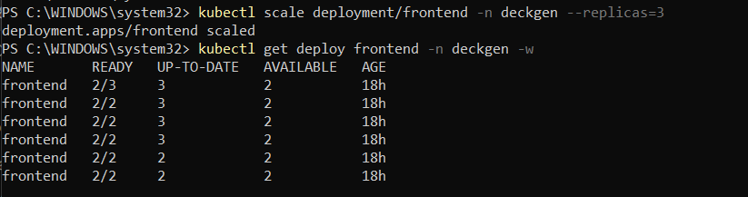
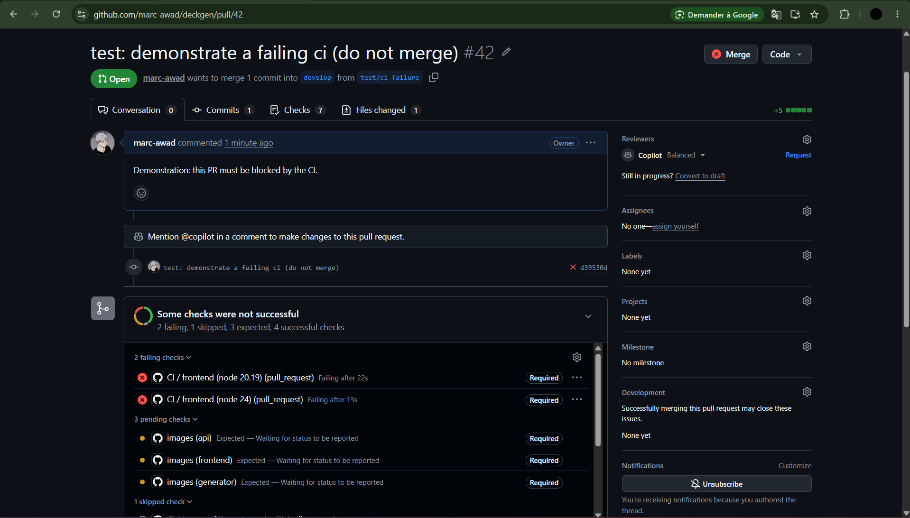
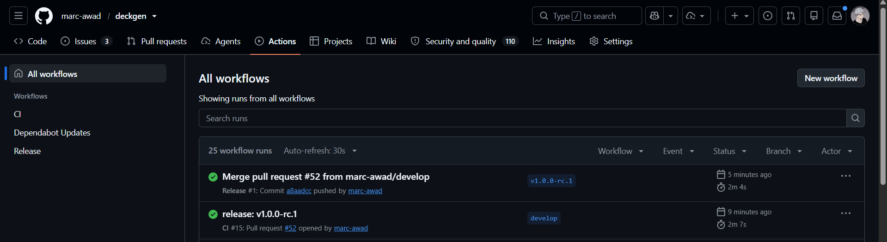
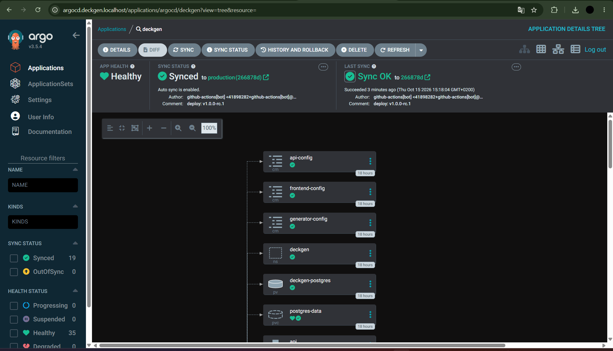
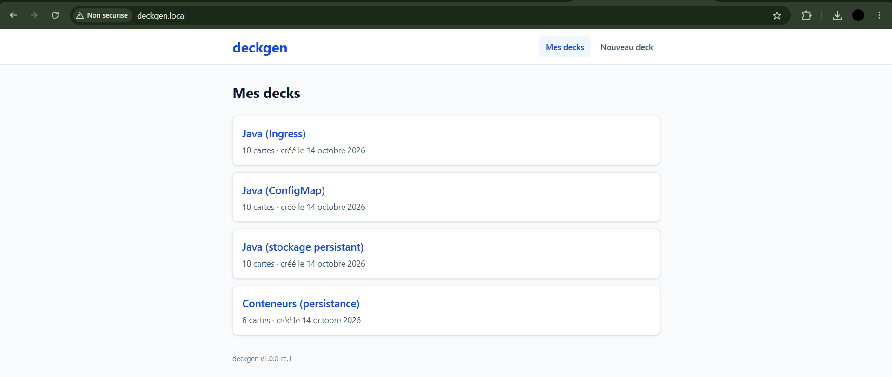

<section class="cover">
<h1>deckgen : dossier technique</h1>
<p class="subtitle">Générateur de flashcards par IA, conteneurisé et orchestré</p>
<table class="meta">
<tr><td>Auteur</td><td>Marc Awad</td></tr>
<tr><td>Formation</td><td>ESILV, MSc CSDS1, groupe A4-PAR-ALT</td></tr>
<tr><td>Module</td><td>Conteneurisation &amp; Orchestration</td></tr>
<tr><td>Formateur</td><td>Maxime Cordeiro</td></tr>
<tr><td>Version</td><td>v1.0.0</td></tr>
<tr><td>Date</td><td>15 octobre 2026</td></tr>
<tr><td>Dépôt</td><td><a href="https://github.com/marc-awad/deckgen">github.com/marc-awad/deckgen</a></td></tr>
</table>
<p class="bottom">Projet individuel. Ce dossier remplace la soutenance orale : il présente l'architecture,
les choix techniques, les démonstrations et les difficultés rencontrées, avec des liens vers la
documentation détaillée du dépôt.</p>
</section>

[[TOC]]

## Synthèse

- **deckgen** transforme un cours collé en flashcards (question et réponse) importables dans Anki.
- La génération est faite par un modèle de langage **local** (Ollama, `gemma3:4b`) : gratuit, et
  le cours ne quitte pas la machine.
- Trois microservices conteneurisés (interface React/nginx, API Node.js, generator Python) et une
  base PostgreSQL.
- Lancement en une commande avec Docker Compose ; déploiement sur un cluster Kubernetes local.
- Pipeline GitOps : un tag Git publie les images sur GHCR, Argo CD applique la version au cluster.



<div class="keyfigures">
<div><b>3</b>microservices (React/nginx, Node.js, Python) et PostgreSQL</div>
<div><b>123</b>tests automatisés (30 generator, 67 api, 26 frontend)</div>
<div><b>9</b>status checks de CI exigés pour fusionner</div>
<div><b>-87 à -96 %</b>de taille d'image grâce au multi-stage</div>
<div><b>19</b>objets Kubernetes synchronisés par Argo CD</div>
<div><b>v1.0.0</b>publiée le 15 octobre 2026, déployée en GitOps</div>
</div>

## Grille de conformité à la consigne

| Exigence | Section | Fichier du dépôt | Preuve |
|----------|---------|------------------|--------|
| **Livrables** | | | |
| Dépôt Git : `main` protégée, `develop`, branches `feature/`, historique clair | [8](#workflow-git-et-gestion-de-projet) | rulesets GitHub, historique | 4 rulesets actifs, Conventional Commits, une PR par issue |
| Un Dockerfile multi-stage par microservice | [4](#conteneurisation-et-docker-compose) | `api/Dockerfile`, `frontend/Dockerfile`, `generator/Dockerfile` | Tailles mesurées avant et après |
| `.dockerignore` et `.gitignore` | [4](#conteneurisation-et-docker-compose) | `*/.dockerignore`, `.gitignore` | `.env` exclu des images et de Git, vérifié |
| `docker-compose.yml` qui lance tout en une commande | [4](#conteneurisation-et-docker-compose) | `docker-compose.yml`, `docker-compose.gpu.yml` | `docker compose up --build`, ordre de démarrage vérifié |
| Un Deployment et un Service par microservice | [5](#kubernetes) | `deploy/*.yaml` | 19 objets `Synced` dans Argo CD (figure 8) |
| ConfigMap | [5](#kubernetes) | `deploy/api.yaml`, `generator.yaml`, `frontend.yaml` | Valeurs lues dans les pods (`printenv`) |
| Secret, aucun secret en clair dans Git ni dans l'image | [5](#kubernetes), [10](#difficultés-et-solutions) | Secret créé par commande | Recherche du mot de passe : 0 fichier dans le dépôt et les images |
| PV et PVC pour la base | [5](#kubernetes), [6](#démonstrations) | `deploy/postgres-storage.yaml` | Données conservées après suppression du pod |
| CI : tests sur `develop` | [7](#cicd) | `.github/workflows/ci.yml` | PR bloquée par la CI (figure 6) |
| CD sur tag de `main` : build, push vers un registre, déploiement Kubernetes | [7](#cicd) | `.github/workflows/release.yml` | Releases v1.0.0-rc.1 et v1.0.0 (figures 7 à 9), attestation vérifiée |
| **Critères d'évaluation** | | | |
| Qualité du code et de l'architecture microservices | [3](#architecture-et-microservices) | `api/`, `generator/`, `frontend/` | 123 tests, lint et typecheck en CI |
| Dockerfiles optimisés, compose structuré | [4](#conteneurisation-et-docker-compose) | Dockerfiles, compose | -87 à -96 %, non-root, réseaux isolés |
| Manifestes corrects, concepts bien utilisés | [5](#kubernetes) | `deploy/` | kubeconform strict en CI, dry-run serveur |
| CI/CD automatisé déclenché par les tags (bonus) | [7](#cicd) | `release.yml`, `deploy/cluster/argocd-application.yaml` | Tag v1.0.0 → cluster en v1.0.0, sans intervention |
| Documentation claire (architecture, choix, défis) | ce dossier | `docs/`, README | Sections 3, 9 et 10 |
| **Objectifs pédagogiques** | | | |
| Conteneurisation et microservices | [3](#architecture-et-microservices), [4](#conteneurisation-et-docker-compose) | Dockerfiles | Images non-root, une responsabilité par service |
| Docker Compose | [4](#conteneurisation-et-docker-compose) | `docker-compose.yml` | Healthchecks, `depends_on` conditionnels |
| Déploiement et mise à l'échelle sur Kubernetes | [5](#kubernetes), [6](#démonstrations) | `deploy/api.yaml` (HPA) | HPA de 2 à 5 pods sous charge |
| Objets essentiels | [5](#kubernetes) | `deploy/` | Namespace, Deployment, Service, ConfigMap, Secret, PV, PVC, HPA, Ingress |
| Mises à jour sans interruption | [6](#démonstrations) | `deploy/frontend.yaml` | 0 erreur sur 379 visites complètes (page et script) pendant un rolling update, avec le cookie d'affinité Traefik ; figure 3 |
| Auto-réparation | [6](#démonstrations) | probes, Argo CD | 57 requêtes sur 57, liveness, self-heal (figure 4) |
| CI/CD | [7](#cicd) | `.github/workflows/` | Exécutions réussies, captures |
| **Règles d'usage de l'IA** | | | |
| Transparence : outils et parties concernées | [12](#usage-de-lia) | README | Section « Usage de l'IA » |
| Compréhension du code généré | [12](#usage-de-lia) | | Explications fichier par fichier, relues |
| Validation et tests | [12](#usage-de-lia) | CI | 123 tests, 9 checks, tests manuels |
| Personnalisation | [9](#choix-techniques-et-alternatives), [10](#difficultés-et-solutions) | | Décisions de l'auteur, défauts détectés |
| Sécurité : aucun secret partagé | [12](#usage-de-lia) | | Mots de passe aléatoires hors de Git ; deux expositions déclarées et corrigées |

## Architecture et microservices

| Service | Rôle | Technologie | Image de base | Port |
|---------|------|-------------|---------------|------|
| frontend | Interface web ; avec Compose, relaie `/api/` vers l'api | React 19, TypeScript, Vite, Tailwind CSS, nginx | `node:24.21.0-alpine3.24` (build), `nginxinc/nginx-unprivileged:1.30.5-alpine3.24` | 8080 |
| api | API REST : decks, cartes, génération, export Anki | Node.js 24, Express 5, TypeScript, Drizzle ORM, zod | `node:24.21.0-alpine3.24` | 3000 |
| generator | Transforme un cours en cartes en appelant Ollama | Python 3.13, FastAPI, httpx, pydantic | `python:3.13.16-slim-trixie` | 8000 |
| postgres | Stockage des decks et des cartes | PostgreSQL 18.6 | `postgres:18.6-alpine3.24` | 5432 |
| ollama | Serveur du modèle de langage | Ollama 0.40.3, `gemma3:4b` | `ollama/ollama:0.40.3` (Compose) ; installé sur Windows (Kubernetes) | 11434 |

**Fonctionnalités** : création d'un deck à partir d'un cours (50 à 20 000 caractères, 1 à 30
cartes au plus), génération bornée selon la longueur du cours, modification et suppression des
cartes et des decks, export texte pour Anki (testé avec Anki), version affichée en pied de page.

**Communication**

- **HTTP partout** : le navigateur appelle `/api/...` ; l'api appelle le generator
  (`POST /generate`, JSON) ; le generator appelle Ollama. Seule l'api parle à PostgreSQL.
- **Résolution par nom** : DNS de Docker avec Compose, DNS du cluster sur Kubernetes (`generator`,
  ou `api.deckgen.svc.cluster.local`). Aucune adresse IP dans la configuration.
- **Une seule origine** : interface et api servies par la même adresse (nginx ou Traefik), donc
  pas de CORS, et la même image de frontend fonctionne partout.
- **Délais en cascade** : 120 s par appel à Ollama (deux tentatives au plus), 300 s pour l'api, un
  peu plus pour nginx et Traefik. Le service le plus proche du problème répond (504).

**Principes microservices appliqués**

- **Responsabilité unique** : le frontend affiche, l'api gère les données, le generator ne parle
  qu'au modèle.
- **Base possédée par un seul service** : seule l'api accède à PostgreSQL et applique les
  migrations (Drizzle).
- **Communication par API** : contrats JSON validés des deux côtés (zod, pydantic), erreurs
  normalisées (`{"detail": "..."}`, codes 422, 502, 503, 504).
- **Indépendance** : un Dockerfile, des tests et un nombre de pods par service.
- **Configuration externe** : variables d'environnement ; un service refuse de démarrer si une
  variable obligatoire manque.

## Conteneurisation et Docker Compose

Dockerfile de l'api, à trois étapes (extrait) :

```dockerfile
# Étape 1 : toutes les dépendances, puis compilation TypeScript vers dist/
FROM node:24.21.0-alpine3.24 AS build
COPY package.json package-lock.json ./      # dépendances avant le code : couche en cache
RUN npm ci
COPY tsconfig.json ./
COPY src ./src
RUN npm run build
# Étape 2 : dépendances de production seulement
FROM node:24.21.0-alpine3.24 AS prod-deps
COPY package.json package-lock.json ./
RUN npm ci --omit=dev --omit=optional
# Étape finale : ni TypeScript ni dépendances de développement ; npm retiré, tini en PID 1
FROM node:24.21.0-alpine3.24
RUN apk add --no-cache tini && rm -rf /usr/local/lib/node_modules/npm ...
COPY --from=prod-deps /app/node_modules ./node_modules
COPY --from=build /app/dist ./dist
USER 1000:1000                               # non-root, uid numérique vérifiable par Kubernetes
ENTRYPOINT ["/sbin/tini", "--"]
CMD ["node", "dist/index.js"]
```

| Service | Naïve (disque / compressée) | Optimisée (disque / compressée) | Gain |
|---------|-----------------------------|---------------------------------|------|
| generator | 1,75 Go / 459 Mo | **221 Mo / 53 Mo** | -87 % / -88 % |
| api | 2,2 Go / 570 Mo | **279 Mo / 65 Mo** | -87 % / -89 % |
| frontend | 2,13 Go / 548 Mo | **90,5 Mo / 25,7 Mo** | -96 % / -95 % |

Version naïve : une seule étape, image de base complète, `COPY . .`, toutes les dépendances.

**Sécurité des images**

- Non-root avec uid fixes (101 nginx, 1000 api, 10001 generator) ; tags fixés, jamais `latest`.
- `.dockerignore` (`.env`, tests, caches) ; aucun secret : recherche du vrai mot de passe dans les
  trois images, 0 résultat.
- tini (arrêt propre en moins d'une seconde), healthchecks sur `/health`, scan Trivy en CI.

**Docker Compose** : `docker compose up --build` lance tout, sans rien installer d'autre que Docker.

- **Services** : `postgres`, `ollama`, `ollama-pull` (télécharge le modèle une fois), `generator`,
  `api`, `frontend`. Les `depends_on` conditionnels imposent l'ordre (base healthy avant l'api,
  modèle téléchargé avant le generator).
- **Volumes** : `postgres-data` et `ollama-models` ; après `down` puis `up`, les decks sont là et
  l'application est prête en 15 s.
- **Réseaux isolés** : `front` (frontend, api) et `back` (api, generator, postgres, ollama). Depuis
  le frontend, la base et le modèle sont injoignables, vérifié.
- **Variables** : `.env` copié depuis `.env.example`, ignoré par Git ; `${VAR:?message}` arrête
  compose si une variable manque.
- **GPU** : surcharge `docker-compose.gpu.yml` ; environ 3 s par génération courte sur GPU, contre
  environ 25 s sur CPU.

## Kubernetes

Cluster de Docker Desktop (kubeadm, un node, v1.36.1), namespace `deckgen`. Traefik, metrics-server
et Argo CD sont installés une fois ; Ollama reste sur Windows, avec le GPU.



| Objet | Rôle dans deckgen |
|-------|-------------------|
| Namespace | `deckgen` regroupe toute l'application ; annoté pour qu'Argo CD ne le supprime jamais |
| Deployment | Un par service : frontend 2 pods, api 2 à 5, generator 2 (RollingUpdate, maxSurge 1, maxUnavailable 0) ; postgres 1 pod en `Recreate` |
| Service | ClusterIP pour chaque service ; seul Traefik est exposé (LoadBalancer, port 80) |
| ConfigMap | Un par service, injecté par `envFrom` : adresses, délais, modèle ; aucune valeur dans les Deployments |
| Secret | `postgres-credentials`, créé par `kubectl create` avec un mot de passe aléatoire ; jamais dans Git |
| PersistentVolume | `deckgen-postgres` : 1 Gi, `hostPath` `/var/lib/deckgen/postgres`, politique `Retain` |
| PersistentVolumeClaim | `postgres-data`, liée explicitement au PV (`volumeName`), montée par postgres |
| Probes | startup, liveness (redémarrage) et readiness (retrait du trafic) ; aucune liveness ne dépend d'un autre service |
| Requests / limits | D'après des mesures ; postgres en QoS Guaranteed (requests = limits) |
| HorizontalPodAutoscaler | api de 2 à 5 pods, cible 70 % de 100m CPU ; pas de champ `replicas` dans le Deployment |
| initContainer | `wait-for-postgres` : l'api attend que la base accepte les connexions |
| Ingress | Traefik : `/` vers le frontend, `/api` vers l'api (préfixe retiré, en-têtes de sécurité) ; cookie d'affinité pour le frontend |
| Kustomize | `kustomization.yaml` liste les 7 manifestes ; la release y ajoute les images GHCR (version et digest) |

Détails : [docs/kubernetes.md](https://github.com/marc-awad/deckgen/blob/develop/docs/kubernetes.md),
[deploy/README.md](https://github.com/marc-awad/deckgen/blob/develop/deploy/README.md).

## Démonstrations

| Démonstration | Résultat mesuré |
|---------------|-----------------|
| Scaling et HPA (4 flux de requêtes sur l'api) | 2 pods → 4 à +31 s (539 % de CPU) → 5 à +95 s ; après l'arrêt de la charge, retour à 2 pods à +5 min 37 s (fenêtre de stabilisation) |
| Auto-réparation (pod api supprimé, requêtes toutes les 200 ms) | Pod recréé en 2 s ; **57 requêtes sur 57 en HTTP 200** |
| Readiness (PostgreSQL à 0 réplica) | Pods api retirés du Service en moins de 10 s, RESTARTS inchangé ; de nouveau Ready au retour de la base |
| Liveness (processus d'un generator figé) | 3 échecs de liveness, conteneur redémarré en 63 s |
| Rolling update et rollback (frontend 0.1.0 → 0.2.0 → 0.1.0) | 748 requêtes sur 748 en HTTP 200 ; mais 93 chargements de page sur 318 en échec sur le script avant la correction (affinité), puis 0 sur 379 avec le cookie Traefik |
| Persistance (pod postgres supprimé) | Base retrouvée (« Skipping initialization »), deck intact, api sans redémarrage |
| Self-heal d'Argo CD (frontend passé à 3 pods à la main) | Argo CD remet les 2 pods déclarés dans Git |

<div class="figrow">




</div>

Détails : [docs/rolling-update.md](https://github.com/marc-awad/deckgen/blob/develop/docs/rolling-update.md),
[docs/kubernetes.md](https://github.com/marc-awad/deckgen/blob/develop/docs/kubernetes.md).

## CI/CD



**CI** (`ci.yml`, à chaque PR vers `develop` ou `main` et à chaque push sur `develop`)

- 9 jobs, tous status checks exigés : `generator` (ruff, pytest), `api` et `frontend` sur Node 20.19
  et 24 (lint, typecheck, tests, build), `config` (compose, Kustomize, kubeconform), `images` x3.
- Trivy : rapport complet ; échec seulement sur une CRITICAL corrigeable. 0 CRITICAL dans les trois
  images.
- Actions épinglées par SHA de commit (l'action Trivy a été compromise par ses tags le 19 mars 2026,
  CVE-2026-33634) ; permissions minimales ; Dependabot chaque semaine.
- PR #42 : un test volontairement faux (1 + 1 = 3) dans le frontend bloque la fusion (figure 6).

**Release** (`release.yml`, sur un tag `vX.Y.Z` de `main`)

- `verify` (SemVer, commit sur `main`) → `publish` x3 (GHCR, tags `1.0.0`, `1.0`, `sha-…`,
  provenance, SBOM, attestation signée) → `scan` x3 (Trivy par digest) → Déploiement sur Kubernetes.
- Le déploiement écrit dans la branche `production` les images avec version **et** digest ; Argo CD
  l'applique. Aucun secret de dépôt : le `GITHUB_TOKEN` éphémère suffit.
- v1.0.0-rc.1 (2 min 4 s) puis v1.0.0 (1 min 59 s), le 15 octobre 2026, sur le commit `a8aadcc`.
- Attestation vérifiée : `gh attestation verify` confirme que l'image `deckgen-api@sha256:462866e0…`
  a été construite par `release.yml` depuis le tag v1.0.0 ; c'est le digest qui tourne dans le
  cluster.

<div class="figrow">





</div>

<div class="figrow">





</div>

## Workflow Git et gestion de projet

- **Branches** : `main` protégée (PR depuis `develop`, merge commit seul) ; `develop` par défaut
  (squash des branches `feature/…`, `fix/…`, `docs/…`, `chore/…`) ; `production` écrite par la
  release. Une branche et une PR par issue, sauf l'initialisation du dépôt (premier commit sur
  `main`).
- **Rulesets** : PR et 9 checks sur `develop` et `main` ; ni suppression ni force push sur
  `production` ; tags `v*` non modifiables.
- **Conventional Commits** : `feat(api): add decks and cards routes, generation and anki export
  (#26)`, `fix(generator): enforce card count bounds with JSON schema (#29)`, `ci: add github
  actions workflow with tests, image builds and trivy scan (#41)`.
- **Gestion de projet** : 22 issues (dont une de bug, #27) avec critères d'acceptation,
  7 milestones (M0 Setup à M6 Documentation), GitHub Projects et labels.
- **Release** : tag annoté `vX.Y.Z` sur `main` ; retour arrière par `git revert` sur `production`.

## Choix techniques et alternatives

| Choix | Alternative écartée | Raison du choix |
|-------|---------------------|-----------------|
| Node.js pour l'api | ASP.NET Core | TypeScript partagé avec le frontend, image plus légère ; l'auteur souhaitait ne pas utiliser ASP.NET |
| LLM local (Ollama) | API payante | Gratuit, les cours restent sur la machine |
| `gemma3:4b` | `gemma4:latest` | 13 à 17 s contre 58 à 87 s pour 10 cartes (diagnostic de l'issue #27), 3,4 Go contre 9,6 Go, tient dans les 6 Go du GPU |
| Ollama sur l'hôte (Kubernetes) | Ollama dans le cluster | Accès direct au GPU, cluster local limité |
| PGlite pour les tests | Base de test dans un conteneur | Vraies migrations PostgreSQL en mémoire, aucun service externe en CI |
| Drizzle ORM | Prisma | Léger, proche du SQL, pas de moteur binaire dans l'image |
| Traefik | ingress-nginx | ingress-nginx retiré depuis mars 2026 |
| GitOps avec Argo CD | Runner auto-hébergé, cluster cloud | Cluster non joignable depuis Internet, poste derrière un proxy, coût et GPU du cloud |
| Deployment `Recreate` pour PostgreSQL | StatefulSet | Même garantie pour une instance sur un node ; StatefulSet en production |
| PV `hostPath` statique | Provisionnement dynamique | Exigé par la consigne ; dynamique en production |
| Kustomize | Helm | Simple liste de fichiers ; la release y ajoute les images |
| Digest dans les manifestes | Tag seul | Un tag peut être republié, un digest non |

## Difficultés et solutions

| Problème | Cause | Solution |
|----------|-------|----------|
| Une seule carte générée pour un long cours (issue #27) | Le JSON schema ne fixait ni minimum ni maximum de cartes | Bornes `minItems` / `maxItems` ; ensuite 10, 6, 10, 10, 8, 10 cartes sur 6 essais |
| Scripts en 404 pendant un rolling update (93 visites sur 318) | Page servie par la nouvelle version, script demandé à l'ancienne | Affinité de session, puis cookie Traefik : 0 sur 379 |
| nginx en 502 : « api could not be resolved » | Le `resolver` de nginx ignore les domaines de recherche du DNS | Nom complet `api.deckgen.svc.cluster.local` |
| Migrations en double au démarrage de plusieurs pods | Migrations lancées en parallèle (3 échecs sur 4) | Verrou consultatif PostgreSQL : 4 succès sur 4 |
| Api démarrée avant PostgreSQL, puis redémarrée | Aucun ordre de démarrage entre pods | initContainer `wait-for-postgres` : RESTARTS 0 |
| Générations longues coupées par Traefik | Hypothèse fausse sur `readTimeout` ; c'est `writeTimeout` qui coupe | `writeTimeout` à 330 s, vérifié par une génération de 88,8 s |
| Mot de passe recopié en clair dans l'annotation `last-applied-configuration` | `kubectl apply` sur un Secret | Secret créé par `kubectl create` |
| Pipeline incapable de joindre le cluster | Cluster local, poste derrière un proxy | GitOps : Argo CD va chercher la version, en sortie |

## Limites et améliorations

- Un seul node et un seul environnement : préproduction et cluster multi-node à prévoir.
- PV `hostPath` sans sauvegarde : StorageClass dynamique et `pg_dump`.
- Secrets non chiffrés dans etcd, pas de TLS : chiffrement au repos, cert-manager.
- Ollama hors du cluster : point unique de défaillance.
- 48 vulnérabilités HIGH dans l'image du generator, dont 4 corrigeables venant de pip : retrait de
  pip prévu.
- Ni tests de bout en bout, ni supervision (Prometheus, Grafana), ni authentification.
- Argo CD vérifie Git toutes les 2 à 3 minutes, sans webhook possible.

## Usage de l'IA

**Démarche.** Le projet a été piloté de bout en bout par son auteur, avec l'IA comme outil de
production. Cette section détaille ce qui a été fait par l'auteur et ce qui a été délégué à l'IA.

**Travail de l'auteur**

- **Décisions techniques** : sujet, stack (Node.js plutôt qu'ASP.NET, Python pour le service IA,
  LLM local plutôt qu'une API payante), Node 20 sur le poste et Node 24 dans les images, priorité
  à la persistance avant la configuration, Argo CD choisi parmi trois options (poste
  professionnel, proxy, budget, GPU).
- **Gestion de projet** : 21 issues et une issue de bug, avec critères d'acceptation ; GitHub
  Projects, milestones, labels ; une branche et une PR par issue ; rulesets ; Conventional
  Commits ; tri des PR de Dependabot.
- **Opérations** : environnement (Git, GitHub CLI, Docker Desktop, Kubernetes, Helm), cluster,
  fichier hosts, Argo CD et son mot de passe, rulesets, releases v1.0.0-rc.1 puis v1.0.0.
- **Validation** : test manuel de chaque fonctionnalité, import réel dans Anki, démonstrations
  avec captures, contrôle de chaque commit avant son envoi.
- **Détection de problèmes** : issue #27 diagnostiquée par des mesures avant correction, cartes
  répétées sur un texte court, modification hors périmètre écartée, erreurs d'environnement
  résolues (PATH, verrou Git, DNS, accès au cluster).

**Travail délégué à l'IA**

- **Claude (claude.ai)** : tuteur pour les notions du cours ; proposition du découpage en issues
  et du workflow Git ; rédaction des consignes données à Claude Code, à partir des besoins et des
  contraintes de l'auteur ; guidage des opérations et lecture des messages d'erreur.
- **Claude Code (extension VS Code)** : écriture du code, des tests, des Dockerfiles, des fichiers
  Compose, des manifestes, des workflows et de la documentation, avec une explication fichier par
  fichier.

**Processus de validation.** Aucune contribution de l'IA n'a été fusionnée sans les 123 tests
automatisés, la CI (lint, typecheck, tests sur Node 20 et 24, build, Trivy), la lecture des
explications fichier par fichier et un test manuel. Les erreurs de l'IA ont été corrigées en
mesurant plutôt qu'en supposant (exemple : les délais de Traefik).

**Sécurité.** Deux mots de passe ont été affichés par erreur dans une conversation avec l'IA : le
mot de passe administrateur initial d'Argo CD, changé immédiatement (et son Secret initial
supprimé), et celui de PostgreSQL, remplacé ensuite (`ALTER USER`, puis mise à jour du Secret).
Aucun autre secret n'a été partagé. Les mots de passe sont générés aléatoirement et stockés hors de
Git ; les images, la CI et la release n'en contiennent aucun.

## Vidéo de démonstration

Lien de la vidéo : [à compléter]

## Pour aller plus loin

| Document | Contenu |
|----------|---------|
| [README.md](https://github.com/marc-awad/deckgen/blob/develop/README.md) | Présentation, lancement, choix techniques, workflow Git |
| [docs/docker-images.md](https://github.com/marc-awad/deckgen/blob/develop/docs/docker-images.md) | Dockerfiles, tailles des images |
| [docs/docker-compose.md](https://github.com/marc-awad/deckgen/blob/develop/docs/docker-compose.md) | Services, réseaux, volumes, ordre de démarrage |
| [docs/model-choice.md](https://github.com/marc-awad/deckgen/blob/develop/docs/model-choice.md) | Choix du modèle, diagnostic de l'issue #27 |
| [docs/kubernetes.md](https://github.com/marc-awad/deckgen/blob/develop/docs/kubernetes.md) | Objets, probes, autoscaling, persistance, Ingress, mesures |
| [docs/rolling-update.md](https://github.com/marc-awad/deckgen/blob/develop/docs/rolling-update.md) | Rolling update et rollback, avec toutes les captures |
| [docs/ci.md](https://github.com/marc-awad/deckgen/blob/develop/docs/ci.md) | Intégration continue, Trivy, épinglage, Dependabot |
| [docs/cd.md](https://github.com/marc-awad/deckgen/blob/develop/docs/cd.md) | Release, GHCR, branche production, Argo CD |
| [docs/release.md](https://github.com/marc-awad/deckgen/blob/develop/docs/release.md) | Versionnement, étapes d'une release, retour arrière |
| [deploy/README.md](https://github.com/marc-awad/deckgen/blob/develop/deploy/README.md) | Installation pas à pas sur Kubernetes |
