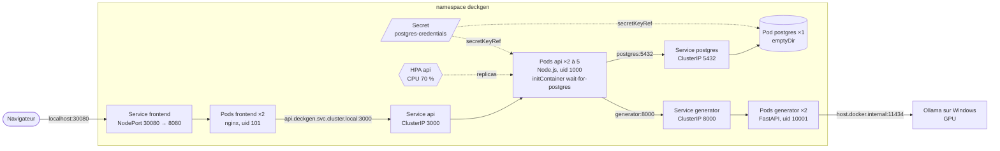

# Kubernetes

deckgen est déployé sur le Kubernetes de Docker Desktop (mode kubeadm, 1 node, v1.36.1). Les
manifestes sont dans [deploy/](../deploy/) : un Deployment et un Service par service, dans le
namespace `deckgen`, plus un HorizontalPodAutoscaler pour l'api. Ollama n'est pas dans le
cluster : il tourne sur Windows et utilise le GPU directement. metrics-server, composant du
cluster nécessaire au HPA et à `kubectl top`, est décrit dans [deploy/cluster/](../deploy/cluster/).
Les mises à jour sans interruption et le retour arrière sont décrits dans
[rolling-update.md](rolling-update.md).

## Ressources

Chaque pod est créé par un Deployment (via un ReplicaSet), non représenté sur le schéma.

## Rôle de chaque objet

| Objet          | Rôle                                                                   |
|----------------|------------------------------------------------------------------------|
| **Namespace**  | Regroupe toutes les ressources de deckgen. `kubectl delete namespace deckgen` supprime tout |
| **Deployment** | Déclare l'état voulu : quelle image, combien de pods, avec quelle configuration. Il crée un ReplicaSet qui maintient ce nombre de pods : un pod supprimé est recréé (mesuré : 2 s pour l'api) |
| **Pod**        | Le conteneur en cours d'exécution. Éphémère : son nom et son IP changent à chaque recréation |
| **Service**    | Adresse stable (IP virtuelle et nom DNS) devant les pods qui portent un label donné. Les autres pods utilisent le Service, jamais l'IP d'un pod |
| **Secret**     | Identifiants PostgreSQL, créés par `kubectl create secret` et injectés dans les pods postgres et api |
| **HorizontalPodAutoscaler** | Ajuste le nombre de pods de l'api (2 à 5) selon leur consommation CPU mesurée par metrics-server |

Les Services ClusterIP (`postgres`, `generator`, `api`) ne sont joignables que depuis le cluster.
Seul le frontend est exposé à l'extérieur, en NodePort.

## Labels et selectors

Chaque ressource porte trois labels, recommandés par la documentation de Kubernetes :

| Label                          | Valeurs                                  | Rôle                        |
|--------------------------------|------------------------------------------|-----------------------------|
| `app.kubernetes.io/name`       | `postgres`, `generator`, `api`, `frontend` | Identifie le service : utilisé par les selectors |
| `app.kubernetes.io/component`  | `database`, `backend`, `frontend`        | Rôle dans l'architecture    |
| `app.kubernetes.io/part-of`    | `deckgen`                                | Application d'ensemble      |

- Le **selector d'un Deployment** désigne les pods qu'il gère. Il doit correspondre aux labels du
  template de pod, et il est **immuable** : le changer oblige à supprimer et recréer le Deployment.
  Il ne contient donc que `app.kubernetes.io/name`, un label qui ne changera jamais.
- Le **selector d'un Service** désigne les pods vers lesquels il envoie le trafic. Les
  EndpointSlices (`kubectl get endpointslices -n deckgen`) montrent les adresses retenues.
- Les deux autres labels servent à filtrer : `kubectl get pods -n deckgen -l app.kubernetes.io/component=backend`.

## Choix techniques

**Secret créé hors de Git.** Les valeurs d'un Secret ne sont qu'encodées en base64, pas
chiffrées : un Secret versionné exposerait le mot de passe. Il est donc créé par
`kubectl create secret generic` avec un mot de passe aléatoire (commande dans
[deploy/README.md](../deploy/README.md)). Les pods lisent chaque clé avec `secretKeyRef`.

**`Recreate` pour PostgreSQL.** La stratégie par défaut, `RollingUpdate`, démarre le nouveau pod
avant d'arrêter l'ancien : pendant quelques secondes, deux PostgreSQL utiliseraient les mêmes
fichiers, ce qui corrompt une base. `Recreate` arrête l'ancien pod avant de créer le nouveau, au
prix d'une courte interruption. Ce sera indispensable avec le volume persistant de l'issue 16.

**NodePort plutôt que LoadBalancer.** Un Service LoadBalancer demande une adresse à un
équilibreur de charge externe, normalement fourni par un cloud. Docker Desktop en simule un sur
`localhost`, mais il utiliserait directement le port du Service (8080), déjà pris par
docker-compose, et ce comportement n'existe pas sur un cluster kubeadm ordinaire. NodePort
ouvre un port fixe (30080, dans la plage 30000-32767) sur le node, que Docker Desktop relaie sur
`localhost` : c'est le mécanisme de base, présent sur tout cluster. Il sera remplacé par un
Ingress à l'issue 17.

**Nom DNS complet pour nginx.** Dans un pod, `/etc/resolv.conf` contient
`search deckgen.svc.cluster.local svc.cluster.local cluster.local` : les outils système
complètent un nom court (`api`) avec ces domaines. La directive `resolver` de nginx, elle,
interroge le DNS avec le nom tel quel, sans domaine de recherche. Vérifié : avec
`API_UPSTREAM=api:3000`, `nslookup api` trouve bien le Service, mais nginx répond 502 avec
« api could not be resolved ». Le frontend utilise donc `api.deckgen.svc.cluster.local:3000`.
L'api, elle, utilise les noms courts (`postgres`, `generator`) : Node.js passe par le résolveur
système, qui applique les domaines de recherche.

**securityContext.** Pour frontend, api et generator :

| Niveau    | Réglage                          | Effet                                                    |
|-----------|----------------------------------|----------------------------------------------------------|
| pod       | `runAsNonRoot: true`             | Kubernetes refuse de démarrer le conteneur s'il tournerait en root |
| pod       | `runAsUser` / `runAsGroup`       | uid de l'image (101, 1000, 10001), imposé même si l'image changeait |
| pod       | `seccompProfile: RuntimeDefault` | Filtre les appels système dangereux (profil par défaut du runtime) |
| conteneur | `allowPrivilegeEscalation: false`| Aucun processus ne peut obtenir plus de droits que son parent (setuid) |
| conteneur | `capabilities.drop: ["ALL"]`     | Retire tous les privilèges Linux particuliers (aucun n'est nécessaire) |

PostgreSQL n'a pas `runAsNonRoot` : son image officielle démarre en root pour préparer le
dossier de données, puis lance PostgreSQL sous l'utilisateur `postgres` (vérifié dans le pod).

**`enableServiceLinks: false`.** Par défaut, Kubernetes injecte dans chaque pod des variables
pour tous les Services du namespace (`POSTGRES_PORT=tcp://10.x.x.x:5432`, `API_PORT=...`),
héritées des « links » de Docker. Ces noms ressemblent à nos variables de configuration et
pourraient les remplacer. Le DNS suffit pour trouver les Services.

**Deployment plutôt que StatefulSet pour PostgreSQL.** Un StatefulSet est l'objet prévu pour les
applications avec état : nom de pod stable (`postgres-0`), un volume persistant par pod créé
automatiquement (`volumeClaimTemplates`), démarrage et arrêt ordonnés, et la garantie qu'un pod
n'est jamais lancé en double. Pour une seule instance sur un seul node, un Deployment à
1 réplica avec `Recreate` donne le même résultat, avec un objet déjà utilisé par les autres
services et plus simple à expliquer. **En production, un StatefulSet serait préférable**, et
indispensable pour plusieurs instances (réplication) : chaque pod garde son identité et son
volume. Plus encore, une base managée (service cloud) ou un opérateur PostgreSQL
(CloudNativePG) gérerait sauvegardes, réplication et bascule.

**Images locales.** Tags précis (`0.1.0`, et `0.1.1` pour l'api, qui contient le verrou des
migrations) et `imagePullPolicy: IfNotPresent` : le cluster utilise l'image déjà présente dans
Docker Desktop au lieu de chercher à la télécharger.

## Résilience et passage à l'échelle

### Réplicas

| Service   | Pods      | Raison                                                                |
|-----------|-----------|-----------------------------------------------------------------------|
| frontend  | 2         | Le site reste disponible pendant qu'un pod est remplacé               |
| api       | 2 à 5     | Géré par le HPA (minimum 2 pour la disponibilité)                     |
| generator | 2         | Même raison ; pas d'autoscaling (voir HPA)                            |
| postgres  | 1         | Une seule instance peut écrire dans ses fichiers (`Recreate`)          |

Le Service répartit les requêtes entre les pods prêts. Vérifié avec le log par requête de l'api
(le nom du pod est dans le champ `hostname`) : sur 20 requêtes, 8 et 12 pour les deux pods.

### Les trois types de probes

Le kubelet exécute les probes dans chaque pod (requête HTTP ou commande) :

| Probe     | Si elle échoue `failureThreshold` fois de suite                    | Sert à                         |
|-----------|--------------------------------------------------------------------|--------------------------------|
| startup   | le conteneur est redémarré ; tant qu'elle n'a pas réussi, les deux autres sont désactivées | laisser le temps de démarrer   |
| liveness  | le conteneur est **redémarré**                                      | relancer un processus bloqué   |
| readiness | le pod est **retiré des endpoints** du Service, sans redémarrage    | ne pas envoyer de trafic à un pod qui ne peut pas répondre |

| Service   | startup                         | liveness                          | readiness                         |
|-----------|---------------------------------|-----------------------------------|-----------------------------------|
| api       | `/health`, 2 s × 30 (60 s)       | `/health`, 10 s, timeout 2 s, × 3 | `/ready`, 5 s, timeout 3 s, × 2   |
| generator | `/health`, 2 s × 15 (30 s)       | `/health`, 10 s, timeout 2 s, × 3 | `/health`, 5 s, timeout 2 s, × 2  |
| frontend  | aucune (nginx démarre en moins d'une seconde) | `/health`, 10 s, timeout 2 s, × 3 | `/health`, 5 s, timeout 2 s, × 2 |
| postgres  | aucune                          | `pg_isready`, délai initial 30 s, 10 s, timeout 5 s, × 6 | `pg_isready`, 5 s, timeout 3 s, × 2 |

Choix des valeurs :

- **startup** : vérifiée souvent (2 s) pour que le pod soit utilisable dès qu'il est prêt, avec
  un nombre d'essais qui laisse une marge large. L'api ne répond qu'après ses migrations ; elle
  démarre en moins d'une seconde aujourd'hui, 60 s couvrent une migration longue.
- **liveness** : 3 échecs à 10 s d'intervalle, soit environ 30 s sans réponse avant un
  redémarrage. Plus court, une lenteur passagère (GC, pic de charge) ferait redémarrer un pod
  sain ; plus long, un processus bloqué resterait en place.
- **readiness** : 2 échecs à 5 s, soit environ 10 s pour retirer un pod du trafic. Retirer un
  pod est sans danger (il revient tout seul) : on réagit plus vite que pour la liveness.
- **timeouts de 2 à 3 s** : `/health` répond en quelques millisecondes ; `/ready` exécute
  `SELECT 1`, un peu plus long.
- **postgres** : `pg_isready -h 127.0.0.1` passe par TCP. Au premier démarrage, l'image lance un
  serveur temporaire sur un socket Unix seulement (initialisation de la base) : il ne doit pas
  être pris pour le vrai. Le délai initial de 30 s de la liveness couvre cette initialisation.

**Aucune liveness ne dépend d'un autre service.** `/health` (api, generator, frontend) répond
sans appeler la base, le generator ou l'api. Si la liveness de l'api testait PostgreSQL, une panne
de la base ferait redémarrer en boucle tous les pods api : cela ne répare rien, ajoute de la charge
au moment du retour de la base, et une panne d'un composant se propagerait à tous ceux qui en
dépendent. La dépendance à la base est vérifiée par la **readiness** (`/ready`) : sans base, le
pod sort du trafic et revient tout seul quand elle répond.

### initContainer wait-for-postgres

Un initContainer s'exécute jusqu'au bout avant le conteneur principal. Celui de l'api lance
`pg_isready -h postgres` toutes les 2 s jusqu'à ce que PostgreSQL accepte les connexions, avec la
même image que le Deployment postgres (aucune image supplémentaire). Résultat : au premier
déploiement, l'api ne démarre plus avant la base et ne redémarre plus (RESTARTS 0, contre 1
avant). Son log montre l'attente : trois « no response » puis « accepting connections ».

Il tourne sous l'uid 70, l'utilisateur `postgres` de l'image : `pg_isready` a besoin d'un nom
d'utilisateur, et l'uid 1000 du pod api n'existe pas dans cette image (mesuré : « no attempt »,
code 3, sans même essayer de se connecter). Il reste non-root, sans capabilities ni élévation de
privilèges.

### Verrou des migrations

Plusieurs pods api peuvent démarrer ensemble (mise à jour, montée en charge, recréation) et
appliquer les migrations en même temps. `runMigrations()` prend d'abord un **verrou consultatif**
PostgreSQL (`pg_advisory_lock`) sur une connexion dédiée : le premier pod l'obtient et applique
les migrations, les autres attendent, puis trouvent les migrations déjà appliquées. Le verrou est
libéré à la fin (`pg_advisory_unlock`), ou automatiquement par PostgreSQL si la connexion est
coupée.

Vérifié sur une base vide, avec 4 migrations lancées en parallèle : sans verrou, 3 échouent
(« duplicate key value violates unique constraint ») ; avec le verrou, les 4 réussissent et une
seule migration est enregistrée.

### Requests et limits

- **request** : ce que le scheduler réserve pour le pod sur un node ; c'est aussi la base du
  calcul du HPA (pourcentage de la request).
- **limit** : le plafond imposé par le noyau (cgroups). Au-delà de sa limite CPU, le conteneur
  est ralenti ; au-delà de sa limite mémoire, il est tué (`OOMKilled`) puis redémarré.

Mesures (`kubectl top pods`, metrics-server) :

| Pod       | Au repos      | Pendant une génération | Sous charge (4 boucles sur `/decks`) |
|-----------|---------------|------------------------|--------------------------------------|
| api       | 1m / 33 Mi    | 4m / 33 Mi             | 800m / 98 Mi                         |
| generator | 3-4m / 41 Mi  | 4m / 41 Mi             | -                                    |
| frontend  | 0m / 18 Mi    | 4m / 18 Mi             | -                                    |
| postgres  | 1m / 106 Mi   | 2m / 106 Mi            | 410m / 115 Mi                        |

Pendant une génération, rien ne bouge : le travail est fait par Ollama sur Windows.

Valeurs choisies :

| Conteneur          | Request CPU / RAM | Limit CPU / RAM | Justification                          |
|--------------------|-------------------|-----------------|----------------------------------------|
| api                | 100m / 128 Mi     | 1 / 256 Mi      | Node.js utilise au plus un cœur ; 98 Mi mesurés sous charge, limite ×2,5 |
| wait-for-postgres  | 10m / 16 Mi       | 100m / 32 Mi    | Une commande `pg_isready` toutes les 2 s |
| generator          | 50m / 96 Mi       | 500m / 256 Mi   | 41 Mi mesurés, marge pour les réponses du modèle |
| frontend           | 25m / 32 Mi       | 500m / 64 Mi    | Fichiers statiques et proxy, très léger |
| postgres           | 500m / 512 Mi     | 500m / 512 Mi   | 410m / 115 Mi sous charge ; requests = limits (QoS Guaranteed) |

Les ressources d'un initContainer comptent aussi : la request du pod est le maximum entre celle
de l'initContainer et la somme de celles des conteneurs.

**Workers nginx.** nginx lance un worker par cœur visible : 22 sur cette machine, alors que sa
limite est d'un demi-cœur. `NGINX_ENTRYPOINT_WORKER_PROCESSES_AUTOTUNE` fait lire la limite CPU
du cgroup à l'image et fixe le nombre de workers à cette limite, arrondie au supérieur. Mesuré :
22 workers avant, **1 par pod** après, et la mémoire du pod passe de 18 Mi à 2 Mi.

### Classes QoS

Kubernetes classe chaque pod selon ses requests et limits ; quand un node manque de mémoire, il
évince d'abord les BestEffort, puis les Burstable, et les Guaranteed en dernier.

| Classe         | Condition                                              | Pods de deckgen        |
|----------------|--------------------------------------------------------|------------------------|
| Guaranteed     | requests = limits, CPU et mémoire, pour tous les conteneurs | postgres            |
| Burstable      | au moins une request, mais pas Guaranteed              | api, generator, frontend |
| BestEffort     | aucune request ni limit                                | aucun                  |

PostgreSQL, seul pod avec état, est le mieux protégé. Les autres peuvent dépasser leur request
jusqu'à leur limite quand le node a de la marge (pic de charge de l'api).
Commande : `kubectl get pods -n deckgen -o custom-columns=POD:.metadata.name,QOS:.status.qosClass`.

### HorizontalPodAutoscaler (api)

Le HPA (`autoscaling/v2`) compare la consommation CPU moyenne des pods api à leur request : cible
70 % de 100m, soit 70m par pod. Toutes les 15 s, il calcule le nombre de pods voulu
(`pods actuels × utilisation actuelle / cible`, arrondi au supérieur, entre 2 et 5) et modifie
le champ `replicas` du Deployment. Pour éviter les oscillations, il ne réduit le nombre de pods
qu'après 5 minutes de charge basse.

**Pas de HPA sur le generator** : chaque génération attend Ollama, qui fait le calcul sur le GPU
de Windows. Le generator consomme 4m CPU pendant une génération : son CPU ne reflète pas la
charge, et plus de pods generator ne génèrent pas plus vite, puisqu'Ollama traite les requêtes
une par une.

**Conflit avec le champ `replicas`.** Le HPA et `kubectl apply` modifient tous deux
`spec.replicas`. Avec `replicas: 2` dans le manifeste, chaque `kubectl apply` remettrait l'api à
2 pods, même si le HPA en avait choisi 5 pour tenir la charge. Le Deployment de l'api n'a donc
**pas** de champ `replicas` : seul le HPA le gère. Conséquence observée : au moment où le champ
est retiré d'un Deployment déjà déployé, `kubectl apply` le remet à sa valeur par défaut (1 pod),
puis le HPA remonte à 2. Pour éviter cette baisse en production, on retire d'abord le champ de la
configuration mémorisée (`kubectl apply edit-last-applied deployment/api`) avant d'appliquer.

**Démonstration.** Un pod de charge appelle `/decks` en boucle sur 4 flux parallèles, directement
sur le Service api :

| Temps                       | CPU moyen (% de la request) | Pods api |
|-----------------------------|-----------------------------|----------|
| départ                      | 1 %                         | 2        |
| +31 s                       | 539 %                       | 4 (le HPA double au plus le nombre de pods à chaque étape) |
| +95 s                       | 278 %                       | 5 (le maximum)                   |
| pod de charge supprimé      | 278 %                       | 5        |
| +98 s                       | 1 %                         | 5 (fenêtre de stabilisation)     |
| +5 min 37 s                 | 1 %                         | 2 (« All metrics below target »)  |

Pendant la charge, `kubectl apply -f deploy/` laisse l'api à 5 pods (`unchanged`) : sans champ
`replicas`, le manifeste ne contredit pas le HPA.

### Résultats des tests de résilience

| Test | Résultat |
|------|----------|
| Redéploiement complet (`delete namespace`, Secret, `apply`) | Tous les pods Ready en 13 s, RESTARTS 0 partout ; l'initContainer de l'api a attendu PostgreSQL environ 6 s |
| Suppression d'un pod api pendant des requêtes toutes les 200 ms | Pod recréé en 2 s ; **57 requêtes sur 57 en HTTP 200** (l'autre pod a pris le trafic) |
| PostgreSQL à 0 réplica | Pods api `0/1` en moins de 10 s (readiness 503), endpoints `ready=false`, nginx répond 502, **RESTARTS inchangé** ; retour de PostgreSQL : pods Ready |
| Processus d'un generator figé (`docker kill --signal=STOP`) | 3 échecs de liveness, « Container generator failed liveness probe, will be restarted », RESTARTS 0 → 1 en 63 s (30 s de détection + 30 s de délai de grâce, un processus figé ne traite pas SIGTERM) |
| Répartition de charge | 20 requêtes : 8 et 12 sur les deux pods api |
| Génération de bout en bout sur http://localhost:30080 | 201 en 26,6 s, 6 cartes (cours Java), export Anki OK |

Deux détails de ces tests :

- `kill -STOP 1` lancé **dans** le conteneur est ignoré : le noyau ne délivre pas SIGSTOP au
  PID 1 d'un namespace depuis ce namespace (mesuré : code 0, processus toujours actif). Le signal
  a donc été envoyé depuis l'extérieur, par Docker, moteur du cluster Docker Desktop.
- Après le test PostgreSQL à 0, la nouvelle base était vide (`emptyDir`) : l'api a répondu 500
  jusqu'à `kubectl rollout restart deployment api`, qui réapplique les migrations.

## Limites provisoires

| Limite                     | Conséquence                                                   | Correction  |
|----------------------------|---------------------------------------------------------------|-------------|
| `emptyDir` pour PostgreSQL | Les données disparaissent quand le pod est supprimé ou recréé (y compris par `Recreate` après une modification). La nouvelle base est vide : l'api répond 500 jusqu'à son redémarrage, qui réapplique les migrations | PVC, issue 16 |
| Configuration en dur       | `OLLAMA_URL`, `OLLAMA_MODEL`, `DB_HOST`... sont dans les Deployments | ConfigMap, issue 15 |
| NodePort                   | Port non standard, un port par service exposé                | Ingress, issue 17 |
| Un seul node               | Les réplicas protègent d'une panne de pod, pas d'une panne de machine : tous les pods sont sur le même node | Cluster multi-node (hors projet) |
| Ollama hors du cluster     | Point unique de défaillance : s'il est arrêté, les générations échouent (503), sans que Kubernetes puisse le relancer | Hors projet (GPU dans le cluster) |
| `--kubelet-insecure-tls`   | metrics-server ne vérifie pas le certificat du kubelet        | Certificats du kubelet signés par le cluster (hors Docker Desktop) |
