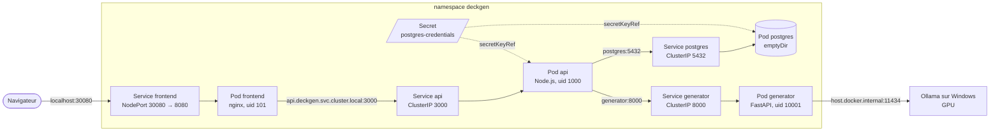

# Kubernetes

deckgen est déployé sur le Kubernetes de Docker Desktop (mode kubeadm, 1 node, v1.36.1). Les
manifestes sont dans [deploy/](../deploy/) : un Deployment et un Service par service, dans le
namespace `deckgen`. Ollama n'est pas dans le cluster : il tourne sur Windows et utilise le GPU
directement.

## Ressources

Chaque pod est créé par un Deployment (via un ReplicaSet), non représenté sur le schéma.

## Rôle de chaque objet

| Objet          | Rôle                                                                   |
|----------------|------------------------------------------------------------------------|
| **Namespace**  | Regroupe toutes les ressources de deckgen. `kubectl delete namespace deckgen` supprime tout |
| **Deployment** | Déclare l'état voulu : quelle image, combien de pods, avec quelle configuration. Il crée un ReplicaSet qui maintient ce nombre de pods : un pod supprimé est recréé (mesuré : 2 s pour l'api) |
| **Pod**        | Le conteneur en cours d'exécution. Éphémère : son nom et son IP changent à chaque recréation |
| **Service**    | Adresse stable (IP virtuelle et nom DNS) devant les pods qui portent un label donné. Les autres pods utilisent le Service, jamais l'IP d'un pod |
| **Secret**     | Identifiants PostgreSQL, créés par `kubectl create secret` et injectés dans les pods postgres et api |

Les Services ClusterIP (`postgres`, `generator`, `api`) ne sont joignables que depuis le cluster.
Seul le frontend est exposé à l'extérieur, en NodePort.

## Labels et selectors

Chaque ressource porte trois labels, recommandés par la documentation de Kubernetes :

| Label                          | Valeurs                                  | Rôle                        |
|--------------------------------|------------------------------------------|-----------------------------|
| `app.kubernetes.io/name`       | `postgres`, `generator`, `api`, `frontend` | Identifie le service : utilisé par les selectors |
| `app.kubernetes.io/component`  | `database`, `backend`, `frontend`        | Rôle dans l'architecture    |
| `app.kubernetes.io/part-of`    | `deckgen`                                | Application d'ensemble      |

- Le **selector d'un Deployment** désigne les pods qu'il gère. Il doit correspondre aux labels du
  template de pod, et il est **immuable** : le changer oblige à supprimer et recréer le Deployment.
  Il ne contient donc que `app.kubernetes.io/name`, un label qui ne changera jamais.
- Le **selector d'un Service** désigne les pods vers lesquels il envoie le trafic. Les
  EndpointSlices (`kubectl get endpointslices -n deckgen`) montrent les adresses retenues.
- Les deux autres labels servent à filtrer : `kubectl get pods -n deckgen -l app.kubernetes.io/component=backend`.

## Choix techniques

**Secret créé hors de Git.** Les valeurs d'un Secret ne sont qu'encodées en base64, pas
chiffrées : un Secret versionné exposerait le mot de passe. Il est donc créé par
`kubectl create secret generic` avec un mot de passe aléatoire (commande dans
[deploy/README.md](../deploy/README.md)). Les pods lisent chaque clé avec `secretKeyRef`.

**`Recreate` pour PostgreSQL.** La stratégie par défaut, `RollingUpdate`, démarre le nouveau pod
avant d'arrêter l'ancien : pendant quelques secondes, deux PostgreSQL utiliseraient les mêmes
fichiers, ce qui corrompt une base. `Recreate` arrête l'ancien pod avant de créer le nouveau, au
prix d'une courte interruption. Ce sera indispensable avec le volume persistant de l'issue 16.

**NodePort plutôt que LoadBalancer.** Un Service LoadBalancer demande une adresse à un
équilibreur de charge externe, normalement fourni par un cloud. Docker Desktop en simule un sur
`localhost`, mais il utiliserait directement le port du Service (8080), déjà pris par
docker-compose, et ce comportement n'existe pas sur un cluster kubeadm ordinaire. NodePort
ouvre un port fixe (30080, dans la plage 30000-32767) sur le node, que Docker Desktop relaie sur
`localhost` : c'est le mécanisme de base, présent sur tout cluster. Il sera remplacé par un
Ingress à l'issue 17.

**Nom DNS complet pour nginx.** Dans un pod, `/etc/resolv.conf` contient
`search deckgen.svc.cluster.local svc.cluster.local cluster.local` : les outils système
complètent un nom court (`api`) avec ces domaines. La directive `resolver` de nginx, elle,
interroge le DNS avec le nom tel quel, sans domaine de recherche. Vérifié : avec
`API_UPSTREAM=api:3000`, `nslookup api` trouve bien le Service, mais nginx répond 502 avec
« api could not be resolved ». Le frontend utilise donc `api.deckgen.svc.cluster.local:3000`.
L'api, elle, utilise les noms courts (`postgres`, `generator`) : Node.js passe par le résolveur
système, qui applique les domaines de recherche.

**securityContext.** Pour frontend, api et generator :

| Niveau    | Réglage                          | Effet                                                    |
|-----------|----------------------------------|----------------------------------------------------------|
| pod       | `runAsNonRoot: true`             | Kubernetes refuse de démarrer le conteneur s'il tournerait en root |
| pod       | `runAsUser` / `runAsGroup`       | uid de l'image (101, 1000, 10001), imposé même si l'image changeait |
| pod       | `seccompProfile: RuntimeDefault` | Filtre les appels système dangereux (profil par défaut du runtime) |
| conteneur | `allowPrivilegeEscalation: false`| Aucun processus ne peut obtenir plus de droits que son parent (setuid) |
| conteneur | `capabilities.drop: ["ALL"]`     | Retire tous les privilèges Linux particuliers (aucun n'est nécessaire) |

PostgreSQL n'a pas `runAsNonRoot` : son image officielle démarre en root pour préparer le
dossier de données, puis lance PostgreSQL sous l'utilisateur `postgres` (vérifié dans le pod).

**`enableServiceLinks: false`.** Par défaut, Kubernetes injecte dans chaque pod des variables
pour tous les Services du namespace (`POSTGRES_PORT=tcp://10.x.x.x:5432`, `API_PORT=...`),
héritées des « links » de Docker. Ces noms ressemblent à nos variables de configuration et
pourraient les remplacer. Le DNS suffit pour trouver les Services.

**Deployment plutôt que StatefulSet pour PostgreSQL.** Un StatefulSet est l'objet prévu pour les
applications avec état : nom de pod stable (`postgres-0`), un volume persistant par pod créé
automatiquement (`volumeClaimTemplates`), démarrage et arrêt ordonnés, et la garantie qu'un pod
n'est jamais lancé en double. Pour une seule instance sur un seul node, un Deployment à
1 réplica avec `Recreate` donne le même résultat, avec un objet déjà utilisé par les autres
services et plus simple à expliquer. **En production, un StatefulSet serait préférable**, et
indispensable pour plusieurs instances (réplication) : chaque pod garde son identité et son
volume. Plus encore, une base managée (service cloud) ou un opérateur PostgreSQL
(CloudNativePG) gérerait sauvegardes, réplication et bascule.

**Images locales.** Tag précis `0.1.0` et `imagePullPolicy: IfNotPresent` : le cluster utilise
l'image déjà présente dans Docker Desktop au lieu de chercher à la télécharger.

## Limites provisoires

| Limite                     | Conséquence                                                   | Correction  |
|----------------------------|---------------------------------------------------------------|-------------|
| `emptyDir` pour PostgreSQL | Les données disparaissent avec le pod (suppression, redémarrage du node) | PVC, issue 16 |
| Pas de probes              | Kubernetes considère un pod prêt dès que son processus démarre, avant que le serveur écoute : le Service peut lui envoyer des requêtes trop tôt, et un processus bloqué n'est pas redémarré. Au premier déploiement, l'api redémarre une fois car PostgreSQL n'est pas encore prêt | Probes, issue 13 |
| Pas de requests/limits     | Le scheduler ne connaît pas les besoins des pods, et un pod peut consommer toute la mémoire du node | Issue 13 |
| Configuration en dur       | `OLLAMA_URL`, `OLLAMA_MODEL`, `DB_HOST`... sont dans les Deployments | ConfigMap, issue 15 |
| NodePort                   | Port non standard, un port par service exposé                | Ingress, issue 17 |
