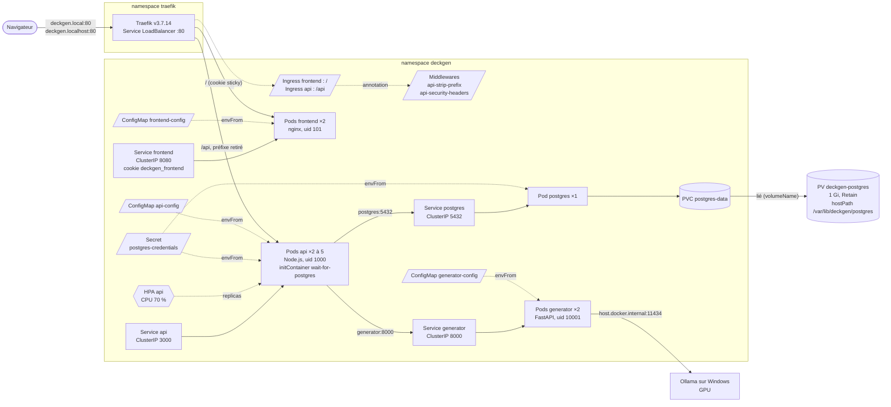

# Kubernetes

deckgen est déployé sur le Kubernetes de Docker Desktop (mode kubeadm, 1 node, v1.36.1). Les
manifestes sont dans [deploy/](../deploy/) : un Deployment et un Service par service, dans le
namespace `deckgen`, plus un HorizontalPodAutoscaler pour l'api. Ollama n'est pas dans le
cluster : il tourne sur Windows et utilise le GPU directement. metrics-server, composant du
cluster nécessaire au HPA et à `kubectl top`, est décrit dans [deploy/cluster/](../deploy/cluster/).
Les mises à jour sans interruption et le retour arrière sont décrits dans
[rolling-update.md](rolling-update.md). Depuis l'issue 19, l'application est déployée par Argo CD
depuis la branche `production` (GitOps) : voir [cd.md](cd.md) et [release.md](release.md). Les
manifestes sont appliqués avec Kustomize (`kubectl apply -k deploy/`,
[deploy/kustomization.yaml](../deploy/kustomization.yaml)).

## Ressources

Chaque pod est créé par un Deployment (via un ReplicaSet), non représenté sur le schéma. Traefik
lit les Services pour connaître les pods, puis leur envoie les requêtes directement.

## Rôle de chaque objet

| Objet          | Rôle                                                                   |
|----------------|------------------------------------------------------------------------|
| **Namespace**  | Regroupe toutes les ressources de deckgen. `kubectl delete namespace deckgen` supprime tout |
| **Deployment** | Déclare l'état voulu : quelle image, combien de pods, avec quelle configuration. Il crée un ReplicaSet qui maintient ce nombre de pods : un pod supprimé est recréé (mesuré : 2 s pour l'api) |
| **Pod**        | Le conteneur en cours d'exécution. Éphémère : son nom et son IP changent à chaque recréation |
| **Service**    | Adresse stable (IP virtuelle et nom DNS) devant les pods qui portent un label donné. Les autres pods utilisent le Service, jamais l'IP d'un pod |
| **ConfigMap**  | Configuration non sensible d'un service (adresses, délais, modèle), injectée en variables d'environnement |
| **Secret**     | Identifiants PostgreSQL, créés par `kubectl create secret` et injectés dans les pods postgres et api |
| **HorizontalPodAutoscaler** | Ajuste le nombre de pods de l'api (2 à 5) selon leur consommation CPU mesurée par metrics-server |
| **PersistentVolume** | Un espace de stockage réel du cluster (ici, un dossier du node). Ressource du cluster, sans namespace |
| **PersistentVolumeClaim** | La demande de stockage d'une application (« 1 Gi en lecture-écriture »), liée à un PersistentVolume. Le pod utilise la claim, sans connaître le stockage réel |
| **Ingress** | Règles de routage HTTP (nom d'hôte, chemin → Service), lues par un contrôleur Ingress |
| **IngressClass** | Désigne le contrôleur chargé d'un Ingress (`traefik`) |
| **Middleware** (CRD de Traefik) | Traitement appliqué à une route par Traefik : retrait du préfixe `/api`, en-têtes de sécurité |

Tous les Services sont en ClusterIP : ils ne sont joignables que depuis le cluster. Le seul point
d'entrée est Traefik (Service LoadBalancer sur le port 80), qui applique les règles des Ingress.

## Labels et selectors

Chaque ressource porte trois labels, recommandés par la documentation de Kubernetes :

| Label                          | Valeurs                                  | Rôle                        |
|--------------------------------|------------------------------------------|-----------------------------|
| `app.kubernetes.io/name`       | `postgres`, `generator`, `api`, `frontend` | Identifie le service : utilisé par les selectors |
| `app.kubernetes.io/component`  | `database`, `backend`, `frontend`        | Rôle dans l'architecture    |
| `app.kubernetes.io/part-of`    | `deckgen`                                | Application d'ensemble      |

- Le **selector d'un Deployment** désigne les pods qu'il gère. Il doit correspondre aux labels du
  template de pod, et il est **immuable** : le changer oblige à supprimer et recréer le Deployment.
  Il ne contient donc que `app.kubernetes.io/name`, un label qui ne changera jamais.
- Le **selector d'un Service** désigne les pods vers lesquels il envoie le trafic. Les
  EndpointSlices (`kubectl get endpointslices -n deckgen`) montrent les adresses retenues.
- Les deux autres labels servent à filtrer : `kubectl get pods -n deckgen -l app.kubernetes.io/component=backend`.

## Choix techniques

**Secret créé hors de Git.** Les valeurs d'un Secret ne sont qu'encodées en base64, pas
chiffrées : un Secret versionné exposerait le mot de passe. Il est donc créé par
`kubectl create secret generic` avec un mot de passe aléatoire (commande dans
[deploy/README.md](../deploy/README.md)). Les pods le lisent avec `envFrom` (voir
« Configuration et secrets »).

**`Recreate` pour PostgreSQL.** La stratégie par défaut, `RollingUpdate`, démarre le nouveau pod
avant d'arrêter l'ancien : pendant quelques secondes, deux PostgreSQL utiliseraient les mêmes
fichiers, ce qui corrompt une base. `Recreate` arrête l'ancien pod avant de créer le nouveau, au
prix d'une courte interruption. C'est indispensable avec le volume persistant (voir
« Persistance des données »).

**Exposition : du NodePort à l'Ingress.** Jusqu'à l'issue 17, le frontend était un Service
NodePort : un port fixe du node (dans la plage 30000-32767), que Docker Desktop relayait sur
`localhost`. C'est le mécanisme de base, présent sur tout cluster, mais avec un port non standard
et un port par service exposé. Un Service LoadBalancer demande une adresse à un équilibreur de
charge externe, normalement fourni par un cloud ; Docker Desktop en simule un sur `localhost`.
L'application est maintenant exposée par un **Ingress** (section « Ingress ») : un seul
LoadBalancer, celui de Traefik sur le port 80, route vers tous les services selon le nom d'hôte
et le chemin. Le Service frontend est repassé en ClusterIP.

**Nom DNS complet pour nginx.** Dans un pod, `/etc/resolv.conf` contient
`search deckgen.svc.cluster.local svc.cluster.local cluster.local` : les outils système
complètent un nom court (`api`) avec ces domaines. La directive `resolver` de nginx, elle,
interroge le DNS avec le nom tel quel, sans domaine de recherche. Vérifié : avec
`API_UPSTREAM=api:3000`, `nslookup api` trouve bien le Service, mais nginx répond 502 avec
« api could not be resolved ». Le frontend utilise donc `api.deckgen.svc.cluster.local:3000`.
L'api, elle, utilise les noms courts (`postgres`, `generator`) : Node.js passe par le résolveur
système, qui applique les domaines de recherche.

**securityContext.** Pour frontend, api et generator :

| Niveau    | Réglage                          | Effet                                                    |
|-----------|----------------------------------|----------------------------------------------------------|
| pod       | `runAsNonRoot: true`             | Kubernetes refuse de démarrer le conteneur s'il tournerait en root |
| pod       | `runAsUser` / `runAsGroup`       | uid de l'image (101, 1000, 10001), imposé même si l'image changeait |
| pod       | `seccompProfile: RuntimeDefault` | Filtre les appels système dangereux (profil par défaut du runtime) |
| conteneur | `allowPrivilegeEscalation: false`| Aucun processus ne peut obtenir plus de droits que son parent (setuid) |
| conteneur | `capabilities.drop: ["ALL"]`     | Retire tous les privilèges Linux particuliers (aucun n'est nécessaire) |

PostgreSQL n'a pas `runAsNonRoot` : son image officielle démarre en root pour préparer le
dossier de données, puis lance PostgreSQL sous l'utilisateur `postgres` (vérifié dans le pod).

**`enableServiceLinks: false`.** Par défaut, Kubernetes injecte dans chaque pod des variables
pour tous les Services du namespace (`POSTGRES_PORT=tcp://10.x.x.x:5432`, `API_PORT=...`),
héritées des « links » de Docker. Ces noms ressemblent à nos variables de configuration et
pourraient les remplacer. Le DNS suffit pour trouver les Services.

**Deployment plutôt que StatefulSet pour PostgreSQL.** Un StatefulSet est l'objet prévu pour les
applications avec état : nom de pod stable (`postgres-0`), un volume persistant par pod créé
automatiquement (`volumeClaimTemplates`), démarrage et arrêt ordonnés, et la garantie qu'un pod
n'est jamais lancé en double. Pour une seule instance sur un seul node, un Deployment à
1 réplica avec `Recreate` donne le même résultat, avec un objet déjà utilisé par les autres
services et plus simple à expliquer. **En production, un StatefulSet serait préférable**, et
indispensable pour plusieurs instances (réplication) : chaque pod garde son identité et son
volume. Plus encore, une base managée (service cloud) ou un opérateur PostgreSQL
(CloudNativePG) gérerait sauvegardes, réplication et bascule.

**Images locales.** Tags précis (`0.1.0`, et `0.1.1` pour l'api, qui contient le verrou des
migrations) et `imagePullPolicy: IfNotPresent` : le cluster utilise l'image déjà présente dans
Docker Desktop au lieu de chercher à la télécharger.

## Résilience et passage à l'échelle

### Réplicas

| Service   | Pods      | Raison                                                                |
|-----------|-----------|-----------------------------------------------------------------------|
| frontend  | 2         | Le site reste disponible pendant qu'un pod est remplacé               |
| api       | 2 à 5     | Géré par le HPA (minimum 2 pour la disponibilité)                     |
| generator | 2         | Même raison ; pas d'autoscaling (voir HPA)                            |
| postgres  | 1         | Une seule instance peut écrire dans ses fichiers (`Recreate`)          |

Le Service répartit les requêtes entre les pods prêts. Vérifié avec le log par requête de l'api
(le nom du pod est dans le champ `hostname`) : sur 20 requêtes, 8 et 12 pour les deux pods.

### Les trois types de probes

Le kubelet exécute les probes dans chaque pod (requête HTTP ou commande) :

| Probe     | Si elle échoue `failureThreshold` fois de suite                    | Sert à                         |
|-----------|--------------------------------------------------------------------|--------------------------------|
| startup   | le conteneur est redémarré ; tant qu'elle n'a pas réussi, les deux autres sont désactivées | laisser le temps de démarrer   |
| liveness  | le conteneur est **redémarré**                                      | relancer un processus bloqué   |
| readiness | le pod est **retiré des endpoints** du Service, sans redémarrage    | ne pas envoyer de trafic à un pod qui ne peut pas répondre |

| Service   | startup                         | liveness                          | readiness                         |
|-----------|---------------------------------|-----------------------------------|-----------------------------------|
| api       | `/health`, 2 s × 30 (60 s)       | `/health`, 10 s, timeout 2 s, × 3 | `/ready`, 5 s, timeout 3 s, × 2   |
| generator | `/health`, 2 s × 15 (30 s)       | `/health`, 10 s, timeout 2 s, × 3 | `/health`, 5 s, timeout 2 s, × 2  |
| frontend  | aucune (nginx démarre en moins d'une seconde) | `/health`, 10 s, timeout 2 s, × 3 | `/health`, 5 s, timeout 2 s, × 2 |
| postgres  | aucune                          | `pg_isready`, délai initial 30 s, 10 s, timeout 5 s, × 6 | `pg_isready`, 5 s, timeout 3 s, × 2 |

Choix des valeurs :

- **startup** : vérifiée souvent (2 s) pour que le pod soit utilisable dès qu'il est prêt, avec
  un nombre d'essais qui laisse une marge large. L'api ne répond qu'après ses migrations ; elle
  démarre en moins d'une seconde aujourd'hui, 60 s couvrent une migration longue.
- **liveness** : 3 échecs à 10 s d'intervalle, soit environ 30 s sans réponse avant un
  redémarrage. Plus court, une lenteur passagère (GC, pic de charge) ferait redémarrer un pod
  sain ; plus long, un processus bloqué resterait en place.
- **readiness** : 2 échecs à 5 s, soit environ 10 s pour retirer un pod du trafic. Retirer un
  pod est sans danger (il revient tout seul) : on réagit plus vite que pour la liveness.
- **timeouts de 2 à 3 s** : `/health` répond en quelques millisecondes ; `/ready` exécute
  `SELECT 1`, un peu plus long.
- **postgres** : `pg_isready -h 127.0.0.1` passe par TCP. Au premier démarrage, l'image lance un
  serveur temporaire sur un socket Unix seulement (initialisation de la base) : il ne doit pas
  être pris pour le vrai. Le délai initial de 30 s de la liveness couvre cette initialisation.

**Aucune liveness ne dépend d'un autre service.** `/health` (api, generator, frontend) répond
sans appeler la base, le generator ou l'api. Si la liveness de l'api testait PostgreSQL, une panne
de la base ferait redémarrer en boucle tous les pods api : cela ne répare rien, ajoute de la charge
au moment du retour de la base, et une panne d'un composant se propagerait à tous ceux qui en
dépendent. La dépendance à la base est vérifiée par la **readiness** (`/ready`) : sans base, le
pod sort du trafic et revient tout seul quand elle répond.

### initContainer wait-for-postgres

Un initContainer s'exécute jusqu'au bout avant le conteneur principal. Celui de l'api lance
`pg_isready -h postgres` toutes les 2 s jusqu'à ce que PostgreSQL accepte les connexions, avec la
même image que le Deployment postgres (aucune image supplémentaire). Résultat : au premier
déploiement, l'api ne démarre plus avant la base et ne redémarre plus (RESTARTS 0, contre 1
avant). Son log montre l'attente : trois « no response » puis « accepting connections ».

Il tourne sous l'uid 70, l'utilisateur `postgres` de l'image : `pg_isready` a besoin d'un nom
d'utilisateur, et l'uid 1000 du pod api n'existe pas dans cette image (mesuré : « no attempt »,
code 3, sans même essayer de se connecter). Il reste non-root, sans capabilities ni élévation de
privilèges.

### Verrou des migrations

Plusieurs pods api peuvent démarrer ensemble (mise à jour, montée en charge, recréation) et
appliquer les migrations en même temps. `runMigrations()` prend d'abord un **verrou consultatif**
PostgreSQL (`pg_advisory_lock`) sur une connexion dédiée : le premier pod l'obtient et applique
les migrations, les autres attendent, puis trouvent les migrations déjà appliquées. Le verrou est
libéré à la fin (`pg_advisory_unlock`), ou automatiquement par PostgreSQL si la connexion est
coupée.

Vérifié sur une base vide, avec 4 migrations lancées en parallèle : sans verrou, 3 échouent
(« duplicate key value violates unique constraint ») ; avec le verrou, les 4 réussissent et une
seule migration est enregistrée.

### Requests et limits

- **request** : ce que le scheduler réserve pour le pod sur un node ; c'est aussi la base du
  calcul du HPA (pourcentage de la request).
- **limit** : le plafond imposé par le noyau (cgroups). Au-delà de sa limite CPU, le conteneur
  est ralenti ; au-delà de sa limite mémoire, il est tué (`OOMKilled`) puis redémarré.

Mesures (`kubectl top pods`, metrics-server) :

| Pod       | Au repos      | Pendant une génération | Sous charge (4 boucles sur `/decks`) |
|-----------|---------------|------------------------|--------------------------------------|
| api       | 1m / 33 Mi    | 4m / 33 Mi             | 800m / 98 Mi                         |
| generator | 3-4m / 41 Mi  | 4m / 41 Mi             | -                                    |
| frontend  | 0m / 18 Mi    | 4m / 18 Mi             | -                                    |
| postgres  | 1m / 106 Mi   | 2m / 106 Mi            | 410m / 115 Mi                        |

Pendant une génération, rien ne bouge : le travail est fait par Ollama sur Windows.

Valeurs choisies :

| Conteneur          | Request CPU / RAM | Limit CPU / RAM | Justification                          |
|--------------------|-------------------|-----------------|----------------------------------------|
| api                | 100m / 128 Mi     | 1 / 256 Mi      | Node.js utilise au plus un cœur ; 98 Mi mesurés sous charge, limite ×2,5 |
| wait-for-postgres  | 10m / 16 Mi       | 100m / 32 Mi    | Une commande `pg_isready` toutes les 2 s |
| generator          | 50m / 96 Mi       | 500m / 256 Mi   | 41 Mi mesurés, marge pour les réponses du modèle |
| frontend           | 25m / 32 Mi       | 500m / 64 Mi    | Fichiers statiques et proxy, très léger |
| postgres           | 500m / 512 Mi     | 500m / 512 Mi   | 410m / 115 Mi sous charge ; requests = limits (QoS Guaranteed) |

Les ressources d'un initContainer comptent aussi : la request du pod est le maximum entre celle
de l'initContainer et la somme de celles des conteneurs.

**Workers nginx.** nginx lance un worker par cœur visible : 22 sur cette machine, alors que sa
limite est d'un demi-cœur. `NGINX_ENTRYPOINT_WORKER_PROCESSES_AUTOTUNE` fait lire la limite CPU
du cgroup à l'image et fixe le nombre de workers à cette limite, arrondie au supérieur. Mesuré :
22 workers avant, **1 par pod** après, et la mémoire du pod passe de 18 Mi à 2 Mi.

### Classes QoS

Kubernetes classe chaque pod selon ses requests et limits ; quand un node manque de mémoire, il
évince d'abord les BestEffort, puis les Burstable, et les Guaranteed en dernier.

| Classe         | Condition                                              | Pods de deckgen        |
|----------------|--------------------------------------------------------|------------------------|
| Guaranteed     | requests = limits, CPU et mémoire, pour tous les conteneurs | postgres            |
| Burstable      | au moins une request, mais pas Guaranteed              | api, generator, frontend |
| BestEffort     | aucune request ni limit                                | aucun                  |

PostgreSQL, seul pod avec état, est le mieux protégé. Les autres peuvent dépasser leur request
jusqu'à leur limite quand le node a de la marge (pic de charge de l'api).
Commande : `kubectl get pods -n deckgen -o custom-columns=POD:.metadata.name,QOS:.status.qosClass`.

### HorizontalPodAutoscaler (api)

Le HPA (`autoscaling/v2`) compare la consommation CPU moyenne des pods api à leur request : cible
70 % de 100m, soit 70m par pod. Toutes les 15 s, il calcule le nombre de pods voulu
(`pods actuels × utilisation actuelle / cible`, arrondi au supérieur, entre 2 et 5) et modifie
le champ `replicas` du Deployment. Pour éviter les oscillations, il ne réduit le nombre de pods
qu'après 5 minutes de charge basse.

**Pas de HPA sur le generator** : chaque génération attend Ollama, qui fait le calcul sur le GPU
de Windows. Le generator consomme 4m CPU pendant une génération : son CPU ne reflète pas la
charge, et plus de pods generator ne génèrent pas plus vite, puisqu'Ollama traite les requêtes
une par une.

**Conflit avec le champ `replicas`.** Le HPA et `kubectl apply` modifient tous deux
`spec.replicas`. Avec `replicas: 2` dans le manifeste, chaque `kubectl apply` remettrait l'api à
2 pods, même si le HPA en avait choisi 5 pour tenir la charge. Le Deployment de l'api n'a donc
**pas** de champ `replicas` : seul le HPA le gère. Conséquence observée : au moment où le champ
est retiré d'un Deployment déjà déployé, `kubectl apply` le remet à sa valeur par défaut (1 pod),
puis le HPA remonte à 2. Pour éviter cette baisse en production, on retire d'abord le champ de la
configuration mémorisée (`kubectl apply edit-last-applied deployment/api`) avant d'appliquer.

**Démonstration.** Un pod de charge appelle `/decks` en boucle sur 4 flux parallèles, directement
sur le Service api :

| Temps                       | CPU moyen (% de la request) | Pods api |
|-----------------------------|-----------------------------|----------|
| départ                      | 1 %                         | 2        |
| +31 s                       | 539 %                       | 4 (le HPA double au plus le nombre de pods à chaque étape) |
| +95 s                       | 278 %                       | 5 (le maximum)                   |
| pod de charge supprimé      | 278 %                       | 5        |
| +98 s                       | 1 %                         | 5 (fenêtre de stabilisation)     |
| +5 min 37 s                 | 1 %                         | 2 (« All metrics below target »)  |

Pendant la charge, `kubectl apply -f deploy/` (aujourd'hui `-k`) laisse l'api à 5 pods (`unchanged`) : sans champ
`replicas`, le manifeste ne contredit pas le HPA.

### Résultats des tests de résilience

| Test | Résultat |
|------|----------|
| Redéploiement complet (`delete namespace`, Secret, `apply`) | Tous les pods Ready en 13 s, RESTARTS 0 partout ; l'initContainer de l'api a attendu PostgreSQL environ 6 s |
| Suppression d'un pod api pendant des requêtes toutes les 200 ms | Pod recréé en 2 s ; **57 requêtes sur 57 en HTTP 200** (l'autre pod a pris le trafic) |
| PostgreSQL à 0 réplica | Pods api `0/1` en moins de 10 s (readiness 503), endpoints `ready=false`, nginx répond 502, **RESTARTS inchangé** ; retour de PostgreSQL : pods Ready |
| Processus d'un generator figé (`docker kill --signal=STOP`) | 3 échecs de liveness, « Container generator failed liveness probe, will be restarted », RESTARTS 0 → 1 en 63 s (30 s de détection + 30 s de délai de grâce, un processus figé ne traite pas SIGTERM) |
| Répartition de charge | 20 requêtes : 8 et 12 sur les deux pods api |
| Génération de bout en bout (par le NodePort de l'époque) | 201 en 26,6 s, 6 cartes (cours Java), export Anki OK |

Deux détails de ces tests :

- `kill -STOP 1` lancé **dans** le conteneur est ignoré : le noyau ne délivre pas SIGSTOP au
  PID 1 d'un namespace depuis ce namespace (mesuré : code 0, processus toujours actif). Le signal
  a donc été envoyé depuis l'extérieur, par Docker, moteur du cluster Docker Desktop.
- Après le test PostgreSQL à 0, la nouvelle base était vide (stockage `emptyDir` à l'époque) :
  l'api a répondu 500 jusqu'à `kubectl rollout restart deployment api`, qui réapplique les
  migrations. Corrigé depuis par le volume persistant (section suivante).

## Persistance des données

Avant, PostgreSQL écrivait dans un `emptyDir`, un dossier créé avec le pod et supprimé avec lui :
chaque recréation du pod repartait d'une base vide, et l'api répondait 500 (tables absentes)
jusqu'à son redémarrage. Ses données sont maintenant sur un **PersistentVolume**
([deploy/postgres-storage.yaml](../deploy/postgres-storage.yaml)).

### PersistentVolume, PersistentVolumeClaim et liaison

Kubernetes sépare deux rôles :

- le **PersistentVolume** (PV) `deckgen-postgres` décrit un stockage réel : 1 Gi, un dossier du
  node (`hostPath` `/var/lib/deckgen/postgres`, créé s'il n'existe pas grâce à
  `DirectoryOrCreate`). C'est une ressource du **cluster**, sans namespace, comme un disque que
  l'administrateur met à disposition ;
- la **PersistentVolumeClaim** (PVC) `postgres-data`, dans le namespace `deckgen`, exprime le
  besoin de l'application : 1 Gi en `ReadWriteOnce`. Le pod postgres monte la claim, sans savoir
  où sont les données.

La **liaison** (binding) associe une claim à un PV compatible (taille, mode d'accès, classe). Elle
est exclusive : un PV lié à une claim n'est donné à aucune autre. Ici, elle est explicite : la claim
désigne son volume (`volumeName: deckgen-postgres`), et les deux portent la même
`storageClassName: deckgen-manual`. Cette classe ne correspond à aucune StorageClass réelle : elle
empêche une autre claim de prendre ce PV, et empêche la StorageClass par défaut de Docker Desktop
(`hostpath`) de créer un autre volume pour notre claim.

Le dossier est sous `/var/lib` : sur le node Docker Desktop, c'est le seul dossier stocké sur le
disque virtuel persistant (`/dev/sdd`, fichier `docker_data.vhdx` côté Windows). Le reste du
système de fichiers du node est en mémoire et disparaît à chaque redémarrage de Docker Desktop :
un PV dans `/data/deckgen` aurait semblé fonctionner, puis tout perdu.

### ReadWriteOnce et `Recreate`

`ReadWriteOnce` signifie : monté en lecture-écriture par **un seul node** à la fois. Avec la
stratégie `RollingUpdate`, le nouveau pod postgres démarre avant l'arrêt de l'ancien :

- sur un cluster de plusieurs nodes, s'il est placé sur un autre node, il ne peut pas monter le
  volume et reste bloqué, pendant que l'ancien pod attend un remplaçant prêt : la mise à jour ne
  se termine jamais ;
- sur notre node unique, `ReadWriteOnce` n'empêche pas deux pods de monter le volume en même
  temps : deux PostgreSQL écriraient dans les mêmes fichiers et corrompraient la base.

`Recreate` arrête l'ancien pod avant de créer le nouveau : un seul PostgreSQL à la fois sur ces
données. Le mode `ReadWriteOncePod` (un seul **pod**) ajouterait cette garantie au niveau du
volume, mais la consigne demande `ReadWriteOnce`.

### Retain contre Delete

La politique de récupération (`persistentVolumeReclaimPolicy`) décide du sort du PV quand sa claim
est supprimée :

| Politique | Quand la claim est supprimée                                       | Usage                     |
|-----------|--------------------------------------------------------------------|---------------------------|
| `Delete`  | le volume et ses données sont supprimés                            | défaut des StorageClass, données jetables |
| `Retain`  | le PV et ses données restent, à l'état `Released`                  | données à protéger (choix ici) |

Un PV `Released` ne se relie pas tout seul à une nouvelle claim : il garde dans `spec.claimRef`
l'identifiant (uid) de l'ancienne. Kubernetes ne donne pas d'office les données d'une claim
supprimée à une autre : l'administrateur décide, en retirant le `claimRef` (procédure dans
[deploy/README.md](../deploy/README.md)).

### Provisionnement statique contre dynamique

- **Statique** (choix du projet, exigé par la consigne) : l'administrateur crée le PV à la main,
  puis l'application le réclame. Simple à comprendre, mais il faut un PV par besoin, et
  `hostPath` lie les données à un node précis.
- **Dynamique** (ce qu'on ferait en production) : la claim désigne une **StorageClass**, et son
  provisionneur crée automatiquement un volume de la bonne taille (disque cloud EBS, Azure Disk,
  Ceph...), indépendant des nodes : un pod déplacé retrouve son volume. Docker Desktop en fournit
  une (`hostpath`, politique `Delete`).

### StatefulSet pour une vraie base

Un StatefulSet avec `volumeClaimTemplates` créerait automatiquement une claim par pod
(`data-postgres-0`), garderait le lien entre un pod et son volume, et garantirait qu'un pod n'est
jamais lancé en double. Pour une base répliquée (plusieurs instances), c'est indispensable : chaque
instance a son identité et ses données. Pour une instance unique, le Deployment à 1 réplica avec
`Recreate` et une claim explicite donne le même résultat ici. Voir aussi
« Deployment plutôt que StatefulSet » plus haut.

### Résultats des tests de persistance

| Test | Résultat |
|------|----------|
| `kubectl apply -f deploy/` (aujourd'hui `-k`) | PV `deckgen-postgres` et PVC `postgres-data` créés, PVC **Bound** sur le PV, pod postgres monté sur `postgres-data` |
| Suppression du pod postgres | Pod recréé ; log « Database directory appears to contain a database; Skipping initialization » ; deck et ses 5 cartes intacts ; `/api/decks` en 200 **sans redémarrer l'api** (RESTARTS 0 inchangé) |
| `kubectl delete namespace deckgen` | PV toujours présent, état **Released**, `claimRef` sur l'uid de l'ancienne claim ; données sur le node (62,9 Mo dans `/var/lib/deckgen/postgres/18/docker`) |
| Redéploiement sans action sur le PV | Nouvelle PVC **Pending** (« volume "deckgen-postgres" already bound to a different claim »), pod postgres `Pending` |
| Retrait du `claimRef` | PV `Available`, puis **Bound** sur la nouvelle claim ; PostgreSQL retrouve la base, l'api s'y connecte (Secret recréé avec les mêmes identifiants) ; le deck d'avant est là, date de création d'origine |
| Génération de bout en bout | 201, 10 cartes (cours Java) en 18 s, export OK |

Une seule fois, au passage de `emptyDir` au volume, la base était neuve : l'api a été relancée pour
créer les tables. Le premier appel de génération après un redémarrage du PC a pris plus de 120 s
(chargement du modèle par Ollama, mis à jour automatiquement de 0.40.3 à 0.40.4) : 504, puis 5,6 s
pour l'appel suivant.

**Piège du Secret.** PostgreSQL ne lit `POSTGRES_PASSWORD` qu'à l'initialisation d'un dossier vide.
Une fois les données persistantes, un Secret recréé avec un nouveau mot de passe ne change pas
celui de la base : l'api serait refusée. Il faut recréer le Secret avec les mêmes identifiants
(gardés avant la suppression du namespace), ou redéfinir le mot de passe dans la base
(`ALTER USER`, par une connexion locale au pod, sans mot de passe). Procédures dans
[deploy/README.md](../deploy/README.md).

## Configuration et secrets

Consigne : « ConfigMap pour les configurations non sensibles, Secret pour les mots de passe ;
aucun secret en clair dans Git ni dans l'image Docker ».

### ConfigMap contre Secret

| | ConfigMap | Secret |
|-|-----------|--------|
| Contenu | configuration non sensible : adresses, délais, modèle, niveau de logs | mots de passe, clés, jetons |
| Dans Git | oui, dans le fichier du service (`generator-config`, `api-config`, `frontend-config`) | **non** : créé par `kubectl create secret`, seul un modèle à valeurs factices est versionné |
| Stockage | en clair dans etcd | encodé en **base64** dans etcd |
| Affichage | `kubectl get configmap -o yaml` montre les valeurs | `kubectl describe` masque les valeurs (seulement leur taille) |

**base64 n'est pas du chiffrement.** C'est un simple encodage, réversible sans clé :
`[Convert]::FromBase64String(...)` redonne le mot de passe. Il permet de stocker des valeurs
binaires, pas de les protéger. La protection d'un Secret vient de ce qui l'entoure : il n'est pas
dans Git, les droits d'accès Kubernetes (RBAC) peuvent le réserver à certains utilisateurs, et
etcd peut le chiffrer (voir « En production »).

Toute la configuration est maintenant dans les ConfigMaps : les Deployments ne contiennent plus
aucune valeur de configuration, seulement des références. Les valeurs sont celles d'avant (les
défauts de `OLLAMA_TIMEOUT`, `OLLAMA_NUM_CTX`, `DB_PORT`, `GENERATOR_TIMEOUT_MS` et `LOG_LEVEL`
sont écrits explicitement) : le comportement est identique, vérifié dans les pods avec `env`.

### envFrom contre env + configMapKeyRef

| | `envFrom` (choix du projet) | `env` + `configMapKeyRef` / `secretKeyRef` |
|-|------------------------------|---------------------------------------------|
| Écriture | une ligne par ConfigMap ou Secret | un bloc de 5 lignes par variable |
| Variables injectées | **toutes** les clés, sous leur nom | seulement celles listées, renommables |
| Ajouter une variable | l'ajouter au ConfigMap | l'ajouter au ConfigMap **et** au Deployment |
| Risque | une clé ajoutée par erreur est injectée aussi | aucun : la liste est explicite |

Chaque ConfigMap ne contient que les variables de son service, et le Secret exactement les trois
clés attendues (`POSTGRES_DB`, `POSTGRES_PASSWORD`, `POSTGRES_USER`, vérifié) : `envFrom`
n'injecte rien d'inattendu. Si une même variable venait de deux sources, `env` l'emporterait sur
`envFrom`, et la dernière source de `envFrom` sur les précédentes.

`kubectl describe pod` ne montre que les références (« Environment Variables from:
api-config ConfigMap, postgres-credentials Secret »), jamais les valeurs du Secret.

### Mise à jour d'un ConfigMap

Les variables d'environnement sont lues par le processus **au démarrage** du conteneur. Modifier un
ConfigMap ne change donc rien aux pods en cours ; seuls les pods créés ensuite voient la nouvelle
valeur. Démonstration avec `OLLAMA_MODEL` :

| Étape | Résultat |
|-------|----------|
| `OLLAMA_MODEL: gemma4:latest` dans le ConfigMap, `kubectl apply` | « configmap/generator-config configured », « deployment.apps/generator unchanged » |
| Pods en cours | `printenv OLLAMA_MODEL` : `gemma3:4b` ; génération : log `model=gemma3:4b`, 16,6 s |
| `kubectl rollout restart deployment/generator` | nouveaux pods : `printenv OLLAMA_MODEL` : `gemma4:latest` |
| Génération | log `model=gemma4:latest`, 201 en 96 s (modèle de 9,5 Go, 67 % sur CPU : il ne tient pas dans les 6 Go du GPU) |
| Retour à `gemma3:4b` (fichier, apply, rollout restart) | pods en `gemma3:4b`, `kubectl apply --dry-run` : tout `unchanged` |

`rollout restart` ajoute une annotation de date au template des pods : le Deployment fait un
rolling update, sans interruption. Deux alternatives déclenchent ce redémarrage automatiquement :

- **annotation de checksum** : le template des pods porte une empreinte du contenu du ConfigMap
  (`checksum/config: <sha256>`). Modifier le ConfigMap change l'empreinte, donc le template, donc
  déclenche un rolling update. C'est la pratique des charts Helm, mais il faut un outil pour
  calculer l'empreinte : à la main, on l'oublierait ;
- **ConfigMap immuable à nom versionné** : `generator-config-v2` avec `immutable: true`, et le
  Deployment qui pointe vers ce nouveau nom. Changer de nom modifie le template (rolling update),
  l'ancien ConfigMap permet un `rollout undo` cohérent, et `immutable` protège d'une modification
  accidentelle. Kustomize le fait automatiquement (`configMapGenerator`, suffixe de hash).

Sans Helm ni Kustomize, `kubectl rollout restart` est la méthode la plus simple et la plus lisible.

### Preuves : aucun secret en clair dans Git ni dans les images

| Vérification | Méthode | Résultat |
|--------------|---------|----------|
| Dépôt | Mot de passe lu depuis le Secret dans une variable (jamais affiché), recherche exacte avec ripgrep dans les 121 fichiers du dépôt (règles `.gitignore`, fichiers cachés compris), puis dans tout le dossier y compris les fichiers ignorés ; témoin : `deckgen-manual` trouvé dans 2 fichiers | **0 fichier** |
| Modèle du Secret | `postgres-credentials.yaml.example`, valeurs factices, non appliqué (dry-run : aucun Secret) | aucune vraie valeur |
| Variables des images | `docker image inspect` (`Config.Env`) des 3 images déployées | aucune variable de mot de passe (`GPG_KEY` du generator est l'identifiant public de la clé qui signe Python, hérité de l'image officielle) |
| Construction des images | `docker history --no-trunc` (un `ARG` ou `ENV` y resterait visible) | aucune mention de mot de passe |
| Fichiers des images | `find / -name ".env*"`, et recherche du vrai mot de passe dans tous les fichiers (en root : 5 232 fichiers pour l'api, 1 234 pour le frontend, 6 418 pour le generator ; témoin trouvé dans chaque image) | **0 fichier**, 0 `.env` |
| Pods | `kubectl describe pod` | références seulement |

`git grep` n'a pas été utilisé (consigne : aucune commande git) : ripgrep applique les mêmes règles
`.gitignore` et parcourt les fichiers versionnés et non suivis, un ensemble plus large.

Ce qui rend ces résultats possibles : le Secret est créé par commande, les `.dockerignore` excluent
`.env` et `.env.*`, et les images ne reçoivent leur configuration qu'à l'exécution.

Créer le Secret avec `kubectl create` et non `kubectl apply` compte aussi : `apply` recopie le
manifeste entier, mot de passe en clair compris, dans l'annotation
`kubectl.kubernetes.io/last-applied-configuration` (vérifié en dry-run).

### En production

- **Chiffrement au repos dans etcd** (`EncryptionConfiguration`, clé gérée par un KMS) : une copie
  d'etcd ou de ses sauvegardes ne révèle plus les Secrets.
- **RBAC** : seuls les comptes qui en ont besoin peuvent lire les Secrets du namespace ; les
  développeurs gardent l'accès aux ConfigMaps et aux pods.
- **Secrets versionnés de façon sûre** : Sealed Secrets (le Secret est chiffré avec la clé publique
  du cluster et peut aller dans Git), ou **External Secrets Operator**, qui crée le Secret à partir
  d'un coffre (Azure Key Vault, AWS Secrets Manager, HashiCorp Vault) : le mot de passe n'est
  jamais dans Git, et sa rotation se fait dans le coffre.

## Ingress

L'application est joignable sur **http://deckgen.local** (après ajout au fichier hosts) et
**http://deckgen.localhost** (sans configuration, dans un navigateur ou `curl.exe`). Installation et
fichier hosts : [deploy/README.md](../deploy/README.md).

### Ingress et contrôleur Ingress

Un **Ingress** n'est qu'une description : « pour l'hôte `deckgen.local`, le chemin `/api` va au
Service `api` ». Kubernetes l'enregistre mais ne fait rien d'autre : aucun composant du cluster de
base ne lit les Ingress. Il faut un **contrôleur Ingress**, un reverse proxy qui tourne dans le
cluster, surveille les Ingress et les Services par l'API Kubernetes et configure ses routes en
conséquence. Sans contrôleur, un Ingress reste sans effet (colonne ADDRESS vide).

L'**IngressClass** relie les deux : chaque Ingress indique `ingressClassName: traefik`, et seul le
contrôleur de cette classe le prend en charge. Plusieurs contrôleurs peuvent ainsi coexister. La
classe `traefik` est créée par le chart, sans être la classe par défaut : un Ingress qui ne la
demande pas n'est pas servi par Traefik.

| Composant | Fichier | Installé par |
|-----------|---------|--------------|
| Contrôleur Traefik (namespace `traefik`), IngressClass `traefik`, CRD Traefik | [deploy/cluster/traefik-values.yaml](../deploy/cluster/traefik-values.yaml) | `helm upgrade --install`, une fois par cluster |
| Ingress `frontend` et `api`, Middlewares (namespace `deckgen`) | [deploy/ingress.yaml](../deploy/ingress.yaml) | `kubectl apply -k deploy/`, puis Argo CD ([cd.md](cd.md)) |

Le contrôleur est un composant du cluster, comme metrics-server, et non de l'application :
supprimer le namespace `deckgen` ne le touche pas. Le Kind `Middleware` est défini par une CRD
installée par le chart : **Traefik doit être installé avant `kubectl apply -k deploy/`**, sinon
l'apply échoue avec `no matches for kind "Middleware" in version "traefik.io/v1alpha1"`.

### Choix de Traefik

**ingress-nginx**, longtemps le contrôleur le plus répandu, est **retiré depuis mars 2026** : le
projet Kubernetes a arrêté sa maintenance (plus de nouvelles versions ni de correctifs de
sécurité), faute de mainteneurs, après des failles graves en 2025 (« IngressNightmare », liées à
ses annotations qui injectent de la configuration nginx). L'installer aujourd'hui, ce serait
exposer le cluster avec un logiciel qui ne recevra plus de correctifs.

**Traefik** a été retenu parce qu'il :

- est maintenu activement, avec un chart Helm officiel (`traefik/traefik`) ;
- lit les Ingress standard (provider `kubernetesIngress`) et ses propres ressources (provider
  `kubernetesCRD`, pour les Middlewares) ;
- prend aussi en charge la Gateway API (voir plus bas) : la migration ne demandera pas de changer
  de contrôleur ;
- tourne en non-root, avec un système de fichiers en lecture seule, par défaut.

Version fixée : chart **41.7.1**, image **traefik:v3.7.14** (écrite aussi dans `image.tag`). Une
mise à jour est une modification volontaire du fichier, pas l'effet d'une réinstallation.

### Valeurs du chart

| Réglage | Valeur | Pourquoi |
|---------|--------|----------|
| `service.type` | `LoadBalancer` | Docker Desktop publie les ports d'un Service LoadBalancer sur `localhost` (EXTERNAL-IP `localhost`) |
| `ports.web` | port 8000 dans le pod, 80 exposé | Un processus non-root ne peut pas écouter sous 1024 ; le Service fait la traduction 80 → 8000 |
| `ports.websecure.expose.default` | `false` | Pas de TLS sur ce cluster local : le port 443 n'est pas publié |
| `providers.kubernetesIngress`, `providers.kubernetesCRD` | activés | Ingress standard et Middlewares |
| `ingressClass` | `traefik`, pas par défaut | Un Ingress doit demander Traefik explicitement |
| `api.dashboard`, `ingressRoute.dashboard.enabled` | `true`, `false` | Tableau de bord actif mais sans route : port 8080 absent du Service, accès par `kubectl port-forward` uniquement |
| `global.checkNewVersion`, `sendAnonymousUsage` | `false` | Aucun appel vers Internet au démarrage |
| `resources` | requests 50m / 64Mi, limits 500m / 256Mi | Mesuré : 1m CPU / 26Mi au repos |
| `podSecurityContext`, `securityContext` | uid 65532, non-root, `drop: [ALL]`, lecture seule | Valeurs par défaut du chart, écrites pour être visibles ; vérifié : le pod tourne en uid 65532 |
| `deployment.replicas` | 1 | Suffisant en local (voir limites) |

### Règles de routage

| Hôte | Chemin | Destination | Middlewares |
|------|--------|-------------|-------------|
| `deckgen.local`, `deckgen.localhost` | `/api` (Prefix) | Service `api` (3000) | `api-strip-prefix`, `api-security-headers` |
| `deckgen.local`, `deckgen.localhost` | `/` (Prefix) | Service `frontend` (8080) | aucun (nginx ajoute ses en-têtes) |
| autre hôte (`localhost`…) | | 404 de Traefik | |

`/api` passe avant `/` : Traefik donne la priorité à la règle la plus longue. `pathType: Prefix`
compare des segments entiers : `/api/decks` va à l'api, `/apiculture` irait au frontend.

Il y a **deux Ingress** et non un seul, parce que l'annotation
`traefik.ingress.kubernetes.io/router.middlewares` s'applique à tous les chemins de l'Ingress qui
la porte : dans un Ingress unique, le frontend perdrait aussi son préfixe.

Avant l'Ingress, le navigateur appelait `/api/...` sur nginx, qui relayait à l'api. Désormais
Traefik envoie `/api` directement aux pods api : un saut de moins, et l'api passe à l'échelle sans
dépendre du frontend. La règle `/api/` de nginx reste dans l'image, utilisée par docker-compose.

### Middlewares

Un **Middleware** est une ressource Traefik (CRD `traefik.io/v1alpha1`) qui modifie une requête ou
une réponse au passage. Il est référencé par l'annotation de l'Ingress sous la forme
`<namespace>-<nom>@kubernetescrd`, et appliqué dans l'ordre de la liste.

- **`api-strip-prefix`** (StripPrefix) : retire `/api` avant de transmettre, comme le faisait
  nginx. L'api connaît `/decks`, pas `/api/decks`. Vérifié : `/api/route-inconnue` renvoie le 404
  de l'api (`{"detail":"Route introuvable"}`), donc la requête est bien arrivée à l'api, sans le
  préfixe.
- **`api-security-headers`** (Headers) : `X-Content-Type-Options: nosniff` (pas de devinette du
  type de contenu), `X-Frame-Options: DENY` (pas d'affichage dans une iframe, contre le
  clickjacking), `Referrer-Policy: strict-origin-when-cross-origin`. Sur `/`, nginx ajoutait déjà
  ces en-têtes ; `/api` ne passe plus par nginx, le middleware les remet.

### Affinité par cookie

Le Service frontend avait `sessionAffinity: ClientIP` (issue 14) : pendant un rolling update,
toutes les requêtes d'un navigateur allaient au même pod, donc `index.html` et les fichiers JS
hachés qu'il référence venaient de la même version. Mais Traefik **ne passe pas par l'IP du
Service** : il lit la liste des pods (EndpointSlices) et répartit lui-même, en round-robin.
L'affinité du Service n'aurait plus aucun effet.

Elle est remplacée par un **cookie sticky** de Traefik, déclaré par des annotations du Service
frontend : à la première réponse, Traefik pose le cookie `deckgen_frontend` (HttpOnly,
SameSite=Lax, sans `Secure` car le site est en HTTP), qui désigne un pod. Les requêtes suivantes
qui le présentent vont à ce pod tant qu'il est prêt. Une fois ce pod supprimé, Traefik en choisit
un autre et remplace le cookie.

Mesuré par la boucle de l'issue 14 (`index.html`, puis le JS qu'il référence) pendant deux
changements de version réels (0.2.0 → 0.1.0 → 0.2.0), à travers l'Ingress :

| Client | Visites | 404 sur le JS |
|--------|---------|---------------|
| Avec le cookie | 379 (153 en 0.1.0, 226 en 0.2.0) | **0** |
| Sans cookie (round-robin) | 378 | **157** |

Sans cookie, environ 40 % des visites mélangent les deux versions : c'est le problème de
l'issue 14, ce qui montre que le cookie est bien ce qui l'évite.

Le Service frontend est donc en **ClusterIP**, sans `sessionAffinity` : le port 30080 a disparu
(vérifié : `curl.exe http://localhost:30080` échoue, code 7).

### Délais d'une génération longue

Une génération peut durer jusqu'à 300 s côté api. Trois délais de Traefik sont en jeu sur le
chemin d'une requête :

| Délai | Ce qu'il mesure | Défaut v3 | Valeur |
|-------|-----------------|-----------|--------|
| `entryPoints.web.transport.respondingTimeouts.readTimeout` | Lecture de la requête du client (en-têtes et corps) | 60 s | **60 s** (inchangé) |
| `entryPoints.web.transport.respondingTimeouts.writeTimeout` | Envoi de la réponse complète, compté depuis la fin de la lecture | 0 (aucune limite) | **330 s** |
| `entryPoints.web.transport.respondingTimeouts.idleTimeout` | Connexion keep-alive sans requête | 180 s | 180 s |
| `serversTransport.forwardingTimeouts.responseHeaderTimeout` | Attente des en-têtes de réponse de l'api | 0 (aucune limite) | **330 s** |

330 s laisse 30 s de marge au-dessus des 300 s de l'api : c'est l'api qui répond (504) si la
génération est trop longue, pas Traefik qui coupe sans explication. `readTimeout` reste à 60 s : un
corps de requête fait au plus 100 Ko, et une valeur courte protège contre les clients qui envoient
leur requête très lentement.

Tests avec un modèle plus lent (`gemma4:latest`, mis temporairement dans la ConfigMap du
generator, puis remplacé par `gemma3:4b` et `rollout restart`) :

| Test | Réglages | Résultat |
|------|----------|----------|
| A | `readTimeout` 60 s, `writeTimeout` par défaut | 201 en 61,6 s et 81,7 s : `readTimeout` ne coupe pas une requête qui attend sa réponse |
| B | `writeTimeout` 60 s | Coupée à 72 s, réponse vide (`curl` code 52) : c'est `writeTimeout` qui limite |
| C | Valeurs finales (`writeTimeout` 330 s) | 201 en 88,8 s |

Piège rencontré au test C : juste après `helm upgrade --wait`, une première tentative a été coupée
à 71 s. L'ancien pod Traefik (avec `writeTimeout` 60 s) servait encore les connexions, le temps de
son arrêt. Après une mise à jour du chart, il faut attendre qu'il ne reste qu'un pod Traefik.

### Gateway API, l'évolution

L'Ingress est figé : seuls l'hôte et le chemin sont standard, tout le reste (middlewares, cookie,
délais) passe par des annotations propres à chaque contrôleur, comme ici. La **Gateway API**
(`gateway.networking.k8s.io`) est son successeur officiel :

- elle sépare les rôles : `GatewayClass` (le contrôleur), `Gateway` (le point d'entrée, géré par
  l'équipe plateforme), `HTTPRoute` (les routes, gérées par chaque application) ;
- elle rend standard ce qui était en annotations : réécriture de chemin (`URLRewrite`), ajout
  d'en-têtes, répartition pondérée entre deux versions (déploiement canari).

Traefik la prend en charge (provider `kubernetesGateway`) : la migration remplacerait
`deploy/ingress.yaml` par une `Gateway` et deux `HTTPRoute`, sans changer de contrôleur. L'Ingress
a été gardé ici car il est plus simple et demandé par l'énoncé.

### Résultats des vérifications

| Vérification | Résultat |
|--------------|----------|
| Port 80 libre avant l'installation | `Get-NetTCPConnection -LocalPort 80` : aucun processus |
| `kubectl get pods -n traefik` | 1 pod Running, image traefik:v3.7.14, uid 65532 |
| Service Traefik | LoadBalancer, EXTERNAL-IP `localhost`, port 80 seul |
| `kubectl get ingressclass` | `traefik`, contrôleur `traefik.io/ingress-controller` |
| `kubectl get ingress -n deckgen` | `api` et `frontend`, ADDRESS `localhost`, hôtes deckgen.local et deckgen.localhost |
| `/`, `/decks/3`, `/version.json` sur deckgen.localhost | 200 (fallback SPA de nginx inclus) |
| `/api/health`, `/api/decks` | 200 |
| `deckgen.local` (`curl.exe --resolve deckgen.local:80:127.0.0.1`) | 200 |
| `/api/route-inconnue` | 404 `{"detail":"Route introuvable"}` de l'api : préfixe retiré |
| Hôte inconnu (`http://localhost/`) | 404 de Traefik |
| En-têtes sur `/` et `/api/decks` | `X-Content-Type-Options`, `X-Frame-Options`, `Referrer-Policy` présents ; cookie `deckgen_frontend` (HttpOnly, SameSite=Lax) sur `/` |
| Génération de bout en bout (gemma3:4b) | 201 en 28,3 s, 10 cartes (cours Java), export Anki OK |
| Génération de plus de 60 s | 201 en 88,8 s (voir délais) |
| Rolling update du frontend, boucle d'assets | 0 404 avec le cookie, 157 / 378 sans |
| `http://localhost:30080` | Ne répond plus (`curl` code 7) |
| Données | Paquets 1, 2 et 4 intacts, plus le paquet 6 créé par le test ; tous les pods Ready |

## Limites provisoires

| Limite                     | Conséquence                                                   | Correction  |
|----------------------------|---------------------------------------------------------------|-------------|
| PV `hostPath` statique     | Les données sont dans un dossier d'un node précis : sur plusieurs nodes, un pod déplacé ne les retrouverait pas. Elles dépendent du disque de Docker Desktop (perdues par une réinitialisation), sans sauvegarde | StorageClass dynamique et sauvegardes `pg_dump` (production) |
| Secret non chiffré dans etcd | Le Secret n'est qu'encodé en base64 ; toute personne qui peut lire les Secrets du namespace, ou une copie d'etcd, obtient le mot de passe | Chiffrement au repos, RBAC, External Secrets (production) |
| ConfigMap sans redémarrage automatique | Une modification n'est prise en compte qu'après `kubectl rollout restart` | Checksum ou nom versionné (Helm, Kustomize) |
| HTTP sans TLS              | Le trafic n'est pas chiffré ; le cookie ne peut pas avoir le drapeau `Secure` | Entrée `websecure` avec un certificat (cert-manager) |
| Un seul pod Traefik        | Point unique de défaillance de l'entrée : pendant son remplacement, l'application est injoignable quelques secondes | 2 réplicas et un PodDisruptionBudget |
| `deckgen.local` par fichier hosts | Entrée manuelle, en administrateur, sur chaque poste ; `.local` est réservé à mDNS | Nom DNS réel (production) ; `deckgen.localhost` en local |
| Affinité par cookie        | Toutes les requêtes d'un navigateur vont au même pod frontend : la charge n'est répartie qu'entre navigateurs | Assets des deux versions servis pendant la transition (stockage partagé ou CDN) |
| Ingress et annotations Traefik | Middlewares, cookie et délais propres à Traefik : changer de contrôleur demande de les réécrire | Gateway API |
| Un seul node               | Les réplicas protègent d'une panne de pod, pas d'une panne de machine : tous les pods sont sur le même node | Cluster multi-node (hors projet) |
| Ollama hors du cluster     | Point unique de défaillance : s'il est arrêté, les générations échouent (503), sans que Kubernetes puisse le relancer | Hors projet (GPU dans le cluster) |
| `--kubelet-insecure-tls`   | metrics-server ne vérifie pas le certificat du kubelet        | Certificats du kubelet signés par le cluster (hors Docker Desktop) |
| Déploiement GitOps par interrogation | Argo CD lit GitHub toutes les 2 à 3 minutes ; sans accès à GitHub, il ne déploie plus (l'application continue de tourner) | Voir [cd.md](cd.md#limites) |
