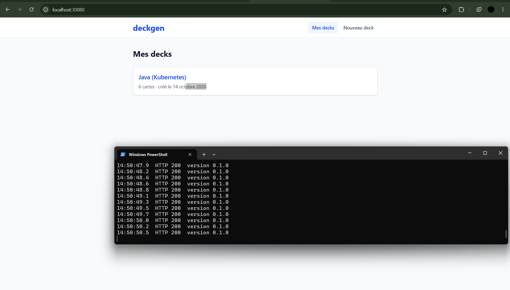
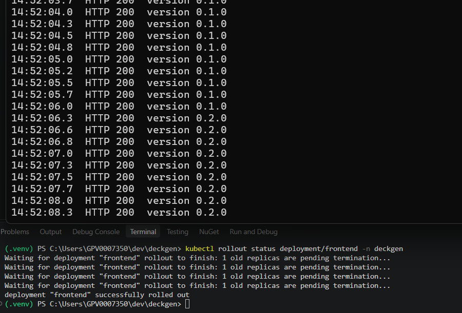
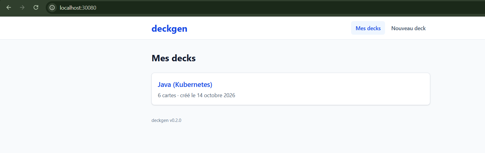
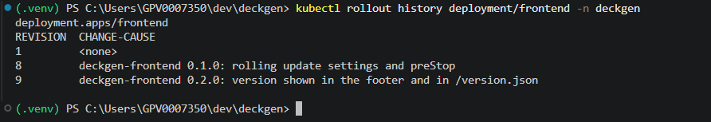
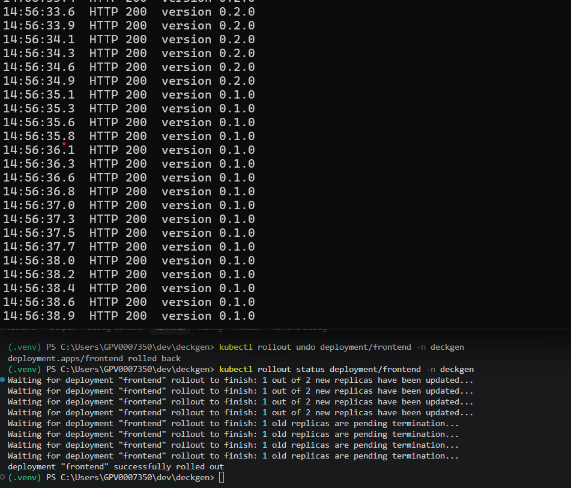
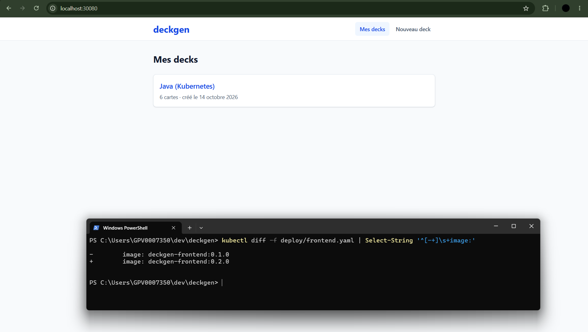

# Rolling update et rollback

Démonstration sur le frontend : passage de la version 0.1.0 à la 0.2.0 sans interruption de
service, puis retour à la 0.1.0 avec `kubectl rollout undo`. La 0.2.0 affiche sa version en pied
de page (« deckgen v0.2.0 ») et expose `/version.json`.

## Principe

Un Deployment ne modifie jamais un pod existant. Quand son template change (nouvelle image,
nouvelle variable...), il crée un **nouveau ReplicaSet** avec le nouveau template, puis remplace
les pods progressivement : il démarre des pods de la nouvelle version, attend qu'ils soient prêts,
puis arrête des pods de l'ancienne, jusqu'à ce que tous soient remplacés. L'ancien ReplicaSet est
conservé à 0 pod : c'est lui qui permet le retour arrière (`kubectl rollout undo`), qui n'est
qu'un rolling update dans l'autre sens.

Chaque ReplicaSet est une **révision**, listée par `kubectl rollout history` avec son annotation
`kubernetes.io/change-cause`.

## Réglages (frontend, api, generator)

| Réglage | Valeur | Rôle et raison du choix |
|---------|--------|--------------------------|
| `strategy.type` | `RollingUpdate` | Remplacement progressif (postgres garde `Recreate` : deux instances ne doivent jamais partager les mêmes fichiers) |
| `maxSurge` | `1` | Au plus 1 pod de plus que le nombre voulu pendant la mise à jour : on remplace un pod à la fois, sans doubler la consommation |
| `maxUnavailable` | `0` | Jamais moins de pods prêts que le nombre voulu : un ancien pod n'est arrêté qu'une fois un nouveau prêt. Aucune perte de capacité, même avec 2 réplicas |
| `minReadySeconds` | `5` | Un nouveau pod doit rester prêt 5 s avant d'être compté comme disponible : un pod qui plante juste après son démarrage bloque la mise à jour au lieu de remplacer les anciens |
| `revisionHistoryLimit` | `5` | Nombre d'anciens ReplicaSets conservés pour revenir en arrière (10 par défaut) |
| `kubernetes.io/change-cause` | texte | Description de la version, affichée par `kubectl rollout history` |
| `preStop` | `sleep 5` | Voir « Arrêt d'un pod sans erreur » |
| `terminationGracePeriodSeconds` | `20` | 5 s de preStop + arrêt propre de l'application (10 s au plus pour l'api) + marge. Au-delà, le kubelet envoie SIGKILL |
| Service frontend : affinité | cookie sticky de Traefik (`ClientIP` jusqu'à l'issue 17) | Voir « Mélange de versions et assets » |

La **readinessProbe** est la pièce centrale : un nouveau pod ne reçoit du trafic, et un ancien
n'est arrêté, qu'une fois la readiness du nouveau réussie. Sans elle, Kubernetes arrêterait les
anciens pods dès que les nouveaux processus démarrent.

## Arrêt d'un pod sans erreur

Quand un pod doit s'arrêter, deux choses se passent **en parallèle** :

1. le pod est retiré des endpoints du Service, puis chaque node met à jour ses règles réseau
   (kube-proxy) : cela prend un peu de temps, pendant lequel des requêtes arrivent encore ;
2. le kubelet exécute le `preStop`, puis envoie le signal d'arrêt au conteneur.

Sans `preStop`, le processus pourrait s'arrêter avant que plus aucune requête ne lui soit
envoyée : ces requêtes échoueraient. `sleep 5` laisse au pod le temps de servir ces dernières
requêtes. `sleep` existe dans les trois images (vérifié : `/bin/sleep` dans les images alpine du
frontend et de l'api, `/usr/bin/sleep` dans l'image Debian du generator).

Ensuite, le signal d'arrêt :

- **frontend (nginx)** : SIGTERM provoque un arrêt *rapide* de nginx (les connexions en cours
  sont coupées), SIGQUIT un arrêt *gracieux* (les requêtes en cours se terminent). L'image
  déclare `STOPSIGNAL SIGQUIT`, et le kubelet utilise ce signal : vérifié en supprimant un pod,
  ses logs montrent `signal 3 (SIGQUIT) received, shutting down` puis `gracefully shutting down`.
  Il n'y a donc rien à changer.
- **api** : tini transmet SIGTERM à Node, qui arrête d'accepter des connexions, termine les
  requêtes en cours (10 s au plus) et ferme le pool PostgreSQL.
- **generator** : uvicorn termine les requêtes en cours à la réception de SIGTERM.

Après `terminationGracePeriodSeconds` (20 s, preStop compris), le conteneur est tué. Une
génération en cours (jusqu'à plusieurs minutes) serait donc interrompue par une mise à jour de
l'api ou du generator : l'utilisateur obtient une erreur et peut cliquer sur « Réessayer ».

## Mélange de versions et assets

Pendant un rolling update, anciens et nouveaux pods servent en même temps. Pour une application
monopage, c'est un piège : `index.html` référence des fichiers dont le nom contient un hash
(`/assets/index-BRFpZxN-.js` en 0.2.0, `/assets/index-BZf3-YfK.js` en 0.1.0). Si `index.html`
vient d'un pod 0.2.0 et que la requête du script arrive sur un pod 0.1.0, ce fichier n'existe
pas : 404, page blanche.

Mesuré pendant un cycle 0.2.0 puis undo, en chargeant `/` puis aussitôt son script :
**93 visites sur 318** recevaient un 404 sur le script, alors que `/` répondait toujours 200.

Correction : `sessionAffinity: ClientIP` sur le Service frontend. Toutes les requêtes d'un même
client vont au même pod, donc à la même version. Mesuré après correction : **2 visites sur 341**,
au seul instant où le pod du client est retiré et où le client bascule vers un autre pod.

Limites de cette solution :

- en local, toutes les requêtes viennent de la même adresse (celle de Docker Desktop) : un seul
  pod frontend reçoit tout le trafic, la répartition de charge disparaît ;
- derrière un Ingress (issue 17), le Service ne voit que l'adresse du contrôleur d'Ingress :
  l'affinité se règle alors dans l'Ingress (cookie) ;
- **depuis l'issue 17**, c'est le cas : Traefik envoie les requêtes directement aux pods, sans
  passer par l'IP du Service, donc `sessionAffinity` n'aurait plus d'effet. Le Service frontend est
  en ClusterIP sans `sessionAffinity`, et Traefik pose un cookie `deckgen_frontend` qui fixe le pod
  d'un navigateur. Mesuré à travers l'Ingress pendant deux changements de version : **0 visite
  sur 379** en 404 avec le cookie, **157 sur 378** sans (détails dans
  [kubernetes.md](kubernetes.md#affinité-par-cookie)) ;
- la solution complète est de garder les assets des versions précédentes disponibles (stockage
  externe ou CDN, ou copie des anciens assets dans la nouvelle image) : le mélange de versions
  ne provoque alors plus aucun 404.

## Version visible

- `frontend/Dockerfile` : `ARG APP_VERSION=dev`, transmis à Vite par `ENV VITE_APP_VERSION`.
  Construction : `docker build --build-arg APP_VERSION=0.2.0 -t deckgen-frontend:0.2.0 ./frontend`.
- Le pied de page affiche `deckgen v<version>` sur toutes les pages.
- Le build écrit `/version.json` (`{"version":"0.2.0"}`), servi par nginx avec
  `Cache-Control: no-cache`, et une balise `<meta name="app-version">` dans `index.html`.
- La 0.1.0 a été construite avant ce changement : pas de pied de page ni de `/version.json`
  (nginx répond alors `index.html`, code 200, grâce au fallback SPA).

## Vérification (avant la démonstration)

Une boucle Node envoyait toutes les 100 ms une requête sur `/` et une sur `/version.json`, chacune
sur une nouvelle connexion, et relevait le code HTTP et la version (balise `meta` de `/`, contenu
de `/version.json`).

| Étape | Instant | Résultat |
|-------|---------|----------|
| `kubectl apply -f deploy/frontend.yaml` (0.2.0) | +5 s | rollout terminé à +18 s |
| `kubectl rollout undo deployment/frontend` | +23 s | retour à 0.1.0 terminé à +36 s |
| Total | 41 s | **748 requêtes, 748 en HTTP 200**, aucune erreur |

Répartition des versions (réponses 200, fenêtres de 5 s), avant l'affinité de session :

| Fenêtre | 0.1.0 | 0.2.0 |
|---------|-------|-------|
| 0-5 s   | 92    | 0     |
| 5-10 s  | 80    | 12    |
| 10-15 s | 48    | 44    |
| 15-20 s | 24    | 68    |
| 20-25 s | 0     | 92    |
| 25-30 s | 37    | 53    |
| 30-35 s | 56    | 36    |
| 35-40 s | 83    | 9     |

Les deux versions sont servies en même temps pendant chaque transition : c'est le principe du
rolling update, et la raison du problème d'assets décrit plus haut. Avec l'affinité de session
(cycle suivant, 680 requêtes, toutes en 200), la bascule est nette : 0.1.0 seule, puis 0.2.0
seule de +10 s à +30 s, puis 0.1.0 seule.

Quelques réponses de l'ancienne version arrivent encore 1 à 3 s après la fin de
`kubectl rollout status` : le pod sortant n'est plus compté, mais il sert encore les requêtes que
kube-proxy lui envoie pendant la mise à jour des règles réseau. C'est le rôle du `preStop`.

## Démonstration

État de départ : le cluster tourne en 0.1.0, `deploy/frontend.yaml` pointe vers la 0.2.0.

Terminal 2, à laisser ouvert pendant toute la démonstration (une ligne toutes les 200 ms).
PowerShell ne résout pas `deckgen.localhost` : la boucle utilise `deckgen.local`, à ajouter au
fichier hosts ([deploy/README.md](../deploy/README.md)). Elle n'envoie pas de cookie : chaque
requête peut aller à un pod différent, ce qui montre bien les deux versions servies ensemble.

```powershell
while ($true) {
  try {
    $r = Invoke-WebRequest http://deckgen.local/version.json -UseBasicParsing -DisableKeepAlive -TimeoutSec 2
    $v = if ($r.Content.TrimStart().StartsWith('{')) { ($r.Content | ConvertFrom-Json).version } else { '0.1.0' }
    "{0:HH:mm:ss.f}  HTTP {1}  version {2}" -f (Get-Date), $r.StatusCode, $v
  } catch { "{0:HH:mm:ss.f}  ERREUR {1}" -f (Get-Date), $_.Exception.Message }
  Start-Sleep -Milliseconds 200
}
```

Terminal 1 :

```powershell
kubectl config current-context                       # docker-desktop
kubectl get pods -n deckgen -l app.kubernetes.io/name=frontend
kubectl apply -f deploy/frontend.yaml                # lance le rolling update vers la 0.2.0
kubectl rollout status deployment/frontend -n deckgen
kubectl rollout history deployment/frontend -n deckgen
kubectl rollout undo deployment/frontend -n deckgen  # retour à la révision précédente (0.1.0)
kubectl rollout status deployment/frontend -n deckgen
```

### 1. Version 1 en service

Navigateur sur http://deckgen.local ou http://deckgen.localhost (pas de pied de page), terminal 2
affichant `HTTP 200 version 0.1.0`. Les captures datent de l'issue 14, quand le frontend était
exposé sur le NodePort `localhost:30080`.



### 2. Rolling update en cours

`kubectl apply` puis `kubectl rollout status` dans le terminal 1, le terminal 2 passant de 0.1.0
à 0.2.0, toujours en HTTP 200.



### 3. Version 2 en service

Navigateur rechargé : pied de page « deckgen v0.2.0 ».



### 4. Historique des révisions

`kubectl rollout history deployment/frontend -n deckgen` : la 0.2.0 est la dernière révision.



### 5. Rollback

`kubectl rollout undo` puis `kubectl rollout status`, le terminal 2 repassant à 0.1.0 sans erreur.



### 6. Version 1 restaurée

Navigateur rechargé (plus de pied de page), et `kubectl rollout history` : la révision de la 0.1.0
a reçu un nouveau numéro, le plus récent.



## Dérive entre Git et le cluster après un rollback

`kubectl rollout undo` modifie le Deployment **dans le cluster** seulement. Après la
démonstration :

- le fichier `deploy/frontend.yaml`, dans Git, indique `deckgen-frontend:0.2.0` ;
- le cluster fait tourner `deckgen-frontend:0.1.0`.

Le dépôt ne décrit plus ce qui tourne. kubectl le signale lors de l'undo (« Rolling back will not
update the kubectl.kubernetes.io/last-applied-configuration annotation »), et
`kubectl diff -f deploy/frontend.yaml` affiche la différence. Le prochain
`kubectl apply -f deploy/` redéploierait la 0.2.0, peut-être celle qu'on venait de retirer parce
qu'elle posait problème.

En pratique, le rollback est une mesure d'urgence, suivie immédiatement d'une correction dans
Git : on remet `image: deckgen-frontend:0.1.0` (et la change-cause) dans le manifeste, par un
commit et une revue, puis `kubectl apply`. Avec un outil GitOps (Argo CD, Flux), le cluster est
synchronisé en permanence sur Git : un undo manuel serait même annulé automatiquement, et le
rollback se fait en revenant sur le commit (`git revert`).
